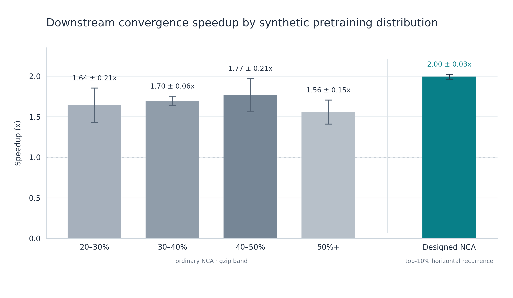

# Final NCA pretraining project report

**Archival closeout, 2026-10-08; scale-transfer update, 2026-10-09.** This document consolidates the saved research record and reads existing artifacts only. “Checkpoint” in the tables means a logged evaluation milestone; model/optimizer files were saved at the run boundaries indicated by their receipts. No training was launched for this report. Values are rounded for display; JSON histories linked below retain full precision.

**Scale-transfer update.** At 9,943,921 language-model parameters and 100M TinyStories tokens, the initial 197.15M-label NCA dose gave Designed an early advantage but both NCA conditions finished behind Scratch. Short 2.001M- and 4.001M-label warm-ups finished modestly ahead of Scratch in the completed seed-0 diagnostic. At the matched 4.001M dose, Designed and Ordinary finished essentially tied (1.85943 versus 1.85922 validation loss). This larger-model result is exploratory and does not replace the five-seed ~1M-model findings below.

## Scope, units, and independent observations

- Downstream validation loss is token cross-entropy on the fixed TinyStories validation stream; perplexity is `exp(loss)`. Lower is better.
- Normalized AUC is trapezoidal loss area divided by the width of the stated token interval. Historical reports sometimes give unnormalized AUC in loss×tokens; divide by interval width to compare with normalized values.
- Unless otherwise stated, SD is the sample SD (`ddof=1`). Pair conditions by model seed. In the horizontal A/B/C experiment, **corpus block is the independent generation unit** and model seeds are repeated initializations within it.
- A crossing is the first downward linear interpolation between logged validation milestones. `S = 10,000,000 / T(L_s*)`, where `L_s*` is scratch seed `s` at 10M. It measures downstream language-token use, **not** combined NCA plus language compute, runtime, or energy.
- Search selection used seed 0; seeds 1–4 on the frozen Top-10 corpus are held-out **model seeds**. Top-10 was not replicated on fresh selected rule populations. Horizontal top-50 was replicated on three fresh blocks, but only to 1M language tokens.

## Original reproduction, generator, data contract, and training setup

The project ports the published NCA pre-pretraining approach at upstream revision `bdd1c71e04eb2e5a2c91481faf278e95846b4431` into an `uv` workspace. NCA generation, packed NCA pretraining, shared Transformer code, and downstream language training are separate packages. The isolated raw v1 format was introduced by the port; the upstream in-memory trajectory/tokenization behavior is the reference. The tiny smoke reproduction checked boundaries, not language transfer.

The production generator used 12×12, ten-color, one-group worlds; a four-channel convolution, 16 hidden channels, identity bias 0, temperature .001; 27 saved frames after burn-in 10 with stride 1; one world per rule; 2×2 nonoverlapping patches. Candidate rules were filtered into gzip bands [20%,30%), [30%,40%), [40%,50%), and [50%,∞). The initial bank accepted 25,000 worlds per band from 324,800 attempted rules, with zero duplicate trajectory hashes or rule/initial-key pairs. Hash splitting and the per-run selected train/validation counts are recorded in the manifests.

A 12×12 frame has 36 patch tokens. Each of 27 frames contributes start + 36 patches + end, making 1,026 int32 tokens per world. Patch IDs are base-ten encodings of 2×2 cell values; start/end are 10,000/10,001. Four 256-position windows are trained per world; **37 shifted targets in the first window** are masked for the first grid, giving 987 scored labels per world and **19,715,325 labels** for 19,975 training worlds. Packed targets remain compatible with the original pipeline. Raw v1 `.npy` dtypes, axes, files, and manifest keys are detailed below.

## Raw trajectory and packed-token contract

### Original in-memory boundary

The published generator returned a JAX categorical array with axes `[simulation, time, height, width, group]`, normally `int32` under JAX's default X64 setting. It did not serialize raw trajectories. The isolated package introduced the disk format below as **schema version 1**. That format remains unchanged.

### Raw version 1 files

| File | Dtype and shape |
| --- | --- |
| `rules.npy` | `uint32[rule_count, 2]` JAX PRNG keys |
| `trajectories-NNNNNN.npy` | `uint8[batch, frames, height, width, groups]` cell IDs |
| `rule-ids-NNNNNN.npy` | `int32[batch]` indices into `rules.npy` |
| `initial-seeds-NNNNNN.npy` | `uint32[batch, 2]` initial-condition PRNG keys |
| `initial-states-NNNNNN.npy` | `uint8[batch, height, width, groups]` pre-rollout grids |

`manifest.json` has exactly these top-level keys: `schema_version`, `config`, `implementation`, `shape`, `frame_times`, `rules`, `shards`. Each shard record has `states`, `rule_ids`, `initial_seeds`, `initial_states`, `count`. The config includes generator seed, rule count, rollout timing, network size, and filter settings. `implementation` records upstream revision and runtime/backend details. The writer does not overwrite an existing directory. A rule seed is `rules[rule_id]`; the matching initial seed and full config are enough for `nca.generate.reproduce` to replay a saved world.

Cell IDs remain raw categorical values in time and row-major grid order. No model tokens are stored in these files. NumPy `.npy` serialization, filenames, axes, dtypes, and manifest structure are frozen for version 1.

### Packed training artifact

`sampleeff_nca_pretraining.packing` converts a saved trajectory to JAX `int32` only in memory, then applies the upstream non-overlapping patch order and base-`num_colors` encoding. With a 2×2 patch, start and end grid tokens are `num_colors**4` and `num_colors**4 + 1`. It returns flattened sequences and marker-masked tokenizer targets. The training view casts tokens to PyTorch `long`, masks the first `min_grid` grids and shifts labels by one, matching the original token training path.

Optional packed `.pt` files contain `sequences`, `targets`, and `metadata`. Their metadata includes the source manifest, selected trajectory indices, source directory and manifest SHA-256, and explicit packing settings. They do not modify raw v1 files.

The principal model is a 4-layer, 2-head, 20-dimensional causal Transformer with context 256, tied input/output embeddings and no dropout. With the NCA vocabulary of 10,002 it has **235,822 trainable parameters**; with the GPT-2 TinyStories vocabulary of 50,257 it has **1,081,177 trainable parameters**. Adam with peak learning rate 3e-4, 100 warmup steps, cosine decay, zero weight decay, effective batch 8, and the original 10M schedule were held fixed in paired downstream experiments. The 10M TinyStories stream is 10,000,001 training token IDs from 44,998 rows and 262,145 validation token IDs from 1,374 rows, from `roneneldan/TinyStories` revision `f54c09fd23315a6f9c86f9dc80f725de7d8f9c64`, GPT-2 tokenizer and EOT ID 50256. Training order seed 17 and training seed 23 were fixed; model initializations 0–4 vary.

The [frozen experiment configuration](../runs/1m-nca-transfer-v2/config/experiment.json), [TinyStories metadata](../runs/1m-nca-transfer-v2/data/tinystories/metadata.json), [generator manifest](../runs/nca-100k-regimes/manifest.json), [architecture](../docs/ARCHITECTURE.md), and [upstream provenance](../docs/UPSTREAM.md) are authoritative for exact hashes and settings. A legacy `one_seed_exploratory` key in the experiment config does not describe the completed five-seed run; the per-seed receipts and metrics do.

## Minimal reproducibility smoke check

From the repository root, with uv installed:

```sh
uv sync --package sampleeff-nca-pre-pretraining
uv run --locked --package sampleeff-nca python -m unittest discover -s packages/nca/tests -v
uv run --locked --package sampleeff-nca-pre-pretraining python -m unittest discover -s packages/pre-pre-training/tests -v
uv run --locked --package sampleeff-nca-pre-pretraining python examples/reproduce_tiny.py runs/my-tiny-reproduction
```

Choose a new output directory for each reproduction; the raw writer refuses to overwrite an existing dataset. The example saves raw v1 shards, a packed `.pt`, a plot, a model `.pth` and JSON sidecar, plus CSV/JSON results. It verifies that checkpoint reload produces identical model output.

The October 2026 smoke run generated **3** tiny 4×4 worlds, trained a **21,875-parameter** one-layer model for **30 CPU steps**, and reduced same-world validation loss from **4.7610 to 1.7685**. All **6** boundary tests passed; the MPS test checked a forward pass, not MPS training. The validation set was deliberately the training set to check that optimization works. This is **not** a held-out result, a replication of the paper's sample-efficiency claim, or a comparison to downstream language training.

The port preserves stride-1 fixed-key rollout behavior. The known stride>1 key-stream difference and sequential versus batched candidate-key sampling are documented in the [data contract](../docs/DATA_CONTRACT.md); they are not changes to the saved v1 schema.

## Chronology and experimental search history

| Stage | Record / outcome |
|:--|--:|
| Port and smoke test | Separated generator/packing/downstream packages; 3-world, 30-step CPU boundary check. |
| Initial 100K-world bank | Four gzip bands, 25K accepted each; fixed 40–50 reference chosen for selector work. |
| Exploratory v1 | One model seed, 5M TinyStories tokens; all four NCA bands beat scratch. |
| Five-seed v2 | Scratch, shuffled NCA, and four structured bands to 10M; original all-band mean-curve result ~1.646x. |
| Selector iterations 01–06 | Low/high temporal change, high spatial agreement, high/low horizontal copy, high transition MI; failed and mixed probes retained. |
| Horizontal replication | A/B/C fresh rule blocks × high/unfiltered/low × five seeds = 45 complete 1M runs. |
| Dose sweep | Frozen Top-50 anchor, Top-25 and Top-10; predeclared target-loss ranking; Top-5 gate failed. |
| Designed validation | Seed-0 model resumed to 10M; seeds 1–4 trained to 10M on the frozen Top-10 corpus. |
| ~10M-model scale transfer | Seed-0 Scratch, Ordinary, and frozen Designed Top-10 trained through 100M TinyStories after 197.153M NCA labels in the latter two; both NCA arms ended behind Scratch. |
| Paper-ratio switch-dose diagnostic | Same seed-0 100M TinyStories stream after 2.001M/4.001M Designed warm-ups and one matched 4.001M Ordinary warm-up; all three ended ahead of Scratch, with matched Ordinary and Designed effectively tied. |

A vertical lag-6 branch was sampled and audited, with a partial NCA stage and zero-token downstream evaluation, then stopped before any language-learning milestone. Matched-copy, lag-76, new mechanism selectors, and Top-5 were not completed English outcome experiments. Their drafts are hypotheses, not positive results.

## Initial one-seed 5M exploratory result

Model: 1,081,177 trainable parameters; {'vocab_size': 50257, 'context_length': 256, 'layers': 4, 'heads': 2, 'embedding_dim': 20, 'dropout': 0.0, 'output_vocab_size': None, 'tie_embeddings': True}.

NCA budget: 19,715,325 usable labels per regime. TinyStories: 5,000,000 training tokens per condition.

| Condition | Final validation loss | Final perplexity |
| --- | ---: | ---: |
| downstream/scratch | 5.19832 | 180.97 |
| downstream/nca_20_30 | 4.92979 | 138.35 |
| downstream/nca_30_40 | 5.04776 | 155.67 |
| downstream/nca_40_50 | 4.83565 | 125.92 |
| downstream/nca_50_plus | 4.94507 | 140.48 |

See summary.json for milestones, throughput, runtime, and loss differences. This one-seed run does not establish statistical significance.

## Baseline: five-seed scratch, shuffled, and gzip-band comparison

## Original paper-regime post-hoc tables

### A. Completion and sanity

The [summary marker](../runs/1m-nca-transfer-v2/summary/done.json) matches the summary artifact hash and the canonical JSON configuration hash. Every stage below has a valid marker, metrics history, final checkpoint, budget, and final loss/perplexity matching the marker. No missing or corrupt metrics were found. Intended configuration and completed evidence agree on five seeds and six downstream conditions.

| Stage | Expected | Completed | Seeds / conditions |
| --- | --- | --- | --- |
| Structured + shuffled NCA | 25 | 25 | 0–4 × 5 |
| Downstream | 30 | 30 | 0–4 × 6 |
| Structured NCA only | 20 | 20 | 0–4 × 4 |

The intended language milestones and actual consumed-token positions are shown below. Actual positions are identical across all 30 downstream stages but differ slightly from the rounded intended milestones; analysis uses the logged positions. All final language runs consumed exactly 10,000,000 tokens. The planned NCA checkpoints are 0, 2M, 4M, 6M, 8M, 10M, 12M, 14M, 16M, 18M, and 20M; their final actual count is 19,715,325 usable labels.

| Planned tokens | Actual min | Actual max |
| --- | --- | --- |
| 0 | 0 | 0 |
| 250,000 | 251,904 | 251,904 |
| 500,000 | 501,760 | 501,760 |
| 1,000,000 | 1,001,472 | 1,001,472 |
| 2,000,000 | 2,000,896 | 2,000,896 |
| 3,000,000 | 3,000,320 | 3,000,320 |
| 5,000,000 | 5,001,088 | 5,001,088 |
| 7,500,000 | 7,501,696 | 7,501,696 |
| 10,000,000 | 10,000,000 | 10,000,000 |

**Metadata inconsistency:** global `config/experiment.json` retains `one_seed_exploratory: true` from the earlier setup, while the completed five-seed summary records `false`. The five seed directories and their completed markers establish the actual run. No training artifact was altered.

### B. Raw final results

At 10M downstream tokens; positive gains favor the condition over paired scratch. The shuffled rows are inventory only.

| Seed | Condition | Train loss | Val loss | Val PPL | Loss gain | PPL gain |
| --- | --- | --- | --- | --- | --- | --- |
| 0 | Scratch | 4.3123 | 4.3140 | 74.74 | 0.0000 | 0.00 |
| 0 | Shuffled NCA | 4.2226 | 4.2315 | 68.82 | 0.0825 | 5.92 |
| 0 | 20–30 | 4.1865 | 4.1954 | 66.38 | 0.1186 | 8.36 |
| 0 | 30–40 | 4.1636 | 4.1741 | 64.98 | 0.1399 | 9.76 |
| 0 | 40–50 | 4.1652 | 4.1734 | 64.93 | 0.1406 | 9.80 |
| 0 | 50+ | 4.2432 | 4.2471 | 69.90 | 0.0669 | 4.84 |
| 1 | Scratch | 4.3186 | 4.3173 | 74.98 | 0.0000 | 0.00 |
| 1 | Shuffled NCA | 4.1735 | 4.1873 | 65.84 | 0.1300 | 9.14 |
| 1 | 20–30 | 4.2245 | 4.2364 | 69.16 | 0.0809 | 5.83 |
| 1 | 30–40 | 4.1919 | 4.2018 | 66.81 | 0.1155 | 8.18 |
| 1 | 40–50 | 4.1867 | 4.2044 | 66.98 | 0.1129 | 8.01 |
| 1 | 50+ | 4.2337 | 4.2416 | 69.52 | 0.0757 | 5.47 |
| 2 | Scratch | 4.3233 | 4.3213 | 75.29 | 0.0000 | 0.00 |
| 2 | Shuffled NCA | 4.1916 | 4.1973 | 66.51 | 0.1239 | 8.78 |
| 2 | 20–30 | 4.2304 | 4.2323 | 68.87 | 0.0890 | 6.41 |
| 2 | 30–40 | 4.1883 | 4.1913 | 66.11 | 0.1300 | 9.18 |
| 2 | 40–50 | 4.1530 | 4.1585 | 63.97 | 0.1628 | 11.31 |
| 2 | 50+ | 4.1869 | 4.1888 | 65.94 | 0.1325 | 9.34 |
| 3 | Scratch | 4.3539 | 4.3556 | 77.92 | 0.0000 | 0.00 |
| 3 | Shuffled NCA | 4.1611 | 4.1728 | 64.90 | 0.1828 | 13.02 |
| 3 | 20–30 | 4.1534 | 4.1719 | 64.84 | 0.1837 | 13.07 |
| 3 | 30–40 | 4.2235 | 4.2325 | 68.89 | 0.1231 | 9.02 |
| 3 | 40–50 | 4.1640 | 4.1727 | 64.89 | 0.1829 | 13.02 |
| 3 | 50+ | 4.2241 | 4.2296 | 68.69 | 0.1260 | 9.22 |
| 4 | Scratch | 4.2966 | 4.3006 | 73.75 | 0.0000 | 0.00 |
| 4 | Shuffled NCA | 4.2075 | 4.2246 | 68.35 | 0.0761 | 5.40 |
| 4 | 20–30 | 4.1777 | 4.1926 | 66.19 | 0.1080 | 7.55 |
| 4 | 30–40 | 4.1570 | 4.1759 | 65.10 | 0.1248 | 8.65 |
| 4 | 40–50 | 4.2063 | 4.2154 | 67.72 | 0.0852 | 6.03 |
| 4 | 50+ | 4.2547 | 4.2569 | 70.59 | 0.0438 | 3.16 |

Across-seed summaries below include sample SD, median, range, and a descriptive t-based 95% CI. Full-precision values are in [`summary.json`](part1/paper_regime/summary.json).

| Condition | Train mean±SD | Val mean±SD | Val median | Val min–max | Val 95% CI | PPL mean±SD | PPL median | PPL min–max | PPL 95% CI |
| --- | --- | --- | --- | --- | --- | --- | --- | --- | --- |
| Scratch | 4.321 ± 0.021 | 4.322 ± 0.020 | 4.317 | 4.301–4.356 | [4.296, 4.347] | 75.33 ± 1.55 | 74.98 | 73.75–77.92 | [73.40, 77.26] |
| Shuffled NCA | 4.191 ± 0.025 | 4.203 ± 0.025 | 4.197 | 4.173–4.232 | [4.172, 4.234] | 66.88 ± 1.66 | 66.51 | 64.90–68.82 | [64.82, 68.95] |
| 20–30 | 4.195 ± 0.032 | 4.206 ± 0.028 | 4.195 | 4.172–4.236 | [4.171, 4.240] | 67.09 ± 1.86 | 66.38 | 64.84–69.16 | [64.78, 69.40] |
| 30–40 | 4.185 ± 0.026 | 4.195 ± 0.024 | 4.191 | 4.174–4.233 | [4.166, 4.225] | 66.38 ± 1.60 | 66.11 | 64.98–68.89 | [64.40, 68.36] |
| 40–50 | 4.175 ± 0.021 | 4.185 ± 0.024 | 4.173 | 4.158–4.215 | [4.155, 4.215] | 65.70 ± 1.58 | 64.93 | 63.97–67.72 | [63.74, 67.66] |
| 50+ | 4.229 ± 0.026 | 4.233 ± 0.026 | 4.242 | 4.189–4.257 | [4.200, 4.266] | 68.93 ± 1.80 | 69.52 | 65.94–70.59 | [66.69, 71.17] |

| Condition | Final train median | Final train min–max | Final train 95% CI |
| --- | --- | --- | --- |
| Scratch | 4.319 | 4.297–4.354 | [4.295, 4.347] |
| Shuffled NCA | 4.192 | 4.161–4.223 | [4.160, 4.222] |
| 20–30 | 4.186 | 4.153–4.230 | [4.154, 4.235] |
| 30–40 | 4.188 | 4.157–4.223 | [4.152, 4.218] |
| 40–50 | 4.165 | 4.153–4.206 | [4.149, 4.201] |
| 50+ | 4.234 | 4.187–4.255 | [4.196, 4.261] |

### C. Paired final effects versus scratch

All effects use each seed's own scratch run. Exact two-sided sign-test p=0.0625 for each 5/5 structured-band direction; it is not evidence for a conventional 0.05 claim. The bootstrap interval is the exact percentile distribution over 5^5 resamples of five paired seeds.

| Band | Seed loss gains 0→4 | Loss mean±SD | Median | Bootstrap 95% | W/L/T | PPL gain mean±SD | PPL bootstrap 95% |
| --- | --- | --- | --- | --- | --- | --- | --- |
| 20–30 | 0.119, 0.081, 0.089, 0.184, 0.108 | 0.116 ± 0.041 | 0.108 | [0.090, 0.152] | 5/0/0 | 8.24 ± 2.87 | [6.41, 10.80] |
| 30–40 | 0.140, 0.115, 0.130, 0.123, 0.125 | 0.127 ± 0.009 | 0.125 | [0.120, 0.134] | 5/0/0 | 8.96 ± 0.59 | [8.49, 9.42] |
| 40–50 | 0.141, 0.113, 0.163, 0.183, 0.085 | 0.137 ± 0.039 | 0.141 | [0.106, 0.166] | 5/0/0 | 9.63 ± 2.74 | [7.48, 11.70] |
| 50+ | 0.067, 0.076, 0.133, 0.126, 0.044 | 0.089 ± 0.039 | 0.076 | [0.059, 0.119] | 5/0/0 | 6.41 ± 2.76 | [4.29, 8.52] |

### D. Full downstream learning curves

The table gives mean validation loss ± sample SD across seeds at each planned checkpoint; the preceding milestone table gives the actual token positions. The 40–50 band is the representative figure because it matches the established replication view and has the lowest five-seed mean final loss among these four bands. This does not establish that it is universally best.


| Planned | Scratch | 20–30 | 30–40 | 40–50 | 50+ |
| --- | --- | --- | --- | --- | --- |
| 0M | 10.969 ± 0.027 | 11.379 ± 0.038 | 11.410 ± 0.070 | 11.428 ± 0.089 | 11.133 ± 0.097 |
| 0.25M | 9.955 ± 0.076 | 9.554 ± 0.094 | 9.572 ± 0.143 | 9.594 ± 0.077 | 9.847 ± 0.109 |
| 0.5M | 8.442 ± 0.058 | 7.370 ± 0.087 | 7.360 ± 0.121 | 7.364 ± 0.101 | 8.008 ± 0.235 |
| 1M | 6.536 ± 0.029 | 6.051 ± 0.043 | 6.018 ± 0.036 | 6.013 ± 0.024 | 6.191 ± 0.097 |
| 2M | 5.567 ± 0.047 | 5.391 ± 0.088 | 5.310 ± 0.068 | 5.302 ± 0.056 | 5.301 ± 0.041 |
| 3M | 5.051 ± 0.046 | 4.886 ± 0.069 | 4.822 ± 0.056 | 4.815 ± 0.044 | 4.833 ± 0.031 |
| 5M | 4.537 ± 0.023 | 4.404 ± 0.042 | 4.380 ± 0.033 | 4.369 ± 0.034 | 4.410 ± 0.025 |
| 7.5M | 4.350 ± 0.020 | 4.232 ± 0.029 | 4.220 ± 0.025 | 4.210 ± 0.025 | 4.257 ± 0.026 |
| 10M | 4.322 ± 0.020 | 4.206 ± 0.028 | 4.195 ± 0.024 | 4.185 ± 0.024 | 4.233 ± 0.026 |

All structured bands begin with worse loss at zero language tokens after the text embedding/head is newly initialized. Every band overtakes scratch by the first logged nonzero checkpoint (~0.252M tokens) and remains ahead in mean loss at all later checkpoints. At that first checkpoint, 20–30, 30–40, and 40–50 win 5/5 paired seeds; 50+ wins 4/5. From ~0.502M onward, all four bands win 5/5 at every logged checkpoint. The early loss gap is larger than the final gap, so the observed advantage shrinks in absolute loss units but persists through 10M.

### E. Sample efficiency and convergence

The primary threshold is **each seed's own scratch@10M validation loss**. Tokens to threshold come from the first linear crossing of the logged NCA curve. Every structured run reaches its paired target within observed checkpoints; no extrapolation is used. The inset in Figure 1 uses the mean curves only to illustrate the crossing; its ~1.74x label is distinct from the mean of five paired seed-level speedups. The existing run summary's 40–50 threshold of 5.747M tokens is likewise a mean-curve crossing; this report's primary paired mean is 5.726M. These differ because interpolation and averaging do not commute.

| Seed | Band | NCA tokens (M) | Fewer tokens | Speedup |
| --- | --- | --- | --- | --- |
| 0 | 20–30 | 6.097 | 39.0% | 1.64x |
| 0 | 30–40 | 5.681 | 43.2% | 1.76x |
| 0 | 40–50 | 5.598 | 44.0% | 1.79x |
| 0 | 50+ | 6.770 | 32.3% | 1.48x |
| 1 | 20–30 | 6.852 | 31.5% | 1.46x |
| 1 | 30–40 | 6.116 | 38.8% | 1.64x |
| 1 | 40–50 | 6.159 | 38.4% | 1.62x |
| 1 | 50+ | 6.717 | 32.8% | 1.49x |
| 2 | 20–30 | 6.584 | 34.2% | 1.52x |
| 2 | 30–40 | 5.734 | 42.7% | 1.74x |
| 2 | 40–50 | 5.219 | 47.8% | 1.92x |
| 2 | 50+ | 5.741 | 42.6% | 1.74x |
| 3 | 20–30 | 5.000 | 50.0% | 2.00x |
| 3 | 30–40 | 6.111 | 38.9% | 1.64x |
| 3 | 40–50 | 4.990 | 50.1% | 2.00x |
| 3 | 50+ | 5.921 | 40.8% | 1.69x |
| 4 | 20–30 | 6.277 | 37.2% | 1.59x |
| 4 | 30–40 | 5.876 | 41.2% | 1.70x |
| 4 | 40–50 | 6.662 | 33.4% | 1.50x |
| 4 | 50+ | 7.152 | 28.5% | 1.40x |

| Band | Tokens M mean±SD | Median M | 95% t CI M | Savings mean±SD | Speedup mean±SD | Mean-curve x (visual only) |
| --- | --- | --- | --- | --- | --- | --- |
| 20–30 | 6.162 ± 0.711 | 6.277 | [5.279, 7.045] | 38.4% ± 7.1% | 1.64 ± 0.21x | 1.61x |
| 30–40 | 5.904 ± 0.205 | 5.876 | [5.650, 6.158] | 41.0% ± 2.0% | 1.70 ± 0.06x | 1.69x |
| 40–50 | 5.726 ± 0.685 | 5.598 | [4.875, 6.577] | 42.7% ± 6.9% | 1.77 ± 0.21x | 1.74x |
| 50+ | 6.460 ± 0.602 | 6.717 | [5.713, 7.208] | 35.4% ± 6.0% | 1.56 ± 0.15x | 1.55x |

| Band | Savings median | Savings 95% t CI | Speedup median | Speedup 95% t CI |
| --- | --- | --- | --- | --- |
| 20–30 | 37.2% | [29.6%, 47.2%] | 1.59x | [1.38x, 1.91x] |
| 30–40 | 41.2% | [38.4%, 43.5%] | 1.70x | [1.62x, 1.77x] |
| 40–50 | 44.0% | [34.2%, 51.3%] | 1.79x | [1.51x, 2.02x] |
| 50+ | 32.8% | [27.9%, 42.9%] | 1.49x | [1.37x, 1.74x] |


### F. Area under the learning curve

Lower AUC means lower validation loss across the downstream trajectory. Units are loss × million tokens. Full-range AUC includes the zero-token evaluation; the 0.5M and 1M starts are interpolated to common token positions. Paired improvements subtract each NCA AUC from its seed's scratch AUC.

| Condition | AUC 0–10M | AUC 0.5–10M | AUC 1–10M | Gain full | Gain from 0.5M | Gain from 1M |
| --- | --- | --- | --- | --- | --- | --- |
| Scratch | 51.564 ± 0.252 | 46.645 ± 0.244 | 42.898 ± 0.237 | — | — | — |
| 20–30 | 49.589 ± 0.370 | 44.851 ± 0.392 | 41.494 ± 0.399 | 1.975 ± 0.449 | 1.794 ± 0.454 | 1.404 ± 0.453 |
| 30–40 | 49.295 ± 0.363 | 44.550 ± 0.333 | 41.203 ± 0.314 | 2.269 ± 0.165 | 2.096 ± 0.149 | 1.695 ± 0.143 |
| 40–50 | 49.219 ± 0.307 | 44.466 ± 0.298 | 41.119 ± 0.294 | 2.345 ± 0.491 | 2.180 ± 0.493 | 1.778 ± 0.491 |
| 50+ | 49.918 ± 0.368 | 45.059 ± 0.319 | 41.506 ± 0.257 | 1.647 ± 0.510 | 1.587 ± 0.459 | 1.392 ± 0.386 |


### G. Early, middle, and late transfer

Entries are mean paired scratch loss − NCA loss. These are logged checkpoints near the named token amounts, not exactly rounded token positions.

| Band | ~0.5M | ~1M | ~2M | ~5M | 10M |
| --- | --- | --- | --- | --- | --- |
| 20–30 | 1.072 | 0.485 | 0.175 | 0.132 | 0.116 |
| 30–40 | 1.082 | 0.518 | 0.257 | 0.157 | 0.127 |
| 40–50 | 1.078 | 0.523 | 0.264 | 0.167 | 0.137 |
| 50+ | 0.434 | 0.345 | 0.265 | 0.126 | 0.089 |

At ~0.5M, mean paired gains span 0.434–1.082 loss units; by 10M they span 0.089–0.137. This is a strong early-learning advantage with a smaller persistent final-quality advantage. The observed curves do not establish an asymptotic advantage beyond 10M.

### H. Gzip-band analysis

Rank 1 is best among the four structured bands for the specified metric. Final-loss rankings change by seed; AUC and threshold-token rankings are also shown. The 40–50 band is best on the five-seed mean of all three metrics, but it has the best final loss in only two of five seeds.

| Band | Final loss ranks, seeds 0→4 | Mean rank | 0.5M AUC ranks | Threshold-token ranks | Final mean loss |
| --- | --- | --- | --- | --- | --- |
| 20–30 | 3, 3, 4, 1, 2 | 2.6 | 3, 4, 4, 2, 2 | 3, 4, 4, 2, 2 | 4.2057 |
| 30–40 | 2, 1, 3, 4, 1 | 2.2 | 2, 2, 2, 4, 1 | 2, 1, 2, 4, 1 | 4.1951 |
| 40–50 | 1, 2, 1, 2, 3 | 1.8 | 1, 1, 1, 1, 3 | 1, 2, 1, 1, 3 | 4.1849 |
| 50+ | 4, 4, 2, 3, 4 | 3.4 | 4, 3, 3, 3, 4 | 4, 3, 3, 3, 4 | 4.2328 |

Pairwise effects below are right-band loss − left-band loss, so positive values favor the left band. Within-seed SD measures variation across the five paired differences.

| Left vs right | Seed differences 0→4 | Mean±SD | 95% bootstrap | Left wins |
| --- | --- | --- | --- | --- |
| 20–30 vs 30–40 | -0.021, -0.035, -0.041, 0.061, -0.017 | -0.011 ± 0.041 | [-0.035, 0.026] | 1/5 |
| 20–30 vs 40–50 | -0.022, -0.032, -0.074, 0.001, 0.023 | -0.021 ± 0.036 | [-0.051, 0.005] | 2/5 |
| 20–30 vs 50+ | 0.052, 0.005, -0.044, 0.058, 0.064 | 0.027 ± 0.046 | [-0.014, 0.059] | 4/5 |
| 30–40 vs 40–50 | -0.001, 0.003, -0.033, -0.060, 0.040 | -0.010 ± 0.038 | [-0.040, 0.018] | 2/5 |
| 30–40 vs 50+ | 0.073, 0.040, -0.002, -0.003, 0.081 | 0.038 ± 0.040 | [0.006, 0.070] | 3/5 |
| 40–50 vs 50+ | 0.074, 0.037, 0.030, 0.057, 0.041 | 0.048 ± 0.017 | [0.035, 0.063] | 5/5 |

The largest gap between structured-band mean final losses is 0.0479, versus mean structured NCA–scratch gain 0.1171; the band spread is 0.41 of that main effect. Mean across-band seed SD of final loss is 0.0255. The 40–50 versus 30–40 mean edge is 0.0103, smaller than their paired-difference SD 0.0377. The data motivate more precise regime tests; they do not isolate a sharp Goldilocks optimum.


### I. NCA training loss and downstream transfer

Final NCA validation loss is measured on held-out NCA rules within each band. The NCA targets have different difficulty distributions across bands, so raw NCA losses are not directly comparable as transfer scores.

| Band | NCA val loss mean±SD | Downstream gain mean±SD |
| --- | --- | --- |
| 20–30 | 3.939 ± 0.011 | 0.116 ± 0.041 |
| 30–40 | 4.941 ± 0.012 | 0.127 ± 0.009 |
| 40–50 | 6.116 ± 0.078 | 0.137 ± 0.039 |
| 50+ | 8.198 ± 0.071 | 0.089 ± 0.039 |

| Downstream quantity | Pooled Pearson | Pooled Spearman | Band-centered Pearson | Band-centered Spearman |
| --- | --- | --- | --- | --- |
| downstream gain | -0.30 | -0.11 | 0.14 | 0.02 |
| downstream final loss | 0.37 | 0.24 | -0.02 | 0.03 |
| auc 500000 | 0.26 | 0.15 | -0.05 | 0.06 |
| tokens to threshold | 0.21 | 0.10 | -0.13 | -0.03 |

These 20 band–seed rows are clustered in five seeds and four bands, not 20 independent draws. The pooled association mainly reflects band difficulty and changes or nearly disappears after band centering. Lower NCA validation loss is therefore not established as a predictor of better TinyStories transfer. Correlations are descriptive; no p-values are used.

### J. Variance and robustness

The main result is more stable than the fine band ranking: each structured band wins 5/5 final paired comparisons against scratch, but the top final-loss band varies across seeds (40–50 in seeds 0 and 2; 30–40 in seeds 1 and 4; 20–30 in seed 3). The four mean final losses span 0.0479; across-seed SD within structured bands spans 0.0238–0.0277. Comparisons among bands are correlated because the seeds and downstream streams are paired. The five-seed sample supports effect consistency more strongly than precise band ordering.
Seed dependence is visible: seed 3 has the highest scratch final loss (4.356) and the largest 20–30 gain (0.184); seed 4 gives 40–50 its smallest gain (0.085) and ranks it third among bands. All five seeds are retained.

### K. Perplexity interpretation

Percent reduction uses (mean scratch PPL − mean NCA PPL) / mean scratch PPL. This is not a percentage change in loss. Perplexity is exp(validation loss) within each run; the table averages those five logged values.

| Band | Scratch mean PPL | NCA mean PPL | Absolute reduction | Percent reduction |
| --- | --- | --- | --- | --- |
| 20–30 | 75.33 | 67.09 | 8.24 | 10.9% |
| 30–40 | 75.33 | 66.38 | 8.96 | 11.9% |
| 40–50 | 75.33 | 65.70 | 9.63 | 12.8% |
| 50+ | 75.33 | 68.93 | 6.41 | 8.5% |

### L. Relation to the original paper

The [original paper](https://arxiv.org/html/2603.10055v1) reports improved language modeling and faster convergence after NCA pre-pre-training, complexity-sensitive transfer, and additional results at much larger model scale and on other corpora and tasks. Our setup is a tiny-scale, one-corpus probe, not an exact reproduction of its model size, downstream data, or full baselines.

| Original-paper claim | Our tiny-scale evidence | Status |
| --- | --- | --- |
| NCA PPT improves language modeling vs scratch | Four bands win 5/5 paired seeds at 10M TinyStories tokens | Qualitatively reproduced |
| NCA PPT increases downstream token efficiency | All bands reach paired scratch@10M before 10M | Qualitatively reproduced |
| Advantage persists during downstream training | Band mean curves lead at every nonzero checkpoint, including 10M | Qualitatively reproduced through 10M |
| Gzip complexity modulates transfer | Mean final losses span 0.048; 50+ underperforms 40–50 in all five seeds | Partially supported |
| Optimal complexity can differ by domain | One downstream corpus only; no cross-domain contrast | Not tested |
| Relative effect changes with model scale | One ~1M-parameter scale only | Not tested |
| Attention layers carry transfer | No component-transfer ablations | Not tested |
| Reasoning benchmark gains | No downstream reasoning evaluation | Not tested |
| C4 or Dyck comparison | Neither baseline run in this analysis | Not tested |

## Distinct shuffled control and band summaries

### Paired effects and sample efficiency

Loss differences use the same seed on both sides; negative favors pretraining.

| Comparison | 5M mean ± SD | 10M mean ± SD | Seeds favoring at 10M |
| --- | ---: | ---: | ---: |
| shuffled_nca − scratch | -0.1488 ± 0.0509 | -0.1191 ± 0.0430 | 5/5 |
| nca_20_30 − scratch | -0.1321 ± 0.0533 | -0.1160 ± 0.0407 | 5/5 |
| nca_30_40 − scratch | -0.1568 ± 0.0180 | -0.1266 ± 0.0091 | 5/5 |
| nca_40_50 − scratch | -0.1671 ± 0.0524 | -0.1369 ± 0.0389 | 5/5 |
| nca_50_plus − scratch | -0.1262 ± 0.0385 | -0.0890 ± 0.0386 | 5/5 |
| nca_40_50 − shuffled_nca | -0.0184 ± 0.0339 | -0.0178 ± 0.0303 | 4/5 |

| Condition | Tokens to scratch 10M loss | Token savings | AUC, 0.5M–10M |
| --- | ---: | ---: | ---: |
| scratch | 10,000,000 | 0.0% | 46,645,440 ± 243,996 |
| shuffled_nca | 6,032,594 | 39.7% | 44,695,846 ± 285,259 |
| nca_20_30 | 6,199,441 | 38.0% | 44,851,169 ± 391,583 |
| nca_30_40 | 5,910,553 | 40.9% | 44,549,701 ± 332,821 |
| nca_40_50 | 5,747,131 | 42.5% | 44,465,919 ± 297,776 |
| nca_50_plus | 6,447,716 | 35.5% | 45,058,690 ± 318,888 |

Tokens to threshold use linear interpolation between measured milestones. AUC is lower when average validation loss is lower. Other shared thresholds are in sample_efficiency.csv.

### Complexity regimes

| Regime | 1M loss ± SD (rank) | 5M loss ± SD (rank) | 10M loss ± SD (rank) |
| --- | ---: | ---: | ---: |
| nca_20_30 | 6.0512 ± 0.0433 (3/4) | 4.4045 ± 0.0425 (3/4) | 4.2057 ± 0.0277 (3/4) |
| nca_30_40 | 6.0182 ± 0.0361 (2/4) | 4.3798 ± 0.0326 (2/4) | 4.1951 ± 0.0238 (2/4) |
| nca_40_50 | 6.0133 ± 0.0240 (1/4) | 4.3695 ± 0.0338 (1/4) | 4.1849 ± 0.0239 (1/4) |
| nca_50_plus | 6.1909 ± 0.0972 (4/4) | 4.4104 ± 0.0252 (4/4) | 4.2328 ± 0.0265 (4/4) |

## Measured gzip of the shuffled corpus

This is a read-only analysis of the five derived shuffled packed corpora. The live training queue and all packed files were left unchanged. There is no single band for an entire corpus: the generator assigns a gzip band **per trajectory**.

### All 25,000 trajectories per seed

| Corpus | Mean ± SD gzip ratio | 30–40 | 40–50 | 50+ | Still 40–50 |
| --- | ---: | ---: | ---: | ---: | ---: |
| Original 40–50 source | 0.45525 ± 0.02818 | 0 | 25,000 | 0 | 100.00% |
| Shuffled seed 0 | 0.45893 ± 0.02679 | 27 | 24,267 | 706 | 97.07% |
| Shuffled seed 1 | 0.45892 ± 0.02678 | 27 | 24,287 | 686 | 97.15% |
| Shuffled seed 2 | 0.45892 ± 0.02679 | 22 | 24,289 | 689 | 97.16% |
| Shuffled seed 3 | 0.45892 ± 0.02680 | 36 | 24,247 | 717 | 96.99% |
| Shuffled seed 4 | 0.45893 ± 0.02681 | 29 | 24,308 | 663 | 97.23% |

No trajectory fell below the 30–40 band. The five shuffled means lie between 0.45892 and 0.45893; the original mean is 0.45525. Shuffling raises the mean ratio by about 0.00367.

### Selected training worlds (19,975 per seed)

| Seed | 30–40 | 40–50 | 50+ |
| ---: | ---: | ---: | ---: |
| 0 | 21 | 19,390 | 564 |
| 1 | 21 | 19,400 | 554 |
| 2 | 19 | 19,406 | 550 |
| 3 | 29 | 19,364 | 582 |
| 4 | 23 | 19,411 | 541 |

### Method and interpretation

The original `nca.analyze.gzip_ratio` metric compresses the row-major stream of 972 `int32` 2×2 patch IDs for each 27-frame trajectory with gzip level 9 and `mtime=0`, then divides compressed bytes by 3,888 raw bytes. Grid start/end markers are excluded. This analysis applies exactly that byte-level operation to the already packed trajectories. The original first-row result matches its generation receipt, and two shuffled rows matched the public `gzip_ratio` function after decoding back to grids. The band cutoffs are [0.30,0.40), [0.40,0.50), and ≥0.50 for the columns above.

**Conclusion:** The shuffled control remains overwhelmingly in the same gzip-complexity band as its 40–50 source, although roughly 3% of trajectories cross a cutoff. Gzip ratio alone does not measure whether rule-following or temporal structure survives; the shuffle deliberately permutes patch-token order. The five rows are deterministic reshuffles of the same 25,000 source trajectories, not 125,000 independent worlds.

Exact counts, range, quantiles, and calculation metadata are in [shuffled_gzip_bands.json](../runs/1m-nca-transfer-v2/analysis/shuffled_gzip_bands.json).

The shuffled arm preserves each trajectory’s patch-token multiset and grid-marker locations while scrambling patch order. Its gain over scratch shows that synthetic pretraining has an effect beyond the selected temporal/spatial ordering; the 40–50 structured-minus-shuffled paired final-loss edge is smaller (mean 0.0178 in favor of structure, 4/5 seeds). The 40–50 band has the lowest mean loss but is the best band in only 2/5 seeds, so the record does not establish a sharp gzip optimum.

### Original all-band aggregate 1.646x: exact definition

The original [two-curve plot data](../runs/1m-nca-transfer-v2/plots/english_nca_vs_scratch_five_seeds.json) first averaged the **four structured NCA bands within each seed**, then averaged those five per-seed curves. Shuffled NCA was excluded. The target was the **scratch mean curve at 10M**, loss **4.321767675876617**. The structured all-band mean curve first crossed that loss at **6,074,906.707824201 TinyStories tokens** by linear interpolation between logged milestones. Thus `10,000,000 / 6,074,906.707824201 = 1.6461158x`. This ratio of averaged curves is distinct from the mean of seed-specific ratios and must not be placed on the same paired-seed bar chart as though it were the 40–50 band.

### Paired per-seed convergence across every original condition

| Seed | Condition | Scratch@10M target | First crossing | Speedup | 10M loss | 10M PPL | 0–10M AUC |
|:--|--:|--:|--:|--:|--:|--:|--:|
| 0 | scratch | 4.31401 | 10.000M | 1.000x | 4.31401 | 74.74 | 5.15871 |
| 0 | shuffled_nca | 4.31401 | 6.613M | 1.512x | 4.23154 | 68.82 | 4.97828 |
| 0 | nca_20_30 | 4.31401 | 6.097M | 1.640x | 4.19542 | 66.38 | 4.94075 |
| 0 | nca_30_40 | 4.31401 | 5.681M | 1.760x | 4.17408 | 64.98 | 4.92615 |
| 0 | nca_40_50 | 4.31401 | 5.598M | 1.786x | 4.17338 | 64.93 | 4.90801 |
| 0 | nca_50_plus | 4.31401 | 6.770M | 1.477x | 4.24708 | 69.90 | 5.01512 |
| 1 | scratch | 4.31728 | 10.000M | 1.000x | 4.31728 | 74.98 | 5.15836 |
| 1 | shuffled_nca | 4.31728 | 5.887M | 1.699x | 4.18727 | 65.84 | 4.92846 |
| 1 | nca_20_30 | 4.31728 | 6.852M | 1.459x | 4.23636 | 69.16 | 5.01540 |
| 1 | nca_30_40 | 4.31728 | 6.116M | 1.635x | 4.20183 | 66.81 | 4.93977 |
| 1 | nca_40_50 | 4.31728 | 6.159M | 1.624x | 4.20435 | 66.98 | 4.94085 |
| 1 | nca_50_plus | 4.31728 | 6.717M | 1.489x | 4.24156 | 69.52 | 5.00765 |
| 2 | scratch | 4.32128 | 10.000M | 1.000x | 4.32128 | 75.29 | 5.15417 |
| 2 | shuffled_nca | 4.32128 | 5.851M | 1.709x | 4.19735 | 66.51 | 4.93375 |
| 2 | nca_20_30 | 4.32128 | 6.584M | 1.519x | 4.23228 | 68.87 | 4.97713 |
| 2 | nca_30_40 | 4.32128 | 5.734M | 1.744x | 4.19125 | 66.11 | 4.90417 |
| 2 | nca_40_50 | 4.32128 | 5.219M | 1.916x | 4.15847 | 63.97 | 4.88361 |
| 2 | nca_50_plus | 4.32128 | 5.741M | 1.742x | 4.18877 | 65.94 | 4.93162 |
| 3 | scratch | 4.35562 | 10.000M | 1.000x | 4.35562 | 77.92 | 5.19095 |
| 3 | shuffled_nca | 4.35562 | 4.992M | 2.003x | 4.17281 | 64.90 | 4.91530 |
| 3 | nca_20_30 | 4.35562 | 5.000M | 2.000x | 4.17194 | 64.84 | 4.92902 |
| 3 | nca_30_40 | 4.35562 | 6.111M | 1.636x | 4.23255 | 68.89 | 4.98520 |
| 3 | nca_40_50 | 4.35562 | 4.990M | 2.004x | 4.17271 | 64.89 | 4.91425 |
| 3 | nca_50_plus | 4.35562 | 5.921M | 1.689x | 4.22963 | 68.69 | 4.98235 |
| 4 | scratch | 4.30064 | 10.000M | 1.000x | 4.30064 | 73.75 | 5.11988 |
| 4 | shuffled_nca | 4.30064 | 6.749M | 1.482x | 4.22458 | 68.35 | 4.97438 |
| 4 | nca_20_30 | 4.30064 | 6.277M | 1.593x | 4.19260 | 66.19 | 4.93212 |
| 4 | nca_30_40 | 4.30064 | 5.876M | 1.702x | 4.17588 | 65.10 | 4.89205 |
| 4 | nca_40_50 | 4.30064 | 6.662M | 1.501x | 4.21540 | 67.72 | 4.96293 |
| 4 | nca_50_plus | 4.30064 | 7.152M | 1.398x | 4.25687 | 70.59 | 5.02204 |

| Condition | Mean ± seed SD paired speedup | Mean crossing tokens |
|:--|--:|--:|
| shuffled_nca | 1.681 ± 0.208x | 6.019M |
| nca_20_30 | 1.642 ± 0.212x | 6.162M |
| nca_30_40 | 1.695 ± 0.059x | 5.904M |
| nca_40_50 | 1.766 ± 0.206x | 5.726M |
| nca_50_plus | 1.559 ± 0.148x | 6.460M |

The 40–50 ordinary band is the highest observed ordinary **mean paired speedup**; broad overlap and seed dependence mean this is an observed ranking, not a precise optimum. The [designed comparison figure](boosted_nca/figures/downstream_convergence_speedup_by_distribution.png) uses exactly this paired definition for all bars.

## Exploratory selector work, including failures

## Outcome summary for all six selector iterations

### Earlier exploratory selectors (iterations 01–06)

Each row below is one selected **corpus** compared with the original 40–50 corpus. The initial corpora share rule streams and many rules, and the six selectors were chosen sequentially. The reported paired model-seed mean is an outcome summary, not six independent causal experiments. AUC is normalized 0–1M loss area; positive gain is better. These data cannot form a common multifeature correlation table because the same full-corpus features were not saved for every iteration.

| Iteration | Selection | Model seeds | Mean endpoint gain | Mean AUC gain | Endpoint wins |
|:--|:--|--:|--:|--:|--:|
| 01 | low cell change | 1 | -0.03457 | -0.05608 | 0/1 |
| 02 | high cell change | 5 | +0.00302 | -0.03908 | 3/5 |
| 03 | high spatial agreement | 1 | -0.03915 | -0.10612 | 0/1 |
| 04 | high horizontal copy | 5 | +0.05917 | +0.02691 | 5/5 |
| 05 | low horizontal copy | 5 | -0.04275 | -0.08126 | 0/5 |
| 06 | high transition MI | 1 | -0.05833 | -0.08480 | 0/1 |

## Saved-world feature screen and candidate-intervention inventory

### World-level measurements within 40–50 gzip

| Property | Definition | Median [10th, 90th] | ρ with gzip | ρ with change |
| --- | --- | ---: | ---: | ---: |
| Cell-change rate | Fraction of cells differing from preceding frame, averaged over 26 steps | .708 [.559, .848] | +.262 | 1.000 |
| Change slope | Mean change in last 13 steps minus first 13 | .000 [-.038, .034] | -.003 | +.153 |
| Change volatility | SD of 26 per-step change fractions | .035 [.026, .051] | -.067 | -.491 |
| Lag-2 recurrence | Fraction of cells equal to their state two frames earlier | .314 [.183, .454] | -.304 | -.192 |
| Lag-3 recurrence | Same at a three-frame lag | .303 [.200, .411] | -.372 | -.318 |
| Color entropy | Shannon entropy of all cell colors in a world, bits | 2.071 [1.830, 2.244] | +.822 | +.297 |
| Color-entropy drift | Last-frame minus first-frame color entropy, bits | -.014 [-.215, .166] | +.045 | +.024 |
| Frame-entropy volatility | SD of 27 framewise color entropies, bits | .090 [.062, .129] | -.103 | -.136 |
| Dominant-color share | Largest color count divided by all cell counts | .424 [.338, .538] | -.416 | -.355 |
| Spatial-edge fraction | Unequal cells across horizontal/vertical periodic neighbors | .703 [.613, .783] | +.459 | +.196 |
| Spatial excess agreement | Periodic neighbor agreement minus exact fixed-count random-neighbor expectation | -.0017 [-.0619, .0563] | -.020 | +.046 |
| Spatial anisotropy | Absolute horizontal–vertical difference in edge fractions | .054 [.009, .182] | -.173 | +.022 |
| Transition conditional entropy | H(next cell color \| current cell color), bits | 1.895 [1.667, 2.087] | +.884 | +.241 |
| Transition mutual information | H(next cell color) − conditional entropy, bits | .143 [.068, .316] | -.040 | +.129 |
| Unique-patch fraction | Unique 2×2 patch IDs divided by 972 patch positions | .311 [.221, .392] | +.910 | +.189 |

The sampled world's median cell-change rate is .7075; the **full 25,000-world** median used for iterations 01–02 is .7086004. Every sampled world has all 144 cells active at least once; `active_cells` is saturated and is therefore a poor selector. Early and late change rates correlate with overall change at .988 and .991, so separate thresholds on them mostly retest the existing change-rate hypothesis. Transition entropy, color entropy, and patch diversity largely track gzip within this band; changing them requires more careful matching.

For spatial excess agreement, each frame's fixed-color-count random-neighbor baseline is `sum_c n_c(n_c−1)/(144×143)`; subtract its 27-frame mean from observed periodic horizontal/vertical neighbor agreement. This finite-grid correction matters near zero: a with-replacement `sum_c p_c²` baseline shifts the sampled median down by about .005. The corrected sampled median is **-.0017**.

A full reference scan (`uv run --all-packages python progress/nca_search/screen_existing.py --stride 1`) covers all 25,000 saved 40–50 worlds. Spatial excess agreement has median **-0.001144367464**, Spearman ρ with gzip **+.007**, and ρ with mean change **+.047**. This full-corpus median is the frozen threshold for iteration 03.

### Feature overlap and gzip-bin confounds

The second coefficient ranks each property **within** each of the five .02-wide gzip sub-bins, centers those ranks, then pools all 5,000 worlds. It describes feature overlap after coarse gzip matching; it is not a causal adjustment or a transfer-outcome correlation. Selected pairwise Spearman coefficients:

| Feature pair | Raw ρ | Within-bin ρ |
| --- | ---: | ---: |
| Spatial excess agreement × transition mutual information | -.040 | -.042 |
| Spatial excess agreement × lag-2 recurrence | -.042 | -.054 |
| Spatial excess agreement × change slope | +.033 | +.034 |
| Spatial excess agreement × change volatility | -.008 | -.009 |
| Spatial excess agreement × mean change | +.046 | +.060 |
| Transition mutual information × lag-2 recurrence | +.218 | +.235 |
| Transition mutual information × mean change | +.129 | +.111 |
| Lag-2 recurrence × change volatility | +.291 | +.278 |
| Lag-2 recurrence × mean change | -.192 | -.137 |
| Change volatility × mean change | -.491 | -.495 |
| Mean change × gzip | +.262 | +.064 |

Spatial excess agreement is almost uncorrelated with these temporal properties in this sample. A spatial-coherence probe would therefore be meaningfully different from the current mean-change screen, although individual rules may differ for many unmeasured reasons. Higher lag-2 recurrence tends to come with higher change volatility; a recurrence selection should measure both. Lower volatility strongly selects higher mean change even inside gzip bins, so it needs additional mean-change matching. Coarse gzip-bin matching reduces some associations (mean change versus gzip: +.262 to +.064) but does not eliminate within-bin gzip variation; compare exact selected gzip distributions too.

### Thirteen candidate interventions

All directions below are proposals. For each, keep the original rule family, train/validation split, world counts, 19,715,325 usable NCA labels, model, optimizer, tokenizer, TinyStories stream, and 40–50 gzip band. Match the five 0.02-wide gzip sub-bin quotas used in [iteration 01](nca_search/EXPERIMENT_LOG.md); change **one** selection threshold at a time. Use the same seed-0 1M-token probe first, then paired seeds and full 10M only for credible winners. Check actual within-sub-bin gzip means, rule overlap, and other correlated features before assigning a mechanism.

| Priority | Proposed selector | Testable rationale | Main confound / diagnostic |
| --- | --- | --- | --- |
| 1 | Higher spatial excess agreement | Local spatial coherence above color-frequency chance may create recurring learnable patch patterns. | Could track other edge or rule properties; compare patch frequencies and temporal features after selection. |
| 2 | Higher transition mutual information | A predictable relationship between consecutive cell states may supply learnable temporal structure while retaining substantial activity. | A one-cell statistic ignores spatial context; compare its level and NCA validation loss after selection. |
| 3 | Higher lag-2 recurrence at fixed change rate | Two-step structure might reward memory beyond copying the immediately previous frame. | Could merely select alternating or short-period worlds; inspect lag-1/lag-3 recurrence and tail periods. |
| 4 | Near-zero or positive change slope | Sustained or increasing late activity may avoid trajectories that exhaust their dynamics. | Mean change can drift; match mean change as well as gzip for attribution. |
| 5 | Lower frame-entropy volatility | Stable color diversity over time may give steadier learning targets. | Could still select different average entropy; compare world color entropy. |
| 6 | Low absolute color-entropy drift | Avoid worlds collapsing or exploding in color diversity over 27 frames. | Opposite signed drifts may have different effects; inspect both tails separately. |
| 7 | Higher spatial anisotropy | Directional patterns might create distinct local predictive rules. | Periodic grid and random rule orientation; verify this is not a rare artifact. |
| 8 | Lower change volatility at matched mean change | Consistent transition difficulty may be easier to learn than intermittent bursts. | Correlates -.491 with mean change; a simple threshold changes mean activity. |
| 9 | Higher spatial-edge fraction | More neighboring contrasts could expose local rule interactions. | Correlates +.459 with gzip; coarse sub-bin matching may not remove it. |
| 10 | Lower lag-3 recurrence at matched lag-2 | Fewer trivial multi-step repeats might raise useful dynamics. | Recurrence also depends on dominant-color share and activity. |
| 11 | Interior color-entropy band | Both nearly single-color and highly diffuse worlds may be less useful than moderate occupancy. | Strong gzip correlation (+.822); compare matched gzip and color marginals. |
| 12 | Interior conditional-transition entropy band | A mix of predictability and novelty may beat either trivial or near-random transitions. | Very strong gzip correlation (+.884); first check whether feasible within each gzip sub-bin. |
| 13 | Interior unique-patch fraction | Moderate patch vocabulary reuse may improve learnability of the patch tokenizer. | Almost a gzip proxy (+.910); low identification value unless tightly matched. |

Priority reflects **how distinct the property is from gzip and the existing mean-change screen**, plus a plausible mechanism. It is not a prediction of effect size. For priorities 1–3, sample high and low cohorts around a saved-corpus median; for 4–13, predefine thresholds from the saved distribution before seeing transfer results. A percentile threshold might fail quota feasibility in some gzip sub-bins; record attempts and acceptance rates.

## Chronological selector log and recorded probe tables

### Iteration 01 — temporal cell-change rate

**Hypothesis.** Among trajectories in the 40–50 gzip regime, lower frame-to-frame cell-change rates may produce more learnable local dynamics and better transfer than the unfiltered regime.

**Single sampling change.** Require the full 27-frame trajectory's mean cell-change fraction to be at or below 0.7086004273504274, the median of the existing 25,000-world 40–50 corpus. Keep the original NCA rule family, rule stream, frame sampling, gzip interval, and train/validation rule split. Match the reference train and validation world counts in five 0.02-wide gzip sub-bins, so coarse gzip composition and NCA token budget stay fixed.

**Reference probe.** Seed 0, `nca_40_50`, validation loss at the logged ~1M-token checkpoint (1,001,472 TinyStories tokens): 5.985511479899287. The candidate uses the same seed-0 base initialization and the same 10M-token downstream learning-rate schedule, stopping after that checkpoint.

**Sampling result.** Complete after 267,904 attempted rules. Candidate: 19,975 training and 256 validation worlds; 19,715,325 usable NCA labels. The five gzip sub-bin counts match the reference exactly. Mean cell-change fraction falls from 0.70335 in the matched reference selection to 0.61888 in the candidate, while mean gzip ratio is 0.45520 versus 0.45486. The candidate reuses 9,995/19,975 reference training rules and 124/256 reference validation rules; the remainder comes later in the same rule stream. The packed tokenizer output was checked against the original `pack_one` implementation. [Sampling receipt](../runs/nca-data-search/iteration-01-low-change/done.json).

**Probe result.** NCA training completed at 19,715,325 usable labels. Final NCA validation loss: 6.03701 versus 6.03565 for the reference. At identical downstream checkpoint steps, token counts, and learning rates:

| TinyStories tokens | Reference validation loss | Low-change validation loss | Candidate − reference |
| ---: | ---: | ---: | ---: |
| 0 | 11.45375 | 11.37634 | -0.07742 |
| 251,904 | 9.57821 | 9.67999 | +0.10178 |
| 501,760 | 7.33914 | 7.42385 | +0.08470 |
| 1,001,472 | 5.98551 | 6.02008 | **+0.03457** |

At 1M, the lower-change sample is worse by 0.03457 validation-loss units (~3.5% higher perplexity). Trapezoidal validation-loss AUC over the four logged 0–1,001,472 token points, divided by that token span, is 8.13591 versus 8.07982 for the reference (higher is worse). The zero-token ordering reverses during language training. This one-seed screen **does not support** the lower-change hypothesis. It cannot separate a real property effect from corpus-sampling noise or predict 10M-token quality. [Candidate metrics](../runs/nca-data-search/iteration-01-low-change/downstream/probe_1m/metrics.json); [completion marker](../runs/nca-data-search/iteration-01-low-change/downstream/probe_1m/done.json).


### Iteration 02 — higher temporal cell-change rate

**Hypothesis.** The opposite side of the same measurable property may transfer better: higher frame-to-frame cell-change rates could provide richer transition signals within the fixed 40–50 gzip regime.

**Single sampling change.** Require mean cell-change fraction ≥ 0.7086004273504274. Use the same candidate rule stream, five reference gzip sub-bin quotas, split function, world counts, tokenizer, NCA token budget, seed-0 initialization, model, optimizer, TinyStories data and 1M-token probe schedule as iteration 01.

**Sampling result.** Complete after 266,048 attempted rules: 19,975 training and 256 validation worlds, 19,715,325 usable NCA labels, and the exact reference counts in all five gzip sub-bins. Mean cell-change fraction is 0.79453, versus 0.70335 in the matched reference and 0.61888 in iteration 01. Mean gzip ratio is 0.45548 versus 0.45520 in the reference. [Sampling receipt](../runs/nca-data-search/iteration-02-high-change/done.json).

**Seed-0 probe result.** NCA training finished at the fixed label budget; candidate NCA validation loss is 6.16979 versus 6.03565 for the reference. The language curve at identical steps, token counts, and learning rates is:

| TinyStories tokens | Reference validation loss | High-change validation loss | Candidate − reference |
| ---: | ---: | ---: | ---: |
| 0 | 11.45375 | 11.40981 | -0.04394 |
| 251,904 | 9.57821 | 9.70600 | +0.12778 |
| 501,760 | 7.33914 | 7.43523 | +0.09608 |
| 1,001,472 | 5.98551 | 5.95815 | **-0.02736** |

The high-change cohort reaches a **better 1M endpoint** by 0.02736 validation-loss units (perplexity 386.90 versus 397.63), but its normalized trapezoidal 0–1M validation-loss AUC is **worse**: 8.13544 versus 8.07982. Both filtered cohorts lag the reference at 250k and 500k; high change only overtakes by 1M. This is a single-seed, partial-corpus-overlap screen and does **not** yet establish reliable or earlier sample-efficiency gain. [Candidate metrics](../runs/nca-data-search/iteration-02-high-change/downstream/probe_1m/metrics.json); [completion marker](../runs/nca-data-search/iteration-02-high-change/downstream/probe_1m/done.json).

**Paired replication at 1M.** The same packed high-change corpus was trained with original base initializations 0–4, the corresponding reference NCA runs, identical NCA budget, and matching TinyStories step, token, and learning-rate histories. Positive gain means lower candidate validation loss.

| Seed | Reference loss | High-change loss | Endpoint gain | Reference AUC | High-change AUC |
| ---: | ---: | ---: | ---: | ---: | ---: |
| 0 | 5.98551 | 5.95815 | +0.02736 | 8.07982 | 8.13544 |
| 1 | 6.01663 | 6.01436 | +0.00227 | 8.08148 | 8.16731 |
| 2 | 5.99324 | 6.02807 | -0.03483 | 8.01865 | 8.10551 |
| 3 | 6.02718 | 6.00585 | +0.02133 | 8.20033 | 8.13877 |
| 4 | 6.04374 | 6.04477 | -0.00103 | 8.10353 | 8.13219 |

Endpoint wins: **3/5**. Mean paired endpoint gain: **+0.00302 ± 0.02438** (mean ± sample SD), with an exploratory two-sided t interval of **[-0.02725, +0.03329]**. Mean candidate-minus-reference normalized 0–1M loss AUC: **+0.03908** (higher is worse); AUC wins: **1/5**. The endpoint signal is small, seed dependent, and does not show a consistent early-learning advantage. Do not promote high change to a full 10M run on this evidence. All outcomes use one selected corpus, so five model seeds do not measure uncertainty over candidate-corpus draws.

High-change NCA validation losses exceed the reference in every seed, but the validation corpora are filtered differently, so those absolute losses are **not a controlled measure of representation quality**. Downstream TinyStories validation is the shared comparison set.


### Iteration 03 — higher spatial excess neighbor agreement

**Hypothesis.** Spatially coherent local patterns beyond what color frequencies alone predict may supply repeated, learnable patch contexts to the NCA pre-pretraining transformer.

**Single sampling change.** Select worlds with periodic right/down neighbor agreement above the fixed-color-count random-neighbor expectation, at or above the median **-0.001144367464** measured on all 25,000 existing 40–50 worlds. Keep the original NCA rule stream, 40–50 gzip interval, five gzip sub-bin quotas, train/validation split and counts, NCA label budget, tokenization, architecture, optimizer, and downstream probe schedule. [Reference feature screen](nca_search/screen_existing.py) (`--stride 1`).

**Sampling result.** Complete after 188,800 attempted rules: 19,975 train worlds, 256 validation worlds, 19,715,325 usable NCA labels, and exact counts in all five reference gzip sub-bins. Candidate mean spatial excess agreement is **+0.03324** versus **-0.00294** in the matched reference selection; mean gzip is 0.45522 versus 0.45520, and mean cell-change fraction is 0.70851 versus 0.70335. The candidate shares 10,103/20,231 rule seeds with that reference selection; the rest come later in the same rule stream. [Sampling receipt](../runs/nca-data-search/iteration-03-high-spatial/done.json).

**Seed-0 probe result.** NCA training finished at the fixed 19,715,325-label budget. At exactly matched TinyStories steps, tokens, and learning rates:

| TinyStories tokens | Reference validation loss | High-spatial validation loss | Candidate − reference |
| ---: | ---: | ---: | ---: |
| 0 | 11.45375 | 11.48363 | +0.02987 |
| 251,904 | 9.57821 | 9.73786 | +0.15965 |
| 501,760 | 7.33914 | 7.47970 | +0.14055 |
| 1,001,472 | 5.98551 | 6.02467 | **+0.03915** |

Normalized trapezoidal 0–1M loss AUC is **8.18594**, versus **8.07982** for the reference (higher is worse). The candidate loses at every logged language checkpoint. This one-seed screen does **not support** the proposed high-spatial selector, though a single candidate corpus and initialization cannot rule out all spatial mechanisms. The NCA validation loss (6.00548 versus reference 6.03565) is measured on differently filtered validation sets and is not a controlled representation-quality comparison. [Candidate metrics](../runs/nca-data-search/iteration-03-high-spatial/downstream/probe_1m/metrics.json); [completion marker](../runs/nca-data-search/iteration-03-high-spatial/downstream/probe_1m/done.json).


### Iteration 04 — higher horizontal patch-copy excess

**Hypothesis.** Extra recurrence of adjacent patch tokens within a frame, beyond what the world's patch frequencies predict, may give the causal 256-token transformer a useful local dependency to learn.

**Single sampling change.** Accept worlds whose horizontal adjacent 2×2 patch-copy fraction minus the exact fixed-count random-pair probability is at or above **-0.000374227071**, the median from all 25,000 saved 40–50 worlds. The chance term is `sum_id n_id(n_id−1)/(972×971)`, and adjacent pairs exclude raster row boundaries. Match the original five gzip sub-bin counts, train/validation split, world count, NCA label budget, initialization, optimizer and downstream probe. The full reference threshold is reproducible with `uv run --all-packages python progress/nca_search/screen_transformer_targets.py --first 25000 --stride 1`.

**Sampling result.** Complete after 189,440 attempted rules: 19,975 train worlds, 256 validation worlds, 19,715,325 usable NCA labels, and exact reference counts in all five gzip sub-bins. Mean horizontal patch-copy excess rises from **+0.00274** in the matched reference selection to **+0.01163** in the candidate. Mean gzip is 0.45523 versus reference 0.45520; mean cell-change fraction is 0.70588 versus 0.70335. Rule-seed overlap with the reference selection is 10,135/20,231. The generator selector was checked against the read-only feature-screen implementation on a saved world. [Sampling receipt](../runs/nca-data-search/iteration-04-high-patch-copy/done.json).

**Seed-0 probe result.** NCA training finished at the fixed 19,715,325-label budget. Matching TinyStories steps, tokens, and learning rates:

| TinyStories tokens | Reference validation loss | High-patch-copy validation loss | Candidate − reference |
| ---: | ---: | ---: | ---: |
| 0 | 11.45375 | 11.41568 | -0.03807 |
| 251,904 | 9.57821 | 9.65432 | +0.07611 |
| 501,760 | 7.33914 | 7.35131 | +0.01217 |
| 1,001,472 | 5.98551 | 5.92392 | **-0.06159** |

At 1M the candidate improves loss by 0.06159 (perplexity 373.87 versus 397.63), but normalized trapezoidal 0–1M loss AUC is 8.08329 versus reference 8.07982, effectively tied and slightly worse. This is an endpoint signal, not a consistent early-curve gain. [Candidate metrics](../runs/nca-data-search/iteration-04-high-patch-copy/downstream/probe_1m/metrics.json); [completion marker](../runs/nca-data-search/iteration-04-high-patch-copy/downstream/probe_1m/done.json).

**Paired 1M replication.** The same candidate corpus was pre-pretrained under original base initializations 0–4, then transferred with exactly matched downstream steps, token counts, and learning rates. Positive endpoint gain means lower candidate validation loss. AUC is the normalized trapezoidal validation-loss area from 0 to 1,001,472 TinyStories tokens.

| Seed | Reference 1M loss | Candidate 1M loss | Endpoint gain | Reference AUC | Candidate AUC |
| ---: | ---: | ---: | ---: | ---: | ---: |
| 0 | 5.98551 | 5.92392 | +0.06159 | 8.07982 | 8.08329 |
| 1 | 6.01663 | 5.96336 | +0.05327 | 8.08148 | 8.05389 |
| 2 | 5.99324 | 5.90230 | +0.09094 | 8.01865 | 8.02841 |
| 3 | 6.02718 | 6.01422 | +0.01297 | 8.20033 | 8.12330 |
| 4 | 6.04374 | 5.96667 | +0.07707 | 8.10353 | 8.06039 |

The candidate wins the **1M endpoint in 5/5 seeds**. Mean reference loss is 6.01326 and candidate loss 5.95409; mean paired gain **+0.05917 ± 0.02960** (mean ± sample SD). An exploratory two-sided t interval is **[+0.02241, +0.09592]**; the two-sided exact sign-test p value for five wins is **0.0625**. The normalized 0–1M AUC improves in 3/5 seeds; mean AUC gain is +0.02691, with exploratory t interval **[-0.01718, +0.07099]**. Mean milestone gains are +0.00775 at zero tokens, **-0.00161** at 251,904, +0.03094 at 501,760, and +0.05917 at 1,001,472. Thus the endpoint effect is more consistent than an immediate early-curve advantage.

This property was selected after several exploratory probes, so the interval and sign test are **descriptive, unadjusted** uncertainty summaries. Five model seeds on **one candidate corpus** do not test robustness to a new rule corpus. The [candidate audit](nca_search/ITERATION_04_AUDIT.md) found close gzip matching and only small measured secondary feature shifts, but about half the rules differ; this is evidence for this selection policy in this corpus, not isolation of a causal patch-copy mechanism.


**Completed 10M continuations.** All five runs resumed from their saved 1M optimizer states and match the reference at all nine logged steps, token counts, and learning rates. Positive gain means lower candidate loss; AUC is normalized trapezoidal validation-loss area over the complete 0–10M curve.

| Seed | Reference 10M loss | Candidate 10M loss | Final gain | Reference AUC | Candidate AUC |
| ---: | ---: | ---: | ---: | ---: | ---: |
| 0 | 4.17338 | 4.16865 | +0.00473 | 4.90801 | 4.87553 |
| 1 | 4.20435 | 4.17396 | +0.03040 | 4.94085 | 4.90204 |
| 2 | 4.15847 | 4.14839 | +0.01008 | 4.88361 | 4.85646 |
| 3 | 4.17271 | 4.18374 | -0.01102 | 4.91425 | 4.91618 |
| 4 | 4.21540 | 4.15638 | +0.05901 | 4.96293 | 4.87635 |

Final wins: **4/5**. Mean final loss is 4.16622 versus reference 4.18486, a paired gain **+0.01864 ± 0.02700** (mean ± sample SD); exploratory two-sided t interval **[-0.01488, +0.05216]**. Full-curve AUC improves in **4/5**; mean AUC gain **+0.03662**, exploratory interval **[-0.00311, +0.07634]**. The final and AUC intervals cross zero and are unadjusted for exploratory selection. Seed 3 reverses: it loses from 2M onward and ends 0.01102 worse.

| TinyStories tokens | Mean paired loss gain | Winning seeds |
| ---: | ---: | ---: |
| 0 | +0.00775 | 3/5 |
| 251,904 | -0.00161 | 2/5 |
| 501,760 | +0.03094 | 3/5 |
| 1,001,472 | +0.05917 | 5/5 |
| 2,000,896 | **+0.08371** | 4/5 |
| 3,000,320 | +0.05973 | 4/5 |
| 5,001,088 | +0.02955 | 4/5 |
| 7,501,696 | +0.01864 | 4/5 |
| 10,000,000 | +0.01864 | 4/5 |

The observed advantage is strongest around 1–3M TinyStories tokens and mostly narrows by 5–10M. This supports a **sample-efficiency hypothesis** for this selected corpus, with seed dependence and no independent-corpus confirmation. [Machine-readable full-curve summary](nca_search/full_10m.csv).

### Iteration 05 — lower horizontal patch-copy excess

**Hypothesis.** If the iteration-04 selector's advantage is related to repeated adjacent patch tokens rather than chance corpus replacement, selecting the opposite half of the same 40–50 reference distribution should reduce or remove the 1M endpoint gain.

**Single sampling change.** Require horizontal patch-copy excess **≤ -0.000374227071**, the same frozen full-reference median used by iteration 04. Use the same rule stream, original generator, five gzip sub-bin quotas, split function, world counts, tokenizer, NCA budget, model and seed-0 downstream probe. This is a directional control, not an independent corpus replication.

**Sampling result.** Complete after 187,968 attempted rules: 19,975 train and 256 validation worlds, 19,715,325 usable NCA labels, and exact reference gzip sub-bin counts. Mean patch-copy excess is **-0.00617**, versus **+0.00274** in the matched reference selection and **+0.01163** in the high-copy cohort. Mean gzip is 0.45516 versus 0.45520 reference; mean cell-change fraction is 0.70231 versus 0.70335 reference. [Sampling receipt](../runs/nca-data-search/iteration-05-low-patch-copy/done.json).

**Seed-0 probe result.** Completed at the same 19,715,325 NCA-label and 1,001,472 TinyStories-token checkpoints. At matched steps, tokens, and learning rates:

| TinyStories tokens | Reference loss | Low-copy loss | High-copy loss |
| ---: | ---: | ---: | ---: |
| 0 | 11.45375 | 11.50424 | 11.41568 |
| 251,904 | 9.57821 | 9.75439 | 9.65432 |
| 501,760 | 7.33914 | 7.58985 | 7.35131 |
| 1,001,472 | 5.98551 | **6.01197** | **5.92392** |

At 1M the low-copy cohort is 0.02645 worse than reference and 0.08805 worse than high-copy. Its normalized 0–1M AUC is **8.23073**, versus reference 8.07982 and high-copy 8.08329. This supports the expected directional ordering for **one model seed on three different corpora**, but it does not isolate copy as the causal feature. [Low-copy metrics](../runs/nca-data-search/iteration-05-low-patch-copy/downstream/probe_1m/metrics.json).


**Five-seed directional control.** The low-copy cohort finished the same NCA-label budget and 1M TinyStories probe for seeds 0–4. All histories have the reference steps, token counts, and learning rates.

| Seed | High-copy 1M loss | Unfiltered 1M loss | Low-copy 1M loss | Low − high |
| ---: | ---: | ---: | ---: | ---: |
| 0 | 5.92392 | 5.98551 | 6.01197 | +0.08805 |
| 1 | 5.96336 | 6.01663 | 6.07536 | +0.11200 |
| 2 | 5.90230 | 5.99324 | 6.05246 | +0.15016 |
| 3 | 6.01422 | 6.02718 | 6.06478 | +0.05057 |
| 4 | 5.96667 | 6.04374 | 6.07548 | +0.10882 |

The **high < unfiltered < low** loss ordering holds in **5/5** model seeds. Mean losses are **5.95409, 6.01326, 6.05601** respectively. Mean low-minus-unfiltered loss is **+0.04275 ± 0.01533** (mean ± sample SD); mean low-minus-high is **+0.10192 ± 0.03642**. Exploratory two-sided paired t intervals are **[+0.02372, +0.06179]** and **[+0.05670, +0.14714]** respectively. Normalized 0–1M AUC means are **8.06985** high, **8.09676** unfiltered, **8.17802** low; high beats low on AUC in **5/5** seeds. These intervals are descriptive and unadjusted for the exploratory selection. All seeds still share the same three corpora and are not independent rule-corpus replicates. [Machine-readable comparison](nca_search/patch_copy_direction.csv).

### Iteration 06 — higher cell-transition mutual information

**Hypothesis, frozen before sampling.** Within the original 40–50 gzip regime, NCA trajectories whose cell transitions contain more information about the next color may offer a learnable rule beyond literal patch copying. On the saved reference worlds, a world-fitted transition predictor improves held-out, transformer-visible patch prediction by 0.5845 bits per patch on average, but no downstream outcome has been measured for this selector. The model is not given the fitted table; transfer remains a hypothesis. [Read-only screen](nca_search/TRANSITION_INFO_TARGET.md).

**Single sampling change.** Accept a world if full-trajectory first-order cell-transition mutual information is **≥ 0.141948363126 bits/cell**, the median from all 25,000 saved 40–50 reference worlds. Use the same 10-color transition table and entropy formula as the reference screen. Keep the existing rule stream, 27-frame rollout, five reference gzip sub-bin quotas, train/validation split and world counts, 2×2 tokenizer, packed tensor layout, NCA label budget, seed-0 initialization, optimizer, original full 10M TinyStories learning-rate schedule, and 1,001,472-token probe checkpoint. The frozen threshold has 49–51% of saved reference worlds above it in every sub-bin. This is a new corpus selection policy, not a causal isolation of mutual information: high-MI worlds in the reference also shift cell change and horizontal patch copy.

**Primary outcome.** Seed-0 TinyStories validation loss at 1,001,472 tokens minus the seed-0 unfiltered 40–50 reference loss **5.985511479899287**. Secondary outcome: normalized trapezoidal 0–1M validation-loss AUC at the four logged milestones. The result will be recorded whether it wins or loses; a single seed and candidate corpus are triage only. Sampling and probe commands are `uv run --all-packages python progress/nca_search/sample_low_change.py --transition-high` and `uv run --all-packages python progress/nca_search/probe_low_change.py --transition-high --seed 0`.

**Sampling and contract audit.** Complete after 191,936 attempted rules: 19,975 train and 256 validation worlds, 19,715,325 usable labels, and the exact reference counts in all five gzip sub-bins. Mean selected MI is **0.24563 bits/cell**; mean gzip is **0.455189** versus reference **0.455195**. The full empirical gzip CDF gap is **0.00400**. Rule overlap with the exact reference train/validation selection is **10,089/20,231**. A deterministic 1,017-world-per-corpus feature audit found MI **0.24222 versus 0.17201**, cell-change fraction **0.71091 versus 0.70424**, and horizontal patch-copy excess **0.00348 versus 0.00322**. Color entropy, rare-patch mass, and lag-2 recurrence also shift; they remain possible confounds. The candidate packed tensors have shape `(20,231, 1,026)`, int32 dtype, the same markers, target masks and split semantics, and sampled rows agree exactly with `pack_one`. [Sampling receipt](../runs/nca-data-search/iteration-06-high-transition-mi/done.json); reproduce the audit with `uv run --all-packages python progress/nca_search/audit_iteration_04.py --candidate iteration-06-high-transition-mi`.

**Seed-0 1M probe result.** NCA training and the fixed-schedule TinyStories probe completed. Candidate and reference evaluation histories have identical step, token, and learning-rate positions:

| TinyStories tokens | Reference validation loss | High-MI validation loss | Candidate − reference |
| ---: | ---: | ---: | ---: |
| 0 | 11.45375 | 11.50610 | +0.05235 |
| 251,904 | 9.57821 | 9.74681 | +0.16860 |
| 501,760 | 7.33914 | 7.39640 | +0.05726 |
| 1,001,472 | 5.98551 | 6.04384 | **+0.05833** |

At 1M, high MI is worse by **0.05833** validation-loss units; perplexity is **421.51 versus 397.63**. Normalized trapezoidal validation-loss AUC over 0–1,001,472 tokens is **8.16462 versus 8.07982** (candidate worse by **0.08480**). The candidate loses at every logged checkpoint. This one-seed screen **does not support** the high-MI selection policy as a way to improve early English learning in this setup. A world-specific fitted transition table's held-out patch-prediction gain did not predict language transfer here. The shift in other selected world properties and the single model seed prevent a causal or general negative claim about transition information. [Candidate metrics](../runs/nca-data-search/iteration-06-high-transition-mi/downstream/probe_1m/metrics.json); [completion marker](../runs/nca-data-search/iteration-06-high-transition-mi/downstream/probe_1m/done.json).

## High-copy discovery feature and packing audit

### Matching and selection

| Check | Candidate | Reference selection |
| --- | ---: | ---: |
| Training / validation worlds | 19,975 / 256 | 19,975 / 256 |
| Usable NCA training labels | 19,715,325 | 19,715,325 |
| Gzip-bin counts, train | 2,913 / 3,544 / 4,034 / 4,559 / 4,925 | Same |
| Gzip-bin counts, validation | 45 / 42 / 49 / 57 / 63 | Same |
| Full-selection mean gzip | 0.455225 | 0.455195 |
| Full-selection median gzip | 0.457562 | 0.457819 |
| Latest selected rule attempt | 189,402 | 92,286 |

The full empirical gzip CDFs differ by at most **0.00262** in cumulative fraction. Within-bin mean differences are at most **0.000095**. Coarse-bin matching has also preserved the finer gzip distribution closely. This is strong evidence against gzip drift explaining a large transfer difference, although gzip is only a rough proxy for token statistics.

Rule-seed overlap is **10,135 / 20,231** worlds: 10,003 training and 132 validation rules. The remaining candidate rules come later in the same deterministic generator stream. Both sets contain unique `(split, rule seed)` pairs. This shared half reduces independence between corpora; the new half could differ in unmeasured rule properties or by chance. The current contrast cannot isolate patch copying causally from all other properties selected with it.

### World-property comparison

Means below are from the matched **1,017-world-per-corpus feature sample**, except the last row. `Δ` is candidate minus reference. The full-selection patch-copy means come from the recorded sampling/result log and candidate receipt, not from the feature subsample.

| Property | Candidate | Reference | Δ |
| --- | ---: | ---: | ---: |
| Horizontal patch-copy excess, sampled | 0.01144 | 0.00322 | **+0.00822** |
| Horizontal raw patch-copy rate | 0.02538 | 0.01646 | +0.00892 |
| Fixed-count patch-copy chance | 0.01394 | 0.01325 | +0.00069 |
| Cell-change fraction | 0.70639 | 0.70424 | +0.00215 |
| Spatial excess agreement | 0.00012 | 0.00084 | -0.00072 |
| Transition mutual information, bits | 0.17925 | 0.17201 | +0.00724 |
| Patch entropy, bits | 7.26185 | 7.26524 | -0.00339 |
| Rare-patch mass (within-world count ≤2) | 0.27140 | 0.26502 | +0.00638 |
| Same-token repeat in 256-token context | 0.47292 | 0.47416 | -0.00124 |
| Late patch novelty | 0.20645 | 0.20210 | +0.00436 |
| Lag-2 cell recurrence | 0.33128 | 0.32349 | +0.00779 |
| **Horizontal patch-copy excess, full selection** | **0.01163** | **0.00274** | **+0.00889** |

The intended selector clearly moved its target: horizontal copying rose while the chance baseline was nearly unchanged in the sample. Full-selection mean cell change is **0.70588** versus **0.70335** in the experiment log, also close. Spatial agreement, patch entropy, and 256-context repeat show no clear sampled shift. Rare-patch mass, transition MI, late novelty, and lag-2 recurrence move slightly; their effects are small relative to world-to-world spread and are plausible secondary selection confounds. In particular, a gain cannot yet be attributed uniquely to adjacent patch copying. Gzip-conditioned and exact-rule controls would be needed for that claim.

### Packed data and loss positions

The candidate packed file is `(20,231, 1,026)` for both `sequences` and `targets`, `torch.int32`; the reference file is `(25,000, 1,026)`, also `torch.int32`. The candidate SHA-256 is `97dfed5bdc4174d9f9964dd9eebdaca88e53225236a44659432a9c8583a43518`, matching its completion receipt. Both have 27 frames of 38 tokens: start marker `10000`, 36 base-10 2×2 patch IDs, end marker `10001`. Stored `targets` mask both marker positions with `-100`. Split-index order matches receipt/chunk order for the exact 19,975/256 selection. Eight sampled worlds from each corpus matched `pack_one` exactly in both tensors.

The actual `NCAWindows` training path constructs shifted targets from `sequences`: it masks the first 37 targets in the first 256-token window and scores 219 + 256 + 256 + 256 = **987** positions per world. This path does not use stored `targets`; candidate and reference follow the same rule. No observed tensor layout, dtype, marker, target-mask, tokenizer, split-count, or effective-label mismatch explains the iteration 04 result.

**Interpretation:** the sampling intervention produced a real patch-copy shift with tightly matched gzip composition and training budget. A transfer gain, if replicated across model seeds, would support this **corpus selection** as useful; it would not prove patch copying is the causal feature because roughly half the worlds change and some other token/dynamic properties move with selection.

The exploratory [five-seed 10M high-copy continuation table](nca_search/full_10m.csv) is a same-corpus follow-up, distinct from the later fresh-block 1M replication and Top-10 10M validation. Its 40–50 reference paired final-loss gain was +0.01864 ± 0.02700 over five model seeds, with 4/5 endpoint wins. The gain was larger in the middle of the curve than at 10M.

## Fresh horizontal high / unfiltered / low experiment

## Frozen policy, all 45 outcomes, block analysis, and targets-to-loss

### Fixed comparison

The reference is the existing 40–50% gzip NCA corpus. Each arm has 19,975 training worlds, 256 validation worlds, and 19,715,325 scored synthetic labels. The text model has 1,081,177 trainable parameters. The tokenizer, NCA rule family, model initialization within seed, optimizer, and TinyStories stream are held fixed. The horizontal selector counts exact copies between neighboring 2×2 patches in each frame's patch rows (**810** adjacent pairs per 27-frame world) and subtracts the fixed-count chance rate `Σ nᵢ(nᵢ−1)/(972×971)` from all 972 patch tokens. High accepts scores **≥ −0.000374227071** and low accepts **≤** that reference-derived cutoff; unfiltered ignores it. In each fresh rule block A/B/C, a rule is assigned to an arm by hash before its feature is measured. [Original configuration](../runs/1m-nca-transfer-v2/config/experiment.json); [sampler definition](nca_search/sample_patch_replication.py); [frozen replication](nca_search/REPLICATION_DESIGN.md).

### What the original experiment established

At 10M TinyStories tokens over five seeds, scratch reaches **4.322 ± 0.020** validation loss and **75.33 ± 1.55** perplexity; structured 40–50 NCA reaches **4.185 ± 0.024** and **65.70 ± 1.58**. The paired loss gain is **+0.137 ± 0.039**. The NCA condition reaches each seed's scratch@10M loss after **5.726 ± 0.685M** downstream tokens on average, **42.7% ± 6.9% fewer**, or mean paired ratio **1.77 ± 0.21x**. These are downstream-token ratios; they exclude synthetic pre-pretraining compute. Shuffled NCA also beats scratch (mean final loss **4.203 ± 0.025**), so structured-versus-scratch alone does not isolate trajectory order. [Five-seed analysis](part1/PAPER_REGIME_POSTHOC.md).

| Condition | 10M validation loss, mean ± seed SD |
|:--|--:|
| Scratch | 4.322 ± 0.020 |
| 20–30% gzip NCA | 4.206 ± 0.028 |
| 30–40% gzip NCA | 4.195 ± 0.024 |
| 40–50% gzip NCA | **4.185 ± 0.024** |
| 50%+ gzip NCA | 4.233 ± 0.026 |

Every structured band beats paired scratch at 10M in all five seeds. The 40–50 band has the lowest mean but is the best final-loss band in only **2/5** seeds. Its mean edge over 30–40 is **0.0103 loss**, smaller than their paired-difference SD **0.0377**. It beats 50+ by **0.048 ± 0.017** in **5/5** seeds. Thus 40–50 is a useful fixed reference, not a demonstrated sharp Goldilocks optimum. [Band analysis](part1/PAPER_REGIME_POSTHOC.md).

### Exploratory search before fresh blocks

These early 1M probes kept the gzip regime, NCA budget, model, and downstream setup fixed. Candidate corpora often shared a rule stream with the reference, so these are selection leads, not independent corpus replications. Positive gain means lower loss than the original unfiltered 40–50 reference.

| Selection | Seeds | Mean paired 1M loss gain | Reading |
|:--|--:|--:|:--|
| Lower temporal cell change | 1 | −0.03457 | Lost |
| Higher temporal cell change | 5 | +0.00302 | Mixed; mean AUC worse |
| Higher spatial excess agreement | 1 | −0.03915 | Lost |
| Higher transition MI | 1 | −0.05833 | Lost at every logged milestone |
| Higher horizontal patch-copy excess | 5 | **+0.05917** | Won 5/5 endpoints, 3/5 AUCs |
| Lower horizontal patch-copy excess | 5 | −0.04275 | Opposite-direction control; lost 5/5 |

The selected high-copy discovery corpus retained a smaller exploratory 10M paired gain, **+0.01864 ± 0.02700**, winning **4/5** seeds. Its advantage was larger near 1–3M than at 10M. This one-corpus continuation does not establish persistent final quality across fresh rule populations. [Experiment log](nca_search/EXPERIMENT_LOG.md); [1M table](nca_search/experiments.csv); [directional control](nca_search/patch_copy_direction.csv); [exploratory 10M table](nca_search/full_10m.csv).

The base NCA-versus-scratch result and the incremental high-copy-versus-unfiltered result answer different questions. The later ratio, if supported by the fresh curves, must be reported as a change **within the same synthetic pre-pretraining budget**, not as the full speedup attributable to NCA.

### Fresh horizontal high / unfiltered / low replication

All three new rule-population blocks were generated independently, with disjoint rule IDs, pre-feature arm assignment, matched gzip sub-bin quotas and the same NCA label budget. Every row below pairs the three arms on corpus block and model initialization. **Positive U−H means high-copy has lower loss than contemporaneous unfiltered NCA.** AUC is normalized trapezoidal validation loss from zero to 1,001,472 TinyStories tokens; lower is better. The source is each arm's `done.json` and `metrics.json`, indexed in [replication_1m.csv](nca_search/replication_1m.csv) and verified by the read-only [closeout renderer](nca_search/render_horizontal_closeout.py).

| Block | Seed | High loss | Unfiltered loss | Low loss | U−H loss | L−U loss | L−H loss | H AUC | U AUC | L AUC |
|:--|--:|--:|--:|--:|--:|--:|--:|--:|--:|--:|
| A | 0 | 5.98590 | 6.07016 | 6.10281 | +0.08426 | +0.03266 | +0.11692 | 8.10619 | 8.20196 | 8.21991 |
| A | 1 | 5.97552 | 6.05090 | 6.09334 | +0.07538 | +0.04244 | +0.11782 | 8.08011 | 8.12383 | 8.25020 |
| A | 2 | 6.00096 | 5.96640 | 6.03513 | −0.03456 | +0.06873 | +0.03417 | 8.09676 | 8.05342 | 8.11078 |
| A | 3 | 5.96517 | 6.01268 | 6.04248 | +0.04751 | +0.02980 | +0.07731 | 8.09070 | 8.15449 | 8.19111 |
| A | 4 | 5.99368 | 6.10538 | 6.05746 | +0.11170 | −0.04792 | +0.06378 | 8.11812 | 8.20091 | 8.18024 |
| B | 0 | 5.94989 | 6.02404 | 6.06766 | +0.07415 | +0.04362 | +0.11777 | 8.02196 | 8.19283 | 8.25285 |
| B | 1 | 5.97654 | 5.97781 | 6.08604 | +0.00126 | +0.10823 | +0.10950 | 8.02745 | 8.05640 | 8.18790 |
| B | 2 | 5.91060 | 5.95660 | 5.99940 | +0.04600 | +0.04280 | +0.08880 | 8.02618 | 8.02237 | 8.05781 |
| B | 3 | 6.01518 | 6.03886 | 6.00793 | +0.02369 | −0.03093 | −0.00725 | 8.18715 | 8.14965 | 8.11845 |
| B | 4 | 6.00610 | 6.08816 | 6.06527 | +0.08205 | −0.02289 | +0.05916 | 8.15047 | 8.21472 | 8.16677 |
| C | 0 | 5.94417 | 5.98520 | 6.02842 | +0.04103 | +0.04323 | +0.08426 | 8.13681 | 8.14761 | 8.12013 |
| C | 1 | 5.97216 | 6.01290 | 6.09062 | +0.04074 | +0.07773 | +0.11847 | 8.01336 | 8.08130 | 8.21765 |
| C | 2 | 5.97738 | 5.99371 | 6.07107 | +0.01633 | +0.07736 | +0.09368 | 8.11044 | 8.00309 | 8.11199 |
| C | 3 | 5.89281 | 6.03310 | 6.08981 | +0.14029 | +0.05671 | +0.19700 | 8.07078 | 8.16784 | 8.16527 |
| C | 4 | 6.01579 | 6.05805 | 6.07675 | +0.04226 | +0.01870 | +0.06096 | 8.10243 | 8.19178 | 8.21090 |

The following means average **five model seeds inside each block**. Parenthesized sample SD is model-initialization variation within that block, and is kept separate from the across-block SD below.

| Block | High loss | Unfiltered loss | Low loss | U−H loss mean (seed SD) | L−U loss mean (seed SD) | L−H loss mean (seed SD) | U−H AUC mean (seed SD) | H beats U | U beats L |
|:--|--:|--:|--:|--:|--:|--:|--:|--:|--:|
| A | 5.98424 | 6.04110 | 6.06625 | +0.05686 (0.05601) | +0.02514 (0.04363) | +0.08200 (0.03586) | +0.04855 (0.05501) | 4/5 | 4/5 |
| B | 5.97166 | 6.01709 | 6.04526 | +0.04543 (0.03387) | +0.02817 (0.05693) | +0.07360 (0.05053) | +0.04455 (0.08010) | 5/5 | 3/5 |
| C | 5.96046 | 6.01659 | 6.07134 | +0.05613 (0.04828) | +0.05474 (0.02488) | +0.11087 (0.05237) | +0.03156 (0.08467) | 5/5 | 5/5 |

| Across the three block means | Mean ± sample block SD | Positive blocks |
|:--|--:|--:|
| High 1M loss | 5.97212 ± 0.01190 | — |
| Unfiltered 1M loss | 6.02493 ± 0.01401 | — |
| Low 1M loss | 6.06095 ± 0.01382 | — |
| U−H 1M loss gain | **+0.05281 ± 0.00640** | 3/3 |
| L−U 1M loss penalty | +0.03602 ± 0.01629 | 3/3 |
| L−H 1M loss gap | +0.08882 ± 0.01955 | 3/3 |
| U−H 0–1M AUC gain | +0.04155 ± 0.00888 | 3/3 |
| U−H paired perplexity reduction | +21.43 ± 2.73 | 3/3 |

High beats unfiltered at the 1M endpoint in **14/15** paired model runs; low is worse than unfiltered in **12/15**. The one high-copy loss is A/seed 2 (−0.03456); B/seed 1 is nearly tied (+0.00126), and C/seed 3 has the largest gain (+0.14029). High beats unfiltered on AUC in **11/15** paired runs, so the curve result is less uniform than the endpoint. The block means are stable in sign but model initialization materially changes effect size. Three positive independent block means give a two-sided exact sign-test **p = 0.25**; these data support a robust directional pattern, not precise population inference.

At the shared language checkpoints, the across-block mean U−H loss gaps are **+0.03078** at zero TinyStories tokens, **+0.01982** at 251,904, **+0.05222** at 501,760, and **+0.05281** at 1,001,472. Thus part of the advantage is present immediately after synthetic pretraining, and the 1M endpoint gain is not just a zero-shot offset. These four points cannot establish a persistent final advantage at 10M.

### Tokens to a common validation loss

The target grid **10, 9, 8, 7, 6.25 loss** was fixed before the full block-C five-seed result. Each value below is `unfiltered TinyStories tokens / high-copy TinyStories tokens`, using the first downward linear crossing of the four saved 0–1M checkpoints. Values above 1 favor high. Every high/unfiltered pair crossed all five targets, so there is no missing-target extrapolation. [Exact interpolated tokens and all 75 paired ratios](nca_search/horizontal_tokens_to_target.json); [read-only method](nca_search/tokens_to_target_1m.py).

| Block | Seed | Loss 10 | Loss 9 | Loss 8 | Loss 7 | Loss 6.25 |
|:--|--:|--:|--:|--:|--:|--:|
| A | 0 | 1.079 | 1.034 | 1.023 | 1.045 | 1.033 |
| A | 1 | 0.974 | 0.988 | 1.009 | 1.048 | 1.032 |
| A | 2 | 0.966 | 0.989 | 0.991 | 0.979 | 0.986 |
| A | 3 | 1.050 | 1.029 | 1.021 | 1.039 | 1.021 |
| A | 4 | 1.015 | 1.021 | 1.028 | 1.067 | 1.044 |
| B | 0 | 1.113 | 1.059 | 1.055 | 1.126 | 1.045 |
| B | 1 | 1.032 | 1.016 | 1.010 | 1.016 | 1.003 |
| B | 2 | 0.962 | 0.990 | 1.000 | 1.014 | 1.016 |
| B | 3 | 0.948 | 0.977 | 0.987 | 0.990 | 1.005 |
| B | 4 | 1.013 | 1.008 | 1.015 | 1.042 | 1.031 |
| C | 0 | 1.053 | 1.014 | 0.995 | 0.986 | 1.008 |
| C | 1 | 1.033 | 1.023 | 1.024 | 1.059 | 1.023 |
| C | 2 | 0.915 | 0.949 | 0.957 | 0.920 | 0.990 |
| C | 3 | 1.029 | 1.028 | 1.030 | 1.073 | 1.053 |
| C | 4 | 1.057 | 1.029 | 1.028 | 1.053 | 1.021 |

| Target loss | A mean ± seed SD | B mean ± seed SD | C mean ± seed SD | Mean ± sample block SD |
|--:|--:|--:|--:|--:|
| 10 | 1.017 ± 0.048 | 1.014 ± 0.065 | 1.017 ± 0.059 | 1.016 ± 0.002 |
| 9 | 1.012 ± 0.022 | 1.010 ± 0.031 | 1.009 ± 0.034 | 1.010 ± 0.002 |
| 8 | 1.014 ± 0.015 | 1.013 ± 0.026 | 1.007 ± 0.031 | 1.011 ± 0.004 |
| 7 | **1.036 ± 0.033** | **1.038 ± 0.053** | **1.018 ± 0.064** | **1.031 ± 0.011** |
| 6.25 | 1.023 ± 0.022 | 1.020 ± 0.018 | 1.019 ± 0.023 | 1.021 ± 0.002 |

At the common loss-7 target, unfiltered needs **1.031×** the downstream tokens high-copy needs on average across block means, or high-copy uses about **3.0% fewer** TinyStories tokens. This is an approximate interpolation over sparse checkpoints, not a wall-time or total-compute speedup; both arms already consumed the full NCA stage. The endpoint loss difference (+0.05281) is the cleanest primary effect size. Perplexity reduction (+21.43 at 1M) is mathematically consistent but less stable as a headline because it depends on the high absolute loss scale. The token ratio is a useful secondary sample-efficiency reading across a predeclared grid, not a cherry-picked best crossing.

### Interpretation and remaining confounds

The fresh-arm feature audits show that high horizontal-copy selection also shifts **lag-2 cell recurrence** and **cell-transition mutual information** in the same direction across A/B/C. These features and horizontal copy each have 6/6 directional agreement with the seed-0 arm ordering; those six within-block contrasts are dependent, descriptive observations. Exact gzip-bin quotas limit coarse complexity differences but do not balance all token statistics or unmeasured rule properties. The failed one-seed high-MI selector does not identify which co-moving property caused high-copy transfer. [Predictor audit](nca_search/TRANSFER_PREDICTOR_AUDIT.md).

**Strongest defensible claim:** within this fixed NCA generator, tokenizer, model and 40–50 gzip regime, selecting for a Transformer-visible recurrence property improved the 1M TinyStories endpoint relative to matched unfiltered NCA in all three fresh rule-population blocks. Selecting against that property generally degraded performance. This is evidence for a useful **data-selection policy**, not proof that literal horizontal patch copying is the uniquely causal mechanism. Lag-2 cell recurrence, transition MI and potentially unmeasured rule properties remain correlated with the selector. A fresh-block 10M continuation was not run, so persistent final quality is unresolved.

## Feature audit and correlated predictors

### Fresh independent rule blocks: A/B/C

The 9 arm-level outcomes are three **blocks**, each with three disjoint corpora. 
Repeated model seeds on a corpus and the 1,017 measured worlds are not independent 
transfer observations. Each arm has the same 19,715,325 NCA labels, 1,001,472 
TinyStories tokens, and original five gzip-bin quotas. Gain is unfiltered loss minus 
selected-arm loss, so positive is better.

| Block | High gain | Low gain | High AUC gain | High−unfiltered copy | High−unfiltered gzip |
|:--|--:|--:|--:|--:|--:|
| A | +0.08426 | -0.03266 | +0.09577 | +0.00916 | +0.000000 |
| B | +0.07415 | -0.04362 | +0.17088 | +0.00934 | -0.000137 |
| C | +0.04103 | -0.04323 | +0.01080 | +0.01037 | -0.000073 |

Across blocks: high-copy gain +0.06648 ± 0.02261; low-copy gain -0.03983 ± 0.00622 (mean ± sample SD, N=3 blocks). Leaving out A/B/C gives high-copy mean gains +0.05759 / +0.06265 / +0.07920.

For each feature, the correlation below centers the three arms **within each block** 
then pools their 9 centered points. Positive means higher feature accompanies lower 
1M loss. Leave-one-block-out values recompute that same descriptive correlation on 
the two remaining blocks. They are sensitivity checks, **not** cross-validated 
prediction accuracy or independent p values.

| Feature | Block-centered r | Omit A | Omit B | Omit C | High−unfiltered feature shift A/B/C |
|:--|--:|--:|--:|--:|:--|
| Horizontal copy excess | +0.971 | +0.977 | +0.963 | +0.981 | +0.00916 / +0.00934 / +0.01037 |
| Cell-change fraction | +0.588 | +0.386 | +0.363 | +0.911 | +0.00904 / +0.00275 / -0.00683 |
| Patch entropy | -0.407 | -0.545 | -0.358 | -0.360 | +0.00511 / -0.01099 / -0.02361 |
| Lag-2 recurrence | +0.968 | +0.985 | +0.948 | +0.982 | +0.01514 / +0.02367 / +0.02022 |
| Transition MI | +0.960 | +1.000 | +0.948 | +0.954 | +0.00659 / +0.01162 / +0.00656 |
| Spatial excess agreement | +0.637 | +0.665 | +0.583 | +0.734 | +0.00118 / +0.00088 / +0.00130 |
| Gzip ratio | -0.625 | -0.684 | -0.693 | -0.565 | +0.00000 / -0.00014 / -0.00007 |

#### Paired direction check

For each of the 3 blocks, compare high vs unfiltered and unfiltered vs low. 
This produces 6 **dependent** directional contrasts. The count below asks whether 
the arm with more of the feature also has lower loss; it is not a significance test.

| Feature | Concordant contrasts |
|:--|--:|
| Horizontal copy excess | 6/6 |
| Cell-change fraction | 4/6 |
| Patch entropy | 3/6 |
| Lag-2 recurrence | 6/6 |
| Transition MI | 6/6 |
| Spatial excess agreement | 5/6 |
| Gzip ratio | 3/6 |

The feature-audit document above was written as a seed-0 snapshot; its feature measurements and seed-0 rows are historical. The complete 45-run model-seed coverage and block-level effects are in the preceding replication table. Block-centered correlations are descriptive for nine arm-level outcomes in three dependent groups, not unique mechanism estimates or independent prediction tests. Horizontal copy, lag-2 recurrence, and transition MI all have 6/6 concordant within-block directional contrasts.

### Exact horizontal target crossings from the saved 0–1M curves

The target grid 10, 9, 8, 7, 6.25 was fixed for the horizontal analysis. These values are first downward linear interpolations in **thousands of TinyStories tokens**. U/H and L/U are token ratios; above 1 favors high over unfiltered and unfiltered over low, respectively. All three arms reach all targets in this grid.

| Block | Seed | Target loss | High K | Unfiltered K | Low K | U/H | L/U |
|:--|--:|--:|--:|--:|--:|--:|--:|
| A | 0 | 10 | 197.6 | 213.2 | 212.3 | 1.079 | 0.996 |
| A | 0 | 9 | 321.4 | 332.4 | 335.8 | 1.034 | 1.010 |
| A | 0 | 8 | 434.3 | 444.2 | 449.7 | 1.023 | 1.012 |
| A | 0 | 7 | 643.8 | 673.0 | 690.2 | 1.045 | 1.025 |
| A | 0 | 6.25 | 908.3 | 937.9 | 950.4 | 1.033 | 1.013 |
| A | 1 | 10 | 201.9 | 196.7 | 215.4 | 0.974 | 1.095 |
| A | 1 | 9 | 321.0 | 316.9 | 334.6 | 0.988 | 1.056 |
| A | 1 | 8 | 427.9 | 431.8 | 450.2 | 1.009 | 1.043 |
| A | 1 | 7 | 617.5 | 647.4 | 691.2 | 1.048 | 1.068 |
| A | 1 | 6.25 | 898.6 | 927.2 | 947.9 | 1.032 | 1.022 |
| A | 2 | 10 | 198.8 | 192.0 | 193.6 | 0.966 | 1.008 |
| A | 2 | 9 | 319.7 | 316.1 | 320.4 | 0.989 | 1.014 |
| A | 2 | 8 | 430.3 | 426.4 | 434.9 | 0.991 | 1.020 |
| A | 2 | 7 | 632.3 | 619.0 | 652.3 | 0.979 | 1.054 |
| A | 2 | 6.25 | 909.4 | 896.5 | 923.7 | 0.986 | 1.030 |
| A | 3 | 10 | 197.7 | 207.7 | 206.1 | 1.050 | 0.993 |
| A | 3 | 9 | 319.8 | 329.1 | 331.9 | 1.029 | 1.008 |
| A | 3 | 8 | 431.5 | 440.4 | 448.3 | 1.021 | 1.018 |
| A | 3 | 7 | 633.4 | 657.9 | 682.1 | 1.039 | 1.037 |
| A | 3 | 6.25 | 900.2 | 918.9 | 932.3 | 1.021 | 1.015 |
| A | 4 | 10 | 199.0 | 202.0 | 205.3 | 1.015 | 1.016 |
| A | 4 | 9 | 320.3 | 326.9 | 328.8 | 1.021 | 1.006 |
| A | 4 | 8 | 434.0 | 446.1 | 443.9 | 1.028 | 0.995 |
| A | 4 | 7 | 645.1 | 688.3 | 674.4 | 1.067 | 0.980 |
| A | 4 | 6.25 | 910.7 | 950.8 | 934.7 | 1.044 | 0.983 |
| B | 0 | 10 | 195.8 | 217.9 | 215.7 | 1.113 | 0.990 |
| B | 0 | 9 | 316.0 | 334.5 | 340.7 | 1.059 | 1.019 |
| B | 0 | 8 | 420.4 | 443.4 | 458.1 | 1.055 | 1.033 |
| B | 0 | 7 | 588.4 | 662.7 | 702.9 | 1.126 | 1.061 |
| B | 0 | 6.25 | 883.4 | 923.0 | 943.1 | 1.045 | 1.022 |
| B | 1 | 10 | 188.4 | 194.4 | 206.5 | 1.032 | 1.062 |
| B | 1 | 9 | 308.5 | 313.3 | 323.0 | 1.016 | 1.031 |
| B | 1 | 8 | 419.0 | 423.1 | 437.7 | 1.010 | 1.035 |
| B | 1 | 7 | 600.3 | 610.0 | 664.5 | 1.016 | 1.089 |
| B | 1 | 6.25 | 894.3 | 897.2 | 941.0 | 1.003 | 1.049 |
| B | 2 | 10 | 191.0 | 183.7 | 186.5 | 0.962 | 1.015 |
| B | 2 | 9 | 313.0 | 310.0 | 314.4 | 0.990 | 1.014 |
| B | 2 | 8 | 422.8 | 422.6 | 427.8 | 1.000 | 1.012 |
| B | 2 | 7 | 604.3 | 612.5 | 630.6 | 1.014 | 1.029 |
| B | 2 | 6.25 | 877.7 | 892.1 | 908.6 | 1.016 | 1.018 |
| B | 3 | 10 | 210.0 | 199.2 | 195.5 | 0.948 | 0.982 |
| B | 3 | 9 | 332.3 | 324.5 | 322.7 | 0.977 | 0.994 |
| B | 3 | 8 | 446.2 | 440.5 | 437.7 | 0.987 | 0.994 |
| B | 3 | 7 | 672.8 | 666.3 | 656.0 | 0.990 | 0.984 |
| B | 3 | 6.25 | 923.1 | 927.9 | 917.2 | 1.005 | 0.988 |
| B | 4 | 10 | 205.3 | 208.1 | 204.6 | 1.013 | 0.983 |
| B | 4 | 9 | 326.5 | 329.1 | 326.9 | 1.008 | 0.993 |
| B | 4 | 8 | 439.2 | 446.0 | 440.4 | 1.015 | 0.987 |
| B | 4 | 7 | 656.4 | 683.8 | 666.3 | 1.042 | 0.974 |
| B | 4 | 6.25 | 916.8 | 945.1 | 935.2 | 1.031 | 0.990 |
| C | 0 | 10 | 204.8 | 215.7 | 195.7 | 1.053 | 0.907 |
| C | 0 | 9 | 328.7 | 333.3 | 318.8 | 1.014 | 0.957 |
| C | 0 | 8 | 441.9 | 439.5 | 434.2 | 0.995 | 0.988 |
| C | 0 | 7 | 655.9 | 646.7 | 651.2 | 0.986 | 1.007 |
| C | 0 | 6.25 | 901.4 | 908.9 | 921.6 | 1.008 | 1.014 |
| C | 1 | 10 | 184.9 | 191.0 | 214.3 | 1.033 | 1.122 |
| C | 1 | 9 | 305.8 | 312.7 | 331.1 | 1.023 | 1.059 |
| C | 1 | 8 | 417.3 | 427.3 | 443.1 | 1.024 | 1.037 |
| C | 1 | 7 | 597.3 | 632.7 | 673.7 | 1.059 | 1.065 |
| C | 1 | 6.25 | 892.2 | 912.9 | 944.0 | 1.023 | 1.034 |
| C | 2 | 10 | 200.3 | 183.3 | 193.2 | 0.915 | 1.054 |
| C | 2 | 9 | 323.6 | 307.2 | 319.4 | 0.949 | 1.040 |
| C | 2 | 8 | 435.3 | 416.6 | 433.1 | 0.957 | 1.040 |
| C | 2 | 7 | 643.5 | 592.1 | 651.2 | 0.920 | 1.100 |
| C | 2 | 6.25 | 906.0 | 897.2 | 934.0 | 0.990 | 1.041 |
| C | 3 | 10 | 196.7 | 202.4 | 196.8 | 1.029 | 0.972 |
| C | 3 | 9 | 319.4 | 328.4 | 324.4 | 1.028 | 0.988 |
| C | 3 | 8 | 431.5 | 444.6 | 442.6 | 1.030 | 0.996 |
| C | 3 | 7 | 627.7 | 673.8 | 678.7 | 1.073 | 1.007 |
| C | 3 | 6.25 | 880.9 | 928.0 | 944.7 | 1.053 | 1.018 |
| C | 4 | 10 | 195.9 | 207.0 | 208.3 | 1.057 | 1.006 |
| C | 4 | 9 | 320.0 | 329.2 | 331.6 | 1.029 | 1.007 |
| C | 4 | 8 | 432.6 | 444.6 | 448.1 | 1.028 | 1.008 |
| C | 4 | 7 | 642.4 | 676.2 | 685.9 | 1.053 | 1.014 |
| C | 4 | 6.25 | 916.0 | 935.2 | 942.3 | 1.021 | 1.008 |

## Frozen stronger-dose sweep and Designed NCA 10M validation

## Selection thresholds, acceptance, quotas, and overlap

### Generator and selection knobs

Keep the original NCA rule family and rollout, 12×12 ten-color states, 27 saved frames after burn-in 10, and 2×2 patch tokenizer. For each generated world, compute the existing `horizontal_copy_excess`: the fraction of equal adjacent 2×2 patch IDs within each patch row, minus `sum_id n_id(n_id−1)/(972×971)` over all 972 patch IDs. Exclude row boundaries. Filter gzip to **[.40, .50)** and fill the *same* five train/validation sub-bin quotas as the reference. Rank stronger cohorts **within each gzip sub-bin**, using cutoffs frozen from the first 25,000 accepted reference `40_50` worlds in receipt order. Quantiles use NumPy's linear interpolation; accept scores `>=` the tabulated cutoff. Ties can make the realized fraction slightly larger.

| Gzip bin | Reference worlds | Top-50% anchor | Top-25% cutoff | Top-10% cutoff |
|:--|--:|--:|--:|--:|
| .40–.42 | 3,640 | −0.000374227071 | +0.013787809437 | +0.034107767225 |
| .42–.44 | 4,435 | −0.000374227071 | +0.009925705543 | +0.025746229122 |
| .44–.46 | 5,013 | −0.000374227071 | +0.006992070455 | +0.017753705187 |
| .46–.48 | 5,766 | −0.000374227071 | +0.004674553831 | +0.012177637072 |
| .48–.50 | 6,146 | −0.000374227071 | +0.003439879976 | +0.008144630498 |

The top-50% anchor deliberately retains the **exact global-median selector already tested** in the horizontal replication. Every top-25% and top-10% bin cutoff exceeds that anchor, so the stronger tiers are subsets of its eligible worlds. The score and tokenizer remain identical. Only the acceptance threshold changes. Do not infer that a stricter tier transfers better before a downstream screen.

The sweep kept the verified block-A top-50% corpus and continued its JAX rule stream (seed **101**) after the saved cursor. It reused eligible high-arm worlds already saved by block A, then accepted only rules assigned to that same high arm by `person=b"nca-arm"`, with the original `nca-split` split hash. Worlds can occur in more than one tier; the top-25/top-10 overlap was **8,121**. New chunks and receipts are under `runs/nca-data-search/boosted-nca/sweep-a/`; the packed int32 `[world,1026]` contract, markers, masks, 19,975 train worlds, 256 validation worlds, and **19,715,325** usable NCA labels per cohort were audited. Both tiers filled at **2,916,352 attempted rules**, below the frozen **5,000,000-attempt cap**. [Sweep protocol](boosted_nca/SWEEP_PROTOCOL.md); [audit receipt](../runs/nca-data-search/boosted-nca/sweep-a/audit.json).

Vertical, MI, lag-76, matched-copy and other mechanism selectors are outside this sweep.

### Expected acceptance and feasibility

The first 25,000 saved reference worlds give the following conditional eligibility among worlds already in gzip [40,50): the global top-50% anchor passes **49.3–50.8%** across the five bins; bin-specific top-25% passes **25.0%** and top-10% **10.0%** in each bin, up to quantile ties. These are saved-corpus estimates, not guarantees on the continuing block-A stream.

The block-A anchor needed **577,920 total attempted rules** for all three preassigned arms. Within that saved high arm, **10,207** worlds already qualify for top-25% and **4,053** for top-10%. Because the continued sweep keeps the one-third high-arm assignment, a rough inverse-rate estimate puts top-25 fill near **1.2M** and top-10 near **2.8M cumulative attempted rules**; the observed final count is the authority. Both tiers share the continuation stream, so total attempts are governed by the harder top-10 quota, not the sum. Sparse cells can raise cost; **5M** is a ceiling. A global top-10% cutoff of `+0.017141210326` would admit only **2.65%** of worlds in the .48–.50 bin, motivating the bin-specific cutoffs. Audit the achieved gzip CDF and feature distributions before training.

### Audited dose-corpus statistics

| Tier | Attempted rules | Train worlds | Val worlds | Scored labels | Mean gzip | Mean copy excess | Rule overlap with Top-50 | Packed SHA-256 |
|:--|--:|--:|--:|--:|--:|--:|--:|--:|
| top_25 | 2916352 | 19975 | 256 | 19715325 | 0.454785 | +0.020567 | 10207 | 9f391d730aa032b14f62ac965ff0b01f30666da2c98890619094a3660dac1025 |
| top_10 | 2916352 | 19975 | 256 | 19715325 | 0.454369 | +0.033562 | 4053 | a992f78a255b7c896eee6a8e77fad57631fc866239af8ab1b05edb1ea9573824 |

Each tier has train gzip sub-bin quotas 2,913 / 3,544 / 4,034 / 4,559 / 4,925 and validation quotas 45 / 42 / 49 / 57 / 63 across the five ascending 40–50% bins. Top-25 and Top-10 share **8,121 rule seeds**. The [sampling audit](../runs/nca-data-search/boosted-nca/sweep-a/audit.json) verifies shapes, dtype, masks, and thresholds; overlap means these tiers are not independent corpus draws.

## Predeclared dose ranking and Top-5 stopping gate

### One sampling change per dose

Generate the stricter cohorts by continuing block A's frozen JAX rule stream (seed 101) **after** its recorded final cursor. First reuse eligible saved high-arm worlds in original attempt order; then accept new worlds only from rules assigned to the same high arm by `person=b"nca-arm"`. Keep `person=b"nca-split"`, original rollout, gzip [40,50), five reference sub-bin quotas, 19,975 train +256 validation worlds, packed tensor contract and **19,715,325 scored NCA labels** for each tier. Top-25 and top-10 acceptance thresholds are the fixed within-bin reference quantiles in [DESIGN.md](boosted_nca/DESIGN.md). A world may appear in both stricter cohorts and in the top-50 anchor; report overlaps. No model seed beyond **0** is screened. These deliberately overlapping corpora reduce unrelated rule-stream variation but do not provide independent population replicates.

Use a **5,000,000-attempt cap** for the joint top-25/top-10 fill (including the original block-A attempts), then stop incomplete rather than loosening quotas. Save accepted raw states, rule/initial seeds, attempt number, split, gzip, score and tier membership in a new `runs/nca-data-search/boosted-nca/sweep-a/` root; never mutate block A. Recompute selected-world scores and compare packed samples with `pack_one` before any training. The two new corpora must each use the full original NCA pretraining stage and the fixed seed-0 TinyStories setup.

### Fixed downstream ranking metric

Run each new tier through the **1,001,472-token** TinyStories checkpoint under the original **10M-token learning-rate schedule**, saving the same 0/251,904/501,760/1,001,472 validation points as the top-50 anchor. Before reading outcomes, fix target losses **7.0, 6.5, 6.25**. For each tier, linearly interpolate the first downward crossing between saved points, without extrapolation. An unreached target ranks behind every tier that reaches it. If all three targets are reached, rank by the **geometric mean of the three crossing-token counts** (smaller is faster). Report each target separately, endpoint loss and AUC as diagnostics; do not choose from whichever single checkpoint or target looks most favorable. A tie within **1%** of geometric-mean tokens is resolved in favor of the less extreme tier.

The already logged block-A top-50 anchor reaches loss **7.0 / 6.5 / 6.25** at interpolated **643,804 / 820,151 / 908,325** downstream tokens, with a geometric mean of **782,762** tokens. Its 1M validation loss is **5.98590**. These values were read and recorded before either stronger tier's English outcome.

Try **top-5% once** only if top-10 needs at least **2% fewer tokens than top-25**, and top-25 at least **2% fewer than top-50**, at **each** of the three targets. Freeze top-5 within-bin cutoffs from the same 25,000 reference worlds before generating it, use the same block-A stream/arm/splits/quotas/budget and seed-0 training, then apply the same ranking rule. If the ordering is not clear, stop the sweep at the fastest tier among top-50/25/10. This practical gate is not a significance test; one corpus block and one initialization cannot support one.

The conditional top-5 cutoffs, computed **before top-25/top-10 English outcomes**, are **+0.052102283082 / +0.040618979203 / +0.026994528571 / +0.018547867584 / +0.012574750056** across the same five ascending gzip bins. They are recorded solely to prevent later threshold choice; no top-5 corpus will be generated unless the gate passes.

After the sweep, freeze the chosen tier and its thresholds. **Resume that tier's saved seed-0 model and optimizer state from its 1M TinyStories checkpoint** to the original 10M milestone under the unchanged schedule. The top-50 anchor also has a compatible 1M checkpoint if it wins. There is no fresh final corpus or second model initialization. Compare the full winning curve with the saved seed-0 scratch and ordinary-NCA curves, explicitly labeling those as historical controls. Do not run this stage before the sweep decision is recorded. No 2× or 3× gain is assumed.

## Dose sweep, crossing grid, selected continuation

### Controlled setup

The existing block-A high arm is the top-50 anchor. The two stricter cohorts reuse eligible worlds from that arm, then continue its rule stream with the same high-arm assignment and train/validation split hashes. Each has 19,975 training and 256 validation worlds, the original five 40–50% gzip sub-bin quotas, the original int32 packed tensor layout, and exactly 19,715,325 scored NCA labels. The [audit receipt](../runs/nca-data-search/boosted-nca/sweep-a/audit.json) verifies these properties, score thresholds, and packing. Sampling filled both cohorts after 2,916,352 attempted rules. The top-25/top-10 cohorts share 8,121 rule seeds; their rule populations are deliberately overlapping, not independent blocks.

Both new cohorts used the same seed-0 initialization, full NCA stage, TinyStories stream, optimizer, and 10M learning-rate schedule. Only the first 1,001,472 TinyStories tokens were used to choose a tier. Each crossing below is the first downward **linear interpolation** between logged checkpoints at 0, 251,904, 501,760, and 1,001,472 tokens. These are approximate crossing times, not dense-curve measurements.

### Frozen 1M tier decision

Smaller crossing-token counts and smaller loss/AUC are better. The selection score is the geometric mean of the three predeclared target crossings, with a 1% conservative tie rule. The top-5 gate required top-25 to beat top-50 by at least 2% **at every target** and top-10 to beat top-25 by at least 2% **at every target**.

| Tier | Loss 7 tokens | Loss 6.5 tokens | Loss 6.25 tokens | Geometric mean | 1M loss | 0–1M AUC |
|:--|--:|--:|--:|--:|--:|--:|
| Top-50 anchor | 643.8K | 820.2K | 908.3K | 782.8K | 5.98590 | 8.10619 |
| Top-25 | 640.6K | 811.8K | 897.4K | 775.7K | 5.94591 | 8.13864 |
| **Top-10** | **627.5K** | **798.0K** | **883.3K** | **761.9K** | **5.90355** | **8.09986** |

Top-10 used **2.7% fewer** downstream tokens than the top-50 anchor on the selection score. All three target crossings improved, but top-25 improved by less than 2% at every target, so the top-5 gate **failed**. Top-10 won the frozen ranking; no top-5 corpus was generated. Top-25's AUC was worse than the anchor despite its better crossing times and 1M endpoint, illustrating why the conclusion is tied to the stated ranking metric. [Exact probe histories](../runs/nca-data-search/boosted-nca/sweep-a/top_10/seeds/seed_0/downstream/probe_1m/metrics.json); [read-only ranking](boosted_nca/rank_sweep.py).

### Resumed top-10 result

The chosen [seed-0 1M checkpoint](../runs/nca-data-search/boosted-nca/sweep-a/top_10/seeds/seed_0/downstream/probe_1m/done.json) supplied the model **and optimizer** for the one [10M continuation](../runs/nca-data-search/boosted-nca/final-10m/done.json). Scratch and ordinary 40–50% gzip NCA are the saved seed-0 historical controls from the original run, with the same TinyStories stream and evaluation points.

| TinyStories tokens | Scratch loss | Ordinary NCA loss | Top-10 loss |
|--:|--:|--:|--:|
| 0 | 10.98895 | 11.45375 | 11.47622 |
| 251,904 | 10.01959 | 9.57821 | 9.68460 |
| 501,760 | 8.47863 | 7.33914 | 7.36855 |
| 1,001,472 | 6.55394 | 5.98551 | 5.90355 |
| 2,000,896 | 5.57218 | 5.30078 | 5.13200 |
| 3,000,320 | 5.05797 | 4.80274 | 4.68434 |
| 5,001,088 | 4.53251 | 4.35077 | 4.31611 |
| 7,501,696 | 4.34195 | 4.19677 | 4.18312 |
| 10,000,000 | 4.31401 | 4.17338 | **4.15957** |

| Condition | 10M loss | 10M perplexity | Normalized 0–10M AUC |
|:--|--:|--:|--:|
| Scratch | 4.31401 | 74.74 | 5.15871 |
| Ordinary NCA | 4.17338 | 64.93 | 4.90801 |
| **Top-10 NCA** | **4.15957** | **64.04** | **4.85835** |

At the **fixed target** of scratch seed-0's 10M loss (**4.31401**), ordinary NCA crosses at **5.598M** and top-10 at **5.041M** TinyStories tokens, by first downward linear interpolation of the logged curve. Thus top-10 uses about **557K fewer language tokens**, or **9.9% fewer** than ordinary NCA, to reach this target. Relative to scratch's 10M tokens, the corresponding ratios are **1.786x** for ordinary NCA and **1.984x** for top-10. These count downstream language tokens only; NCA pretraining compute and wall time are excluded. The 1.984x value is **seed-0 specific** and should not be compared as if it were a five-seed mean against the earlier ~1.65x plot.

The designed condition is worse than ordinary NCA at 250K and 500K, then better from 1M onward. Its final ordinary-NCA loss edge is **0.01381**, smaller than its 2M edge (**0.16878**). In this run the main visible benefit is faster learning through the middle of the curve, with a small 10M endpoint edge.

### What this does and does not establish

The prior [45-run horizontal replication](nca_search/BLOG_FINAL_ANALYSIS.md) supports the top-50 high-copy **direction** across three fresh corpus blocks, with corpus block treated as the independent generation unit. This tighter-dose **selection** used one block and one model seed, with many shared rule seeds across tiers. The later [seed validation](boosted_nca/SEED_VALIDATION.md) checks four additional model initializations on that **same selected corpus**; it does not replicate top-10 selection across fresh rule populations. The historical ordinary-NCA control is not a fresh contemporaneous matched corpus. Interpolated crossings depend on sparse evaluation milestones. Horizontal copy remains correlated with transition MI, lag-2 recurrence, and potentially unmeasured rule properties; no unique causal-mechanism claim follows.

Sources: [top-25 probe](../runs/nca-data-search/boosted-nca/sweep-a/top_25/seeds/seed_0/downstream/probe_1m/metrics.json), [top-10 probe](../runs/nca-data-search/boosted-nca/sweep-a/top_10/seeds/seed_0/downstream/probe_1m/metrics.json), [winning 10M history](../runs/nca-data-search/boosted-nca/final-10m/metrics.json), [original seed-0 scratch](../runs/1m-nca-transfer-v2/seeds/seed_0/downstream/scratch/metrics.json), [original seed-0 ordinary NCA](../runs/1m-nca-transfer-v2/seeds/seed_0/downstream/nca_40_50/metrics.json), [ranking code](boosted_nca/rank_sweep.py), [10M comparison code](boosted_nca/summarize_final.py).

## Five-seed validation and all ordinary-band comparison

### Downstream convergence speedup by synthetic pretraining distribution



| Synthetic pretraining distribution | Speedup, mean ± sample SD over five seeds |
|:--|--:|
| NCA 20–30% gzip | 1.642 ± 0.212x |
| NCA 30–40% gzip | 1.695 ± 0.059x |
| NCA 40–50% gzip | **1.766 ± 0.206x** |
| NCA 50%+ gzip | 1.559 ± 0.148x |
| **Designed NCA** (top-10% horizontal recurrence) | **1.995 ± 0.030x** |

All five bars use the same paired per-seed scratch target and crossing calculation; [plot data](boosted_nca/figures/downstream_convergence_speedup_by_distribution.json), [SVG](boosted_nca/figures/downstream_convergence_speedup_by_distribution.svg), and [reproduction script](boosted_nca/plot_convergence_distributions.py). The 40–50% band has the highest observed ordinary-NCA mean, although the earlier five-seed band comparison did not establish a sharp gzip optimum. Our original [aggregate plot](../runs/1m-nca-transfer-v2/plots/english_nca_vs_scratch_five_seeds.png) averaged all four structured NCA regimes first and gave **1.646x** from a mean-curve crossing. That is a different aggregation and is not used in the bars or the design comparison.

| Seed | Scratch target loss | Ordinary 10M loss | Top-10 10M loss | Ordinary crossing | Top-10 crossing | Ordinary speedup | Top-10 speedup | Top-10 − ordinary speedup |
|--:|--:|--:|--:|--:|--:|--:|--:|--:|
| 0 | 4.31401 | 4.17338 | 4.15957 | 5.598M | 5.041M | 1.786x | 1.984x | 0.198x |
| 1 | 4.31728 | 4.20435 | 4.13766 | 6.159M | 4.990M | 1.624x | 2.004x | 0.380x |
| 2 | 4.32128 | 4.15847 | 4.15434 | 5.219M | 4.970M | 1.916x | 2.012x | 0.096x |
| 3 | 4.35562 | 4.17271 | 4.15809 | 4.990M | 4.934M | 2.004x | 2.027x | 0.023x |
| 4 | 4.30064 | 4.21540 | 4.13888 | 6.662M | 5.130M | 1.501x | 1.949x | 0.448x |

### Mean ± sample SD across model seeds

| Seeds | Ordinary speedup | Top-10 speedup | Paired speedup difference | Top-10 faster count |
|:--|--:|--:|--:|--:|
| All 5 (seed 0 selected) | 1.766 ± 0.206x | 1.995 ± 0.030x | 0.229 ± 0.182x | 5/5 |
| Held-out seeds 1–4 | 1.761 ± 0.238x | 1.998 ± 0.034x | 0.237 ± 0.209x | 4/4 |

The held-out mean is **1.998 ± 0.034x** for top-10 versus **1.761 ± 0.238x** for ordinary NCA. This supports an approximately 2x downstream-token convergence result across these held-out model initializations on the selected corpus, with no claim of fresh-corpus replication.

### Endpoint and curve checks

| Seed | Ordinary 10M PPL | Top-10 10M PPL | Ordinary 0–10M AUC | Top-10 0–10M AUC | Ordinary − top-10 10M loss |
|--:|--:|--:|--:|--:|--:|
| 0 | 64.93 | 64.04 | 4.90801 | 4.85835 | +0.01382 |
| 1 | 66.98 | 62.66 | 4.94085 | 4.85274 | +0.06669 |
| 2 | 63.97 | 63.71 | 4.88361 | 4.82940 | +0.00412 |
| 3 | 64.89 | 63.95 | 4.91425 | 4.89373 | +0.01462 |
| 4 | 67.72 | 62.73 | 4.96293 | 4.85109 | +0.07652 |

### Interpretation limits

The held-out comparison tests sensitivity to model initialization on one selected corpus. It does not independently validate the top-10 selection across fresh NCA rule populations. Seed 0 was used to select the tier, so the all-five-seed mean is descriptive and the seeds 1–4 row is the cleaner check. Crossings are interpolated between sparse milestones, and NCA pretraining compute is excluded. No unique horizontal-copy mechanism is identified; correlated transition MI, lag-2 recurrence, and other rule properties remain possible.

Sources: [frozen decision](../runs/nca-data-search/boosted-nca/decision.json), [corpus audit](../runs/nca-data-search/boosted-nca/sweep-a/audit.json), [seed-0 result](boosted_nca/SWEEP_RESULTS.md), [seed-1 run](../runs/nca-data-search/boosted-nca/sweep-a/top_10/seeds/seed_1/downstream/full_10m/metrics.json), [seed-2 run](../runs/nca-data-search/boosted-nca/sweep-a/top_10/seeds/seed_2/downstream/full_10m/metrics.json), [seed-3 run](../runs/nca-data-search/boosted-nca/sweep-a/top_10/seeds/seed_3/downstream/full_10m/metrics.json), [seed-4 run](../runs/nca-data-search/boosted-nca/sweep-a/top_10/seeds/seed_4/downstream/full_10m/metrics.json).

## Checkpoint ledger: every logged evaluation milestone

The following tables transcribe `metrics.json` histories. A repeated seed/model path is a separate run or arm, not an extra independent corpus. PPL is stored in each history; displayed values are rounded. AUC and crossings above use unrounded logged loss/tokens.

### Original five-seed 10M TinyStories curves (30 runs × 9 evaluations)

| Run / seed | Tokens | Step | Validation loss | PPL |
|:--|--:|--:|--:|--:|
| [scratch / seed 0](../runs/1m-nca-transfer-v2/seeds/seed_0/downstream/scratch/metrics.json) | 0 | 0 | 10.98895 | 59216.26 |
| scratch / seed 0 | 251,904 | 123 | 10.01959 | 22462.18 |
| scratch / seed 0 | 501,760 | 245 | 8.47863 | 4810.85 |
| scratch / seed 0 | 1,001,472 | 489 | 6.55394 | 702.00 |
| scratch / seed 0 | 2,000,896 | 977 | 5.57218 | 263.01 |
| scratch / seed 0 | 3,000,320 | 1465 | 5.05797 | 157.27 |
| scratch / seed 0 | 5,001,088 | 2442 | 4.53251 | 92.99 |
| scratch / seed 0 | 7,501,696 | 3663 | 4.34195 | 76.86 |
| scratch / seed 0 | 10,000,000 | 4883 | 4.31401 | 74.74 |
| [scratch / seed 1](../runs/1m-nca-transfer-v2/seeds/seed_1/downstream/scratch/metrics.json) | 0 | 0 | 10.95180 | 57056.38 |
| scratch / seed 1 | 251,904 | 123 | 9.88660 | 19665.00 |
| scratch / seed 1 | 501,760 | 245 | 8.39161 | 4409.91 |
| scratch / seed 1 | 1,001,472 | 489 | 6.53379 | 688.00 |
| scratch / seed 1 | 2,000,896 | 977 | 5.60140 | 270.81 |
| scratch / seed 1 | 3,000,320 | 1465 | 5.07978 | 160.74 |
| scratch / seed 1 | 5,001,088 | 2442 | 4.53462 | 93.19 |
| scratch / seed 1 | 7,501,696 | 3663 | 4.34655 | 77.21 |
| scratch / seed 1 | 10,000,000 | 4883 | 4.31728 | 74.98 |
| [scratch / seed 2](../runs/1m-nca-transfer-v2/seeds/seed_2/downstream/scratch/metrics.json) | 0 | 0 | 10.93861 | 56308.78 |
| scratch / seed 2 | 251,904 | 123 | 9.86511 | 19247.06 |
| scratch / seed 2 | 501,760 | 245 | 8.37261 | 4326.90 |
| scratch / seed 2 | 1,001,472 | 489 | 6.51005 | 671.86 |
| scratch / seed 2 | 2,000,896 | 977 | 5.57579 | 263.96 |
| scratch / seed 2 | 3,000,320 | 1465 | 5.07109 | 159.35 |
| scratch / seed 2 | 5,001,088 | 2442 | 4.54097 | 93.78 |
| scratch / seed 2 | 7,501,696 | 3663 | 4.35031 | 77.50 |
| scratch / seed 2 | 10,000,000 | 4883 | 4.32128 | 75.29 |
| [scratch / seed 3](../runs/1m-nca-transfer-v2/seeds/seed_3/downstream/scratch/metrics.json) | 0 | 0 | 11.00440 | 60138.12 |
| scratch / seed 3 | 251,904 | 123 | 10.03038 | 22705.82 |
| scratch / seed 3 | 501,760 | 245 | 8.50625 | 4945.57 |
| scratch / seed 3 | 1,001,472 | 489 | 6.57539 | 717.23 |
| scratch / seed 3 | 2,000,896 | 977 | 5.59761 | 269.78 |
| scratch / seed 3 | 3,000,320 | 1465 | 5.07658 | 160.22 |
| scratch / seed 3 | 5,001,088 | 2442 | 4.56977 | 96.52 |
| scratch / seed 3 | 7,501,696 | 3663 | 4.38280 | 80.06 |
| scratch / seed 3 | 10,000,000 | 4883 | 4.35562 | 77.92 |
| [scratch / seed 4](../runs/1m-nca-transfer-v2/seeds/seed_4/downstream/scratch/metrics.json) | 0 | 0 | 10.95922 | 57481.45 |
| scratch / seed 4 | 251,904 | 123 | 9.97095 | 21395.77 |
| scratch / seed 4 | 501,760 | 245 | 8.46213 | 4732.13 |
| scratch / seed 4 | 1,001,472 | 489 | 6.50858 | 670.87 |
| scratch / seed 4 | 2,000,896 | 977 | 5.48589 | 241.26 |
| scratch / seed 4 | 3,000,320 | 1465 | 4.97050 | 144.10 |
| scratch / seed 4 | 5,001,088 | 2442 | 4.50516 | 90.48 |
| scratch / seed 4 | 7,501,696 | 3663 | 4.32736 | 75.74 |
| scratch / seed 4 | 10,000,000 | 4883 | 4.30064 | 73.75 |
| [shuffled_nca / seed 0](../runs/1m-nca-transfer-v2/seeds/seed_0/downstream/shuffled_nca/metrics.json) | 0 | 0 | 11.42032 | 91155.28 |
| shuffled_nca / seed 0 | 251,904 | 123 | 9.64118 | 15385.51 |
| shuffled_nca / seed 0 | 501,760 | 245 | 7.45697 | 1731.89 |
| shuffled_nca / seed 0 | 1,001,472 | 489 | 6.04738 | 423.00 |
| shuffled_nca / seed 0 | 2,000,896 | 977 | 5.38487 | 218.08 |
| shuffled_nca / seed 0 | 3,000,320 | 1465 | 4.89800 | 134.02 |
| shuffled_nca / seed 0 | 5,001,088 | 2442 | 4.41786 | 82.92 |
| shuffled_nca / seed 0 | 7,501,696 | 3663 | 4.25678 | 70.58 |
| shuffled_nca / seed 0 | 10,000,000 | 4883 | 4.23154 | 68.82 |
| [shuffled_nca / seed 1](../runs/1m-nca-transfer-v2/seeds/seed_1/downstream/shuffled_nca/metrics.json) | 0 | 0 | 11.53509 | 102241.58 |
| shuffled_nca / seed 1 | 251,904 | 123 | 9.54430 | 13964.91 |
| shuffled_nca / seed 1 | 501,760 | 245 | 7.35189 | 1559.14 |
| shuffled_nca / seed 1 | 1,001,472 | 489 | 6.01303 | 408.72 |
| shuffled_nca / seed 1 | 2,000,896 | 977 | 5.31643 | 203.66 |
| shuffled_nca / seed 1 | 3,000,320 | 1465 | 4.83602 | 125.97 |
| shuffled_nca / seed 1 | 5,001,088 | 2442 | 4.37436 | 79.39 |
| shuffled_nca / seed 1 | 7,501,696 | 3663 | 4.21331 | 67.58 |
| shuffled_nca / seed 1 | 10,000,000 | 4883 | 4.18727 | 65.84 |
| [shuffled_nca / seed 2](../runs/1m-nca-transfer-v2/seeds/seed_2/downstream/shuffled_nca/metrics.json) | 0 | 0 | 11.36567 | 86307.54 |
| shuffled_nca / seed 2 | 251,904 | 123 | 9.58248 | 14508.39 |
| shuffled_nca / seed 2 | 501,760 | 245 | 7.39114 | 1621.56 |
| shuffled_nca / seed 2 | 1,001,472 | 489 | 6.04627 | 422.53 |
| shuffled_nca / seed 2 | 2,000,896 | 977 | 5.33318 | 207.10 |
| shuffled_nca / seed 2 | 3,000,320 | 1465 | 4.82187 | 124.20 |
| shuffled_nca / seed 2 | 5,001,088 | 2442 | 4.37260 | 79.25 |
| shuffled_nca / seed 2 | 7,501,696 | 3663 | 4.22166 | 68.15 |
| shuffled_nca / seed 2 | 10,000,000 | 4883 | 4.19735 | 66.51 |
| [shuffled_nca / seed 3](../runs/1m-nca-transfer-v2/seeds/seed_3/downstream/shuffled_nca/metrics.json) | 0 | 0 | 11.46841 | 95645.66 |
| shuffled_nca / seed 3 | 251,904 | 123 | 9.66704 | 15788.62 |
| shuffled_nca / seed 3 | 501,760 | 245 | 7.44476 | 1710.87 |
| shuffled_nca / seed 3 | 1,001,472 | 489 | 6.02059 | 411.82 |
| shuffled_nca / seed 3 | 2,000,896 | 977 | 5.27121 | 194.65 |
| shuffled_nca / seed 3 | 3,000,320 | 1465 | 4.80567 | 122.20 |
| shuffled_nca / seed 3 | 5,001,088 | 2442 | 4.35363 | 77.76 |
| shuffled_nca / seed 3 | 7,501,696 | 3663 | 4.19769 | 66.53 |
| shuffled_nca / seed 3 | 10,000,000 | 4883 | 4.17281 | 64.90 |
| [shuffled_nca / seed 4](../runs/1m-nca-transfer-v2/seeds/seed_4/downstream/shuffled_nca/metrics.json) | 0 | 0 | 11.39465 | 88845.02 |
| shuffled_nca / seed 4 | 251,904 | 123 | 9.61596 | 15002.27 |
| shuffled_nca / seed 4 | 501,760 | 245 | 7.41847 | 1666.48 |
| shuffled_nca / seed 4 | 1,001,472 | 489 | 6.06329 | 429.79 |
| shuffled_nca / seed 4 | 2,000,896 | 977 | 5.41485 | 224.72 |
| shuffled_nca / seed 4 | 3,000,320 | 1465 | 4.87471 | 130.94 |
| shuffled_nca / seed 4 | 5,001,088 | 2442 | 4.42077 | 83.16 |
| shuffled_nca / seed 4 | 7,501,696 | 3663 | 4.24886 | 70.03 |
| shuffled_nca / seed 4 | 10,000,000 | 4883 | 4.22458 | 68.35 |
| [nca_20_30 / seed 0](../runs/1m-nca-transfer-v2/seeds/seed_0/downstream/nca_20_30/metrics.json) | 0 | 0 | 11.40035 | 89353.28 |
| nca_20_30 / seed 0 | 251,904 | 123 | 9.60493 | 14837.70 |
| nca_20_30 / seed 0 | 501,760 | 245 | 7.33580 | 1534.26 |
| nca_20_30 / seed 0 | 1,001,472 | 489 | 6.00804 | 406.68 |
| nca_20_30 / seed 0 | 2,000,896 | 977 | 5.36452 | 213.69 |
| nca_20_30 / seed 0 | 3,000,320 | 1465 | 4.85621 | 128.54 |
| nca_20_30 / seed 0 | 5,001,088 | 2442 | 4.38730 | 80.42 |
| nca_20_30 / seed 0 | 7,501,696 | 3663 | 4.22003 | 68.04 |
| nca_20_30 / seed 0 | 10,000,000 | 4883 | 4.19542 | 66.38 |
| [nca_20_30 / seed 1](../runs/1m-nca-transfer-v2/seeds/seed_1/downstream/nca_20_30/metrics.json) | 0 | 0 | 11.42124 | 91239.02 |
| nca_20_30 / seed 1 | 251,904 | 123 | 9.45131 | 12724.80 |
| nca_20_30 / seed 1 | 501,760 | 245 | 7.32481 | 1517.49 |
| nca_20_30 / seed 1 | 1,001,472 | 489 | 6.10950 | 450.12 |
| nca_20_30 / seed 1 | 2,000,896 | 977 | 5.53327 | 252.97 |
| nca_20_30 / seed 1 | 3,000,320 | 1465 | 4.99182 | 147.20 |
| nca_20_30 / seed 1 | 5,001,088 | 2442 | 4.46417 | 86.85 |
| nca_20_30 / seed 1 | 7,501,696 | 3663 | 4.26573 | 71.22 |
| nca_20_30 / seed 1 | 10,000,000 | 4883 | 4.23636 | 69.16 |
| [nca_20_30 / seed 2](../runs/1m-nca-transfer-v2/seeds/seed_2/downstream/nca_20_30/metrics.json) | 0 | 0 | 11.39107 | 88527.22 |
| nca_20_30 / seed 2 | 251,904 | 123 | 9.48474 | 13157.36 |
| nca_20_30 / seed 2 | 501,760 | 245 | 7.32570 | 1518.84 |
| nca_20_30 / seed 2 | 1,001,472 | 489 | 6.03843 | 419.23 |
| nca_20_30 / seed 2 | 2,000,896 | 977 | 5.41302 | 224.31 |
| nca_20_30 / seed 2 | 3,000,320 | 1465 | 4.91653 | 136.53 |
| nca_20_30 / seed 2 | 5,001,088 | 2442 | 4.42920 | 83.86 |
| nca_20_30 / seed 2 | 7,501,696 | 3663 | 4.25875 | 70.72 |
| nca_20_30 / seed 2 | 10,000,000 | 4883 | 4.23228 | 68.87 |
| [nca_20_30 / seed 3](../runs/1m-nca-transfer-v2/seeds/seed_3/downstream/nca_20_30/metrics.json) | 0 | 0 | 11.35367 | 85277.66 |
| nca_20_30 / seed 3 | 251,904 | 123 | 9.68649 | 16098.62 |
| nca_20_30 / seed 3 | 501,760 | 245 | 7.52530 | 1854.38 |
| nca_20_30 / seed 3 | 1,001,472 | 489 | 6.08223 | 438.01 |
| nca_20_30 / seed 3 | 2,000,896 | 977 | 5.32003 | 204.39 |
| nca_20_30 / seed 3 | 3,000,320 | 1465 | 4.82001 | 123.97 |
| nca_20_30 / seed 3 | 5,001,088 | 2442 | 4.35534 | 77.89 |
| nca_20_30 / seed 3 | 7,501,696 | 3663 | 4.19663 | 66.46 |
| nca_20_30 / seed 3 | 10,000,000 | 4883 | 4.17194 | 64.84 |
| [nca_20_30 / seed 4](../runs/1m-nca-transfer-v2/seeds/seed_4/downstream/nca_20_30/metrics.json) | 0 | 0 | 11.32633 | 82978.29 |
| nca_20_30 / seed 4 | 251,904 | 123 | 9.54023 | 13908.11 |
| nca_20_30 / seed 4 | 501,760 | 245 | 7.33780 | 1537.33 |
| nca_20_30 / seed 4 | 1,001,472 | 489 | 6.01795 | 410.74 |
| nca_20_30 / seed 4 | 2,000,896 | 977 | 5.32537 | 205.49 |
| nca_20_30 / seed 4 | 3,000,320 | 1465 | 4.84295 | 126.84 |
| nca_20_30 / seed 4 | 5,001,088 | 2442 | 4.38643 | 80.35 |
| nca_20_30 / seed 4 | 7,501,696 | 3663 | 4.21825 | 67.91 |
| nca_20_30 / seed 4 | 10,000,000 | 4883 | 4.19260 | 66.19 |
| [nca_30_40 / seed 0](../runs/1m-nca-transfer-v2/seeds/seed_0/downstream/nca_30_40/metrics.json) | 0 | 0 | 11.49439 | 98163.33 |
| nca_30_40 / seed 0 | 251,904 | 123 | 9.71142 | 16505.03 |
| nca_30_40 / seed 0 | 501,760 | 245 | 7.45384 | 1726.48 |
| nca_30_40 / seed 0 | 1,001,472 | 489 | 6.02697 | 414.46 |
| nca_30_40 / seed 0 | 2,000,896 | 977 | 5.33202 | 206.86 |
| nca_30_40 / seed 0 | 3,000,320 | 1465 | 4.81455 | 123.29 |
| nca_30_40 / seed 0 | 5,001,088 | 2442 | 4.35702 | 78.02 |
| nca_30_40 / seed 0 | 7,501,696 | 3663 | 4.19874 | 66.60 |
| nca_30_40 / seed 0 | 10,000,000 | 4883 | 4.17408 | 64.98 |
| [nca_30_40 / seed 1](../runs/1m-nca-transfer-v2/seeds/seed_1/downstream/nca_30_40/metrics.json) | 0 | 0 | 11.39130 | 88547.85 |
| nca_30_40 / seed 1 | 251,904 | 123 | 9.47596 | 13042.32 |
| nca_30_40 / seed 1 | 501,760 | 245 | 7.24522 | 1401.40 |
| nca_30_40 / seed 1 | 1,001,472 | 489 | 6.03175 | 416.44 |
| nca_30_40 / seed 1 | 2,000,896 | 977 | 5.37452 | 215.84 |
| nca_30_40 / seed 1 | 3,000,320 | 1465 | 4.85455 | 128.32 |
| nca_30_40 / seed 1 | 5,001,088 | 2442 | 4.38881 | 80.54 |
| nca_30_40 / seed 1 | 7,501,696 | 3663 | 4.22841 | 68.61 |
| nca_30_40 / seed 1 | 10,000,000 | 4883 | 4.20183 | 66.81 |
| [nca_30_40 / seed 2](../runs/1m-nca-transfer-v2/seeds/seed_2/downstream/nca_30_40/metrics.json) | 0 | 0 | 11.33623 | 83803.42 |
| nca_30_40 / seed 2 | 251,904 | 123 | 9.39197 | 11991.66 |
| nca_30_40 / seed 2 | 501,760 | 245 | 7.22803 | 1377.50 |
| nca_30_40 / seed 2 | 1,001,472 | 489 | 6.00262 | 404.49 |
| nca_30_40 / seed 2 | 2,000,896 | 977 | 5.26813 | 194.05 |
| nca_30_40 / seed 2 | 3,000,320 | 1465 | 4.79081 | 120.40 |
| nca_30_40 / seed 2 | 5,001,088 | 2442 | 4.36492 | 78.64 |
| nca_30_40 / seed 2 | 7,501,696 | 3663 | 4.21611 | 67.77 |
| nca_30_40 / seed 2 | 10,000,000 | 4883 | 4.19125 | 66.11 |
| [nca_30_40 / seed 3](../runs/1m-nca-transfer-v2/seeds/seed_3/downstream/nca_30_40/metrics.json) | 0 | 0 | 11.47157 | 95948.65 |
| nca_30_40 / seed 3 | 251,904 | 123 | 9.71566 | 16575.23 |
| nca_30_40 / seed 3 | 501,760 | 245 | 7.49913 | 1806.47 |
| nca_30_40 / seed 3 | 1,001,472 | 489 | 6.06323 | 429.76 |
| nca_30_40 / seed 3 | 2,000,896 | 977 | 5.36158 | 213.06 |
| nca_30_40 / seed 3 | 3,000,320 | 1465 | 4.89762 | 133.97 |
| nca_30_40 / seed 3 | 5,001,088 | 2442 | 4.43302 | 84.19 |
| nca_30_40 / seed 3 | 7,501,696 | 3663 | 4.25870 | 70.72 |
| nca_30_40 / seed 3 | 10,000,000 | 4883 | 4.23255 | 68.89 |
| [nca_30_40 / seed 4](../runs/1m-nca-transfer-v2/seeds/seed_4/downstream/nca_30_40/metrics.json) | 0 | 0 | 11.35602 | 85478.41 |
| nca_30_40 / seed 4 | 251,904 | 123 | 9.56323 | 14231.73 |
| nca_30_40 / seed 4 | 501,760 | 245 | 7.37565 | 1596.63 |
| nca_30_40 / seed 4 | 1,001,472 | 489 | 5.96640 | 390.10 |
| nca_30_40 / seed 4 | 2,000,896 | 977 | 5.21412 | 183.85 |
| nca_30_40 / seed 4 | 3,000,320 | 1465 | 4.75232 | 115.85 |
| nca_30_40 / seed 4 | 5,001,088 | 2442 | 4.35519 | 77.88 |
| nca_30_40 / seed 4 | 7,501,696 | 3663 | 4.19930 | 66.64 |
| nca_30_40 / seed 4 | 10,000,000 | 4883 | 4.17588 | 65.10 |
| [nca_40_50 / seed 0](../runs/1m-nca-transfer-v2/seeds/seed_0/downstream/nca_40_50/metrics.json) | 0 | 0 | 11.45375 | 94254.27 |
| nca_40_50 / seed 0 | 251,904 | 123 | 9.57821 | 14446.60 |
| nca_40_50 / seed 0 | 501,760 | 245 | 7.33914 | 1539.40 |
| nca_40_50 / seed 0 | 1,001,472 | 489 | 5.98551 | 397.63 |
| nca_40_50 / seed 0 | 2,000,896 | 977 | 5.30078 | 200.49 |
| nca_40_50 / seed 0 | 3,000,320 | 1465 | 4.80274 | 121.84 |
| nca_40_50 / seed 0 | 5,001,088 | 2442 | 4.35077 | 77.54 |
| nca_40_50 / seed 0 | 7,501,696 | 3663 | 4.19677 | 66.47 |
| nca_40_50 / seed 0 | 10,000,000 | 4883 | 4.17338 | 64.93 |
| [nca_40_50 / seed 1](../runs/1m-nca-transfer-v2/seeds/seed_1/downstream/nca_40_50/metrics.json) | 0 | 0 | 11.51938 | 100647.29 |
| nca_40_50 / seed 1 | 251,904 | 123 | 9.54149 | 13925.65 |
| nca_40_50 / seed 1 | 501,760 | 245 | 7.32536 | 1518.32 |
| nca_40_50 / seed 1 | 1,001,472 | 489 | 6.01663 | 410.19 |
| nca_40_50 / seed 1 | 2,000,896 | 977 | 5.31769 | 203.91 |
| nca_40_50 / seed 1 | 3,000,320 | 1465 | 4.85497 | 128.38 |
| nca_40_50 / seed 1 | 5,001,088 | 2442 | 4.39237 | 80.83 |
| nca_40_50 / seed 1 | 7,501,696 | 3663 | 4.23023 | 68.73 |
| nca_40_50 / seed 1 | 10,000,000 | 4883 | 4.20435 | 66.98 |
| [nca_40_50 / seed 2](../runs/1m-nca-transfer-v2/seeds/seed_2/downstream/nca_40_50/metrics.json) | 0 | 0 | 11.30286 | 81052.81 |
| nca_40_50 / seed 2 | 251,904 | 123 | 9.51426 | 13551.56 |
| nca_40_50 / seed 2 | 501,760 | 245 | 7.26407 | 1428.05 |
| nca_40_50 / seed 2 | 1,001,472 | 489 | 5.99324 | 400.71 |
| nca_40_50 / seed 2 | 2,000,896 | 977 | 5.25751 | 192.00 |
| nca_40_50 / seed 2 | 3,000,320 | 1465 | 4.76822 | 117.71 |
| nca_40_50 / seed 2 | 5,001,088 | 2442 | 4.33456 | 76.29 |
| nca_40_50 / seed 2 | 7,501,696 | 3663 | 4.18216 | 65.51 |
| nca_40_50 / seed 2 | 10,000,000 | 4883 | 4.15847 | 63.97 |
| [nca_40_50 / seed 3](../runs/1m-nca-transfer-v2/seeds/seed_3/downstream/nca_40_50/metrics.json) | 0 | 0 | 11.49228 | 97956.32 |
| nca_40_50 / seed 3 | 251,904 | 123 | 9.71000 | 16481.63 |
| nca_40_50 / seed 3 | 501,760 | 245 | 7.53220 | 1867.21 |
| nca_40_50 / seed 3 | 1,001,472 | 489 | 6.02718 | 414.54 |
| nca_40_50 / seed 3 | 2,000,896 | 977 | 5.24766 | 190.12 |
| nca_40_50 / seed 3 | 3,000,320 | 1465 | 4.78258 | 119.41 |
| nca_40_50 / seed 3 | 5,001,088 | 2442 | 4.35322 | 77.73 |
| nca_40_50 / seed 3 | 7,501,696 | 3663 | 4.19659 | 66.46 |
| nca_40_50 / seed 3 | 10,000,000 | 4883 | 4.17271 | 64.89 |
| [nca_40_50 / seed 4](../runs/1m-nca-transfer-v2/seeds/seed_4/downstream/nca_40_50/metrics.json) | 0 | 0 | 11.37289 | 86932.49 |
| nca_40_50 / seed 4 | 251,904 | 123 | 9.62689 | 15167.18 |
| nca_40_50 / seed 4 | 501,760 | 245 | 7.35828 | 1569.13 |
| nca_40_50 / seed 4 | 1,001,472 | 489 | 6.04374 | 421.47 |
| nca_40_50 / seed 4 | 2,000,896 | 977 | 5.38714 | 218.58 |
| nca_40_50 / seed 4 | 3,000,320 | 1465 | 4.86703 | 129.93 |
| nca_40_50 / seed 4 | 5,001,088 | 2442 | 4.41647 | 82.80 |
| nca_40_50 / seed 4 | 7,501,696 | 3663 | 4.24207 | 69.55 |
| nca_40_50 / seed 4 | 10,000,000 | 4883 | 4.21540 | 67.72 |
| [nca_50_plus / seed 0](../runs/1m-nca-transfer-v2/seeds/seed_0/downstream/nca_50_plus/metrics.json) | 0 | 0 | 11.13876 | 68786.59 |
| nca_50_plus / seed 0 | 251,904 | 123 | 9.86695 | 19282.50 |
| nca_50_plus / seed 0 | 501,760 | 245 | 8.14211 | 3436.15 |
| nca_50_plus / seed 0 | 1,001,472 | 489 | 6.29955 | 544.33 |
| nca_50_plus / seed 0 | 2,000,896 | 977 | 5.33202 | 206.86 |
| nca_50_plus / seed 0 | 3,000,320 | 1465 | 4.83229 | 125.50 |
| nca_50_plus / seed 0 | 5,001,088 | 2442 | 4.41599 | 82.76 |
| nca_50_plus / seed 0 | 7,501,696 | 3663 | 4.27184 | 71.65 |
| nca_50_plus / seed 0 | 10,000,000 | 4883 | 4.24708 | 69.90 |
| [nca_50_plus / seed 1](../runs/1m-nca-transfer-v2/seeds/seed_1/downstream/nca_50_plus/metrics.json) | 0 | 0 | 11.25047 | 76916.43 |
| nca_50_plus / seed 1 | 251,904 | 123 | 9.78815 | 17821.23 |
| nca_50_plus / seed 1 | 501,760 | 245 | 7.91477 | 2737.43 |
| nca_50_plus / seed 1 | 1,001,472 | 489 | 6.19143 | 488.55 |
| nca_50_plus / seed 1 | 2,000,896 | 977 | 5.35268 | 211.17 |
| nca_50_plus / seed 1 | 3,000,320 | 1465 | 4.87912 | 131.52 |
| nca_50_plus / seed 1 | 5,001,088 | 2442 | 4.42719 | 83.70 |
| nca_50_plus / seed 1 | 7,501,696 | 3663 | 4.26705 | 71.31 |
| nca_50_plus / seed 1 | 10,000,000 | 4883 | 4.24156 | 69.52 |
| [nca_50_plus / seed 2](../runs/1m-nca-transfer-v2/seeds/seed_2/downstream/nca_50_plus/metrics.json) | 0 | 0 | 10.98208 | 58810.48 |
| nca_50_plus / seed 2 | 251,904 | 123 | 9.75826 | 17296.52 |
| nca_50_plus / seed 2 | 501,760 | 245 | 7.77358 | 2376.97 |
| nca_50_plus / seed 2 | 1,001,472 | 489 | 6.04994 | 424.09 |
| nca_50_plus / seed 2 | 2,000,896 | 977 | 5.25735 | 191.97 |
| nca_50_plus / seed 2 | 3,000,320 | 1465 | 4.79368 | 120.75 |
| nca_50_plus / seed 2 | 5,001,088 | 2442 | 4.36664 | 78.78 |
| nca_50_plus / seed 2 | 7,501,696 | 3663 | 4.21327 | 67.58 |
| nca_50_plus / seed 2 | 10,000,000 | 4883 | 4.18877 | 65.94 |
| [nca_50_plus / seed 3](../runs/1m-nca-transfer-v2/seeds/seed_3/downstream/nca_50_plus/metrics.json) | 0 | 0 | 11.16058 | 70303.56 |
| nca_50_plus / seed 3 | 251,904 | 123 | 9.79352 | 17917.25 |
| nca_50_plus / seed 3 | 501,760 | 245 | 7.85859 | 2587.86 |
| nca_50_plus / seed 3 | 1,001,472 | 489 | 6.15376 | 470.48 |
| nca_50_plus / seed 3 | 2,000,896 | 977 | 5.29475 | 199.29 |
| nca_50_plus / seed 3 | 3,000,320 | 1465 | 4.83922 | 126.37 |
| nca_50_plus / seed 3 | 5,001,088 | 2442 | 4.41495 | 82.68 |
| nca_50_plus / seed 3 | 7,501,696 | 3663 | 4.25361 | 70.36 |
| nca_50_plus / seed 3 | 10,000,000 | 4883 | 4.22963 | 68.69 |
| [nca_50_plus / seed 4](../runs/1m-nca-transfer-v2/seeds/seed_4/downstream/nca_50_plus/metrics.json) | 0 | 0 | 11.13135 | 68278.73 |
| nca_50_plus / seed 4 | 251,904 | 123 | 10.02752 | 22641.10 |
| nca_50_plus / seed 4 | 501,760 | 245 | 8.35066 | 4232.98 |
| nca_50_plus / seed 4 | 1,001,472 | 489 | 6.25977 | 523.10 |
| nca_50_plus / seed 4 | 2,000,896 | 977 | 5.26931 | 194.28 |
| nca_50_plus / seed 4 | 3,000,320 | 1465 | 4.82277 | 124.31 |
| nca_50_plus / seed 4 | 5,001,088 | 2442 | 4.42740 | 83.71 |
| nca_50_plus / seed 4 | 7,501,696 | 3663 | 4.28005 | 72.24 |
| nca_50_plus / seed 4 | 10,000,000 | 4883 | 4.25687 | 70.59 |

### Original five-seed NCA pretraining validation (25 runs × 11 evaluations)

The NCA validation distributions differ by gzip/selector; their absolute loss values are not directly controlled language-transfer effects.
| Run / seed | Tokens | Step | Validation loss | PPL |
|:--|--:|--:|--:|--:|
| [shuffled_nca / seed 0](../runs/1m-nca-transfer-v2/seeds/seed_0/nca/shuffled_nca/metrics.json) | 0 | 0 | 9.35671 | 11576.22 |
| shuffled_nca / seed 0 | 2,000,994 | 1013 | 8.04751 | 3125.99 |
| shuffled_nca / seed 0 | 4,000,558 | 2027 | 7.40629 | 1646.31 |
| shuffled_nca / seed 0 | 6,001,219 | 3040 | 6.82173 | 917.57 |
| shuffled_nca / seed 0 | 8,000,289 | 4053 | 6.48507 | 655.29 |
| shuffled_nca / seed 0 | 10,001,690 | 5066 | 6.29573 | 542.25 |
| shuffled_nca / seed 0 | 12,000,340 | 6078 | 6.18848 | 487.10 |
| shuffled_nca / seed 0 | 14,001,384 | 7092 | 6.12663 | 457.89 |
| shuffled_nca / seed 0 | 16,000,319 | 8106 | 6.09644 | 444.27 |
| shuffled_nca / seed 0 | 18,001,831 | 9119 | 6.08602 | 439.67 |
| shuffled_nca / seed 0 | 19,715,325 | 9988 | 6.08485 | 439.15 |
| [shuffled_nca / seed 1](../runs/1m-nca-transfer-v2/seeds/seed_1/nca/shuffled_nca/metrics.json) | 0 | 0 | 9.34058 | 11391.04 |
| shuffled_nca / seed 1 | 2,000,994 | 1013 | 8.01114 | 3014.36 |
| shuffled_nca / seed 1 | 4,000,558 | 2027 | 7.21669 | 1361.97 |
| shuffled_nca / seed 1 | 6,001,219 | 3040 | 6.75312 | 856.73 |
| shuffled_nca / seed 1 | 8,000,289 | 4053 | 6.45534 | 636.09 |
| shuffled_nca / seed 1 | 10,001,690 | 5066 | 6.26327 | 524.93 |
| shuffled_nca / seed 1 | 12,000,340 | 6078 | 6.15292 | 470.09 |
| shuffled_nca / seed 1 | 14,001,384 | 7092 | 6.09231 | 442.44 |
| shuffled_nca / seed 1 | 16,000,319 | 8106 | 6.06310 | 429.71 |
| shuffled_nca / seed 1 | 18,001,831 | 9119 | 6.05326 | 425.50 |
| shuffled_nca / seed 1 | 19,715,325 | 9988 | 6.05215 | 425.02 |
| [shuffled_nca / seed 2](../runs/1m-nca-transfer-v2/seeds/seed_2/nca/shuffled_nca/metrics.json) | 0 | 0 | 9.34403 | 11430.33 |
| shuffled_nca / seed 2 | 2,000,994 | 1013 | 8.07372 | 3209.01 |
| shuffled_nca / seed 2 | 4,000,558 | 2027 | 7.42956 | 1685.06 |
| shuffled_nca / seed 2 | 6,001,219 | 3040 | 6.87935 | 972.00 |
| shuffled_nca / seed 2 | 8,000,289 | 4053 | 6.53380 | 688.01 |
| shuffled_nca / seed 2 | 10,001,690 | 5066 | 6.32743 | 559.72 |
| shuffled_nca / seed 2 | 12,000,340 | 6078 | 6.21163 | 498.52 |
| shuffled_nca / seed 2 | 14,001,384 | 7092 | 6.14870 | 468.11 |
| shuffled_nca / seed 2 | 16,000,319 | 8106 | 6.11739 | 453.68 |
| shuffled_nca / seed 2 | 18,001,831 | 9119 | 6.10751 | 449.22 |
| shuffled_nca / seed 2 | 19,715,325 | 9988 | 6.10639 | 448.72 |
| [shuffled_nca / seed 3](../runs/1m-nca-transfer-v2/seeds/seed_3/nca/shuffled_nca/metrics.json) | 0 | 0 | 9.35250 | 11527.57 |
| shuffled_nca / seed 3 | 2,000,994 | 1013 | 7.93197 | 2784.90 |
| shuffled_nca / seed 3 | 4,000,558 | 2027 | 7.27133 | 1438.47 |
| shuffled_nca / seed 3 | 6,001,219 | 3040 | 6.90317 | 995.43 |
| shuffled_nca / seed 3 | 8,000,289 | 4053 | 6.69738 | 810.28 |
| shuffled_nca / seed 3 | 10,001,690 | 5066 | 6.51483 | 675.08 |
| shuffled_nca / seed 3 | 12,000,340 | 6078 | 6.38032 | 590.12 |
| shuffled_nca / seed 3 | 14,001,384 | 7092 | 6.30035 | 544.76 |
| shuffled_nca / seed 3 | 16,000,319 | 8106 | 6.26090 | 523.69 |
| shuffled_nca / seed 3 | 18,001,831 | 9119 | 6.24799 | 516.97 |
| shuffled_nca / seed 3 | 19,715,325 | 9988 | 6.24644 | 516.17 |
| [shuffled_nca / seed 4](../runs/1m-nca-transfer-v2/seeds/seed_4/nca/shuffled_nca/metrics.json) | 0 | 0 | 9.35226 | 11524.86 |
| shuffled_nca / seed 4 | 2,000,994 | 1013 | 7.95308 | 2844.32 |
| shuffled_nca / seed 4 | 4,000,558 | 2027 | 7.36802 | 1584.50 |
| shuffled_nca / seed 4 | 6,001,219 | 3040 | 6.95259 | 1045.85 |
| shuffled_nca / seed 4 | 8,000,289 | 4053 | 6.63090 | 758.17 |
| shuffled_nca / seed 4 | 10,001,690 | 5066 | 6.41264 | 609.50 |
| shuffled_nca / seed 4 | 12,000,340 | 6078 | 6.28118 | 534.42 |
| shuffled_nca / seed 4 | 14,001,384 | 7092 | 6.20778 | 496.60 |
| shuffled_nca / seed 4 | 16,000,319 | 8106 | 6.17154 | 478.92 |
| shuffled_nca / seed 4 | 18,001,831 | 9119 | 6.15927 | 473.08 |
| shuffled_nca / seed 4 | 19,715,325 | 9988 | 6.15795 | 472.46 |
| [nca_20_30 / seed 0](../runs/1m-nca-transfer-v2/seeds/seed_0/nca/nca_20_30/metrics.json) | 0 | 0 | 8.98005 | 7943.00 |
| nca_20_30 / seed 0 | 2,000,994 | 1013 | 6.19100 | 488.33 |
| nca_20_30 / seed 0 | 4,000,558 | 2027 | 5.17964 | 177.62 |
| nca_20_30 / seed 0 | 6,001,219 | 3040 | 4.57323 | 96.86 |
| nca_20_30 / seed 0 | 8,000,289 | 4053 | 4.25365 | 70.36 |
| nca_20_30 / seed 0 | 10,001,690 | 5066 | 4.09086 | 59.79 |
| nca_20_30 / seed 0 | 12,000,340 | 6078 | 4.00285 | 54.75 |
| nca_20_30 / seed 0 | 14,001,384 | 7092 | 3.95546 | 52.22 |
| nca_20_30 / seed 0 | 16,000,319 | 8106 | 3.93188 | 51.00 |
| nca_20_30 / seed 0 | 18,001,831 | 9119 | 3.92397 | 50.60 |
| nca_20_30 / seed 0 | 19,715,325 | 9988 | 3.92298 | 50.55 |
| [nca_20_30 / seed 1](../runs/1m-nca-transfer-v2/seeds/seed_1/nca/nca_20_30/metrics.json) | 0 | 0 | 8.94851 | 7696.38 |
| nca_20_30 / seed 1 | 2,000,994 | 1013 | 6.21280 | 499.10 |
| nca_20_30 / seed 1 | 4,000,558 | 2027 | 5.18771 | 179.06 |
| nca_20_30 / seed 1 | 6,001,219 | 3040 | 4.58203 | 97.71 |
| nca_20_30 / seed 1 | 8,000,289 | 4053 | 4.26761 | 71.35 |
| nca_20_30 / seed 1 | 10,001,690 | 5066 | 4.10886 | 60.88 |
| nca_20_30 / seed 1 | 12,000,340 | 6078 | 4.02230 | 55.83 |
| nca_20_30 / seed 1 | 14,001,384 | 7092 | 3.97439 | 53.22 |
| nca_20_30 / seed 1 | 16,000,319 | 8106 | 3.95159 | 52.02 |
| nca_20_30 / seed 1 | 18,001,831 | 9119 | 3.94319 | 51.58 |
| nca_20_30 / seed 1 | 19,715,325 | 9988 | 3.94225 | 51.53 |
| [nca_20_30 / seed 2](../runs/1m-nca-transfer-v2/seeds/seed_2/nca/nca_20_30/metrics.json) | 0 | 0 | 8.95537 | 7749.40 |
| nca_20_30 / seed 2 | 2,000,994 | 1013 | 6.18521 | 485.51 |
| nca_20_30 / seed 2 | 4,000,558 | 2027 | 5.22568 | 185.99 |
| nca_20_30 / seed 2 | 6,001,219 | 3040 | 4.61811 | 101.30 |
| nca_20_30 / seed 2 | 8,000,289 | 4053 | 4.27717 | 72.04 |
| nca_20_30 / seed 2 | 10,001,690 | 5066 | 4.11048 | 60.98 |
| nca_20_30 / seed 2 | 12,000,340 | 6078 | 4.02274 | 55.85 |
| nca_20_30 / seed 2 | 14,001,384 | 7092 | 3.97257 | 53.12 |
| nca_20_30 / seed 2 | 16,000,319 | 8106 | 3.94973 | 51.92 |
| nca_20_30 / seed 2 | 18,001,831 | 9119 | 3.94186 | 51.51 |
| nca_20_30 / seed 2 | 19,715,325 | 9988 | 3.94088 | 51.46 |
| [nca_20_30 / seed 3](../runs/1m-nca-transfer-v2/seeds/seed_3/nca/nca_20_30/metrics.json) | 0 | 0 | 8.97781 | 7925.29 |
| nca_20_30 / seed 3 | 2,000,994 | 1013 | 6.18286 | 484.37 |
| nca_20_30 / seed 3 | 4,000,558 | 2027 | 5.23153 | 187.08 |
| nca_20_30 / seed 3 | 6,001,219 | 3040 | 4.63684 | 103.22 |
| nca_20_30 / seed 3 | 8,000,289 | 4053 | 4.30000 | 73.70 |
| nca_20_30 / seed 3 | 10,001,690 | 5066 | 4.12898 | 62.11 |
| nca_20_30 / seed 3 | 12,000,340 | 6078 | 4.03598 | 56.60 |
| nca_20_30 / seed 3 | 14,001,384 | 7092 | 3.98682 | 53.88 |
| nca_20_30 / seed 3 | 16,000,319 | 8106 | 3.96286 | 52.61 |
| nca_20_30 / seed 3 | 18,001,831 | 9119 | 3.95461 | 52.18 |
| nca_20_30 / seed 3 | 19,715,325 | 9988 | 3.95359 | 52.12 |
| [nca_20_30 / seed 4](../runs/1m-nca-transfer-v2/seeds/seed_4/nca/nca_20_30/metrics.json) | 0 | 0 | 8.97876 | 7932.81 |
| nca_20_30 / seed 4 | 2,000,994 | 1013 | 6.22977 | 507.64 |
| nca_20_30 / seed 4 | 4,000,558 | 2027 | 5.23189 | 187.15 |
| nca_20_30 / seed 4 | 6,001,219 | 3040 | 4.62498 | 102.00 |
| nca_20_30 / seed 4 | 8,000,289 | 4053 | 4.28546 | 72.64 |
| nca_20_30 / seed 4 | 10,001,690 | 5066 | 4.11537 | 61.27 |
| nca_20_30 / seed 4 | 12,000,340 | 6078 | 4.02245 | 55.84 |
| nca_20_30 / seed 4 | 14,001,384 | 7092 | 3.97190 | 53.09 |
| nca_20_30 / seed 4 | 16,000,319 | 8106 | 3.94646 | 51.75 |
| nca_20_30 / seed 4 | 18,001,831 | 9119 | 3.93772 | 51.30 |
| nca_20_30 / seed 4 | 19,715,325 | 9988 | 3.93679 | 51.25 |
| [nca_30_40 / seed 0](../runs/1m-nca-transfer-v2/seeds/seed_0/nca/nca_30_40/metrics.json) | 0 | 0 | 9.24336 | 10335.66 |
| nca_30_40 / seed 0 | 2,000,994 | 1013 | 7.06040 | 1164.92 |
| nca_30_40 / seed 0 | 4,000,558 | 2027 | 6.10468 | 447.95 |
| nca_30_40 / seed 0 | 6,001,219 | 3040 | 5.57343 | 263.34 |
| nca_30_40 / seed 0 | 8,000,289 | 4053 | 5.27666 | 195.71 |
| nca_30_40 / seed 0 | 10,001,690 | 5066 | 5.11419 | 166.37 |
| nca_30_40 / seed 0 | 12,000,340 | 6078 | 5.01731 | 151.00 |
| nca_30_40 / seed 0 | 14,001,384 | 7092 | 4.96510 | 143.32 |
| nca_30_40 / seed 0 | 16,000,319 | 8106 | 4.93790 | 139.48 |
| nca_30_40 / seed 0 | 18,001,831 | 9119 | 4.92859 | 138.18 |
| nca_30_40 / seed 0 | 19,715,325 | 9988 | 4.92755 | 138.04 |
| [nca_30_40 / seed 1](../runs/1m-nca-transfer-v2/seeds/seed_1/nca/nca_30_40/metrics.json) | 0 | 0 | 9.21556 | 10052.31 |
| nca_30_40 / seed 1 | 2,000,994 | 1013 | 7.04711 | 1149.53 |
| nca_30_40 / seed 1 | 4,000,558 | 2027 | 6.08332 | 438.48 |
| nca_30_40 / seed 1 | 6,001,219 | 3040 | 5.55885 | 259.52 |
| nca_30_40 / seed 1 | 8,000,289 | 4053 | 5.26912 | 194.24 |
| nca_30_40 / seed 1 | 10,001,690 | 5066 | 5.11126 | 165.88 |
| nca_30_40 / seed 1 | 12,000,340 | 6078 | 5.01846 | 151.18 |
| nca_30_40 / seed 1 | 14,001,384 | 7092 | 4.96882 | 143.86 |
| nca_30_40 / seed 1 | 16,000,319 | 8106 | 4.94225 | 140.08 |
| nca_30_40 / seed 1 | 18,001,831 | 9119 | 4.93362 | 138.88 |
| nca_30_40 / seed 1 | 19,715,325 | 9988 | 4.93255 | 138.73 |
| [nca_30_40 / seed 2](../runs/1m-nca-transfer-v2/seeds/seed_2/nca/nca_30_40/metrics.json) | 0 | 0 | 9.22211 | 10118.40 |
| nca_30_40 / seed 2 | 2,000,994 | 1013 | 7.04957 | 1152.37 |
| nca_30_40 / seed 2 | 4,000,558 | 2027 | 6.14315 | 465.52 |
| nca_30_40 / seed 2 | 6,001,219 | 3040 | 5.60129 | 270.78 |
| nca_30_40 / seed 2 | 8,000,289 | 4053 | 5.29465 | 199.27 |
| nca_30_40 / seed 2 | 10,001,690 | 5066 | 5.12790 | 168.66 |
| nca_30_40 / seed 2 | 12,000,340 | 6078 | 5.03216 | 153.26 |
| nca_30_40 / seed 2 | 14,001,384 | 7092 | 4.97913 | 145.35 |
| nca_30_40 / seed 2 | 16,000,319 | 8106 | 4.95200 | 141.46 |
| nca_30_40 / seed 2 | 18,001,831 | 9119 | 4.94269 | 140.15 |
| nca_30_40 / seed 2 | 19,715,325 | 9988 | 4.94154 | 139.99 |
| [nca_30_40 / seed 3](../runs/1m-nca-transfer-v2/seeds/seed_3/nca/nca_30_40/metrics.json) | 0 | 0 | 9.24234 | 10325.14 |
| nca_30_40 / seed 3 | 2,000,994 | 1013 | 6.99553 | 1091.74 |
| nca_30_40 / seed 3 | 4,000,558 | 2027 | 6.13215 | 460.43 |
| nca_30_40 / seed 3 | 6,001,219 | 3040 | 5.60924 | 272.94 |
| nca_30_40 / seed 3 | 8,000,289 | 4053 | 5.31377 | 203.11 |
| nca_30_40 / seed 3 | 10,001,690 | 5066 | 5.14795 | 172.08 |
| nca_30_40 / seed 3 | 12,000,340 | 6078 | 5.05042 | 156.09 |
| nca_30_40 / seed 3 | 14,001,384 | 7092 | 4.99733 | 148.02 |
| nca_30_40 / seed 3 | 16,000,319 | 8106 | 4.96903 | 143.89 |
| nca_30_40 / seed 3 | 18,001,831 | 9119 | 4.96002 | 142.60 |
| nca_30_40 / seed 3 | 19,715,325 | 9988 | 4.95891 | 142.44 |
| [nca_30_40 / seed 4](../runs/1m-nca-transfer-v2/seeds/seed_4/nca/nca_30_40/metrics.json) | 0 | 0 | 9.23841 | 10284.67 |
| nca_30_40 / seed 4 | 2,000,994 | 1013 | 7.10728 | 1220.82 |
| nca_30_40 / seed 4 | 4,000,558 | 2027 | 6.19232 | 488.98 |
| nca_30_40 / seed 4 | 6,001,219 | 3040 | 5.62537 | 277.38 |
| nca_30_40 / seed 4 | 8,000,289 | 4053 | 5.30844 | 202.03 |
| nca_30_40 / seed 4 | 10,001,690 | 5066 | 5.13666 | 170.15 |
| nca_30_40 / seed 4 | 12,000,340 | 6078 | 5.03853 | 154.24 |
| nca_30_40 / seed 4 | 14,001,384 | 7092 | 4.98391 | 146.04 |
| nca_30_40 / seed 4 | 16,000,319 | 8106 | 4.95645 | 142.09 |
| nca_30_40 / seed 4 | 18,001,831 | 9119 | 4.94724 | 140.79 |
| nca_30_40 / seed 4 | 19,715,325 | 9988 | 4.94611 | 140.63 |
| [nca_40_50 / seed 0](../runs/1m-nca-transfer-v2/seeds/seed_0/nca/nca_40_50/metrics.json) | 0 | 0 | 9.35026 | 11501.81 |
| nca_40_50 / seed 0 | 2,000,994 | 1013 | 8.03305 | 3081.11 |
| nca_40_50 / seed 0 | 4,000,558 | 2027 | 7.33312 | 1530.15 |
| nca_40_50 / seed 0 | 6,001,219 | 3040 | 6.75021 | 854.24 |
| nca_40_50 / seed 0 | 8,000,289 | 4053 | 6.42007 | 614.05 |
| nca_40_50 / seed 0 | 10,001,690 | 5066 | 6.23356 | 509.57 |
| nca_40_50 / seed 0 | 12,000,340 | 6078 | 6.13017 | 459.51 |
| nca_40_50 / seed 0 | 14,001,384 | 7092 | 6.07340 | 434.15 |
| nca_40_50 / seed 0 | 16,000,319 | 8106 | 6.04611 | 422.47 |
| nca_40_50 / seed 0 | 18,001,831 | 9119 | 6.03666 | 418.49 |
| nca_40_50 / seed 0 | 19,715,325 | 9988 | 6.03565 | 418.07 |
| [nca_40_50 / seed 1](../runs/1m-nca-transfer-v2/seeds/seed_1/nca/nca_40_50/metrics.json) | 0 | 0 | 9.33550 | 11333.26 |
| nca_40_50 / seed 1 | 2,000,994 | 1013 | 8.01073 | 3013.13 |
| nca_40_50 / seed 1 | 4,000,558 | 2027 | 7.21667 | 1361.94 |
| nca_40_50 / seed 1 | 6,001,219 | 3040 | 6.78821 | 887.32 |
| nca_40_50 / seed 1 | 8,000,289 | 4053 | 6.49765 | 663.58 |
| nca_40_50 / seed 1 | 10,001,690 | 5066 | 6.29558 | 542.17 |
| nca_40_50 / seed 1 | 12,000,340 | 6078 | 6.17793 | 481.99 |
| nca_40_50 / seed 1 | 14,001,384 | 7092 | 6.11349 | 451.91 |
| nca_40_50 / seed 1 | 16,000,319 | 8106 | 6.08225 | 438.01 |
| nca_40_50 / seed 1 | 18,001,831 | 9119 | 6.07194 | 433.52 |
| nca_40_50 / seed 1 | 19,715,325 | 9988 | 6.07082 | 433.04 |
| [nca_40_50 / seed 2](../runs/1m-nca-transfer-v2/seeds/seed_2/nca/nca_40_50/metrics.json) | 0 | 0 | 9.33583 | 11337.09 |
| nca_40_50 / seed 2 | 2,000,994 | 1013 | 8.06746 | 3189.00 |
| nca_40_50 / seed 2 | 4,000,558 | 2027 | 7.39348 | 1625.35 |
| nca_40_50 / seed 2 | 6,001,219 | 3040 | 6.84879 | 942.74 |
| nca_40_50 / seed 2 | 8,000,289 | 4053 | 6.51297 | 673.83 |
| nca_40_50 / seed 2 | 10,001,690 | 5066 | 6.31975 | 555.44 |
| nca_40_50 / seed 2 | 12,000,340 | 6078 | 6.21021 | 497.81 |
| nca_40_50 / seed 2 | 14,001,384 | 7092 | 6.14889 | 468.20 |
| nca_40_50 / seed 2 | 16,000,319 | 8106 | 6.11837 | 454.13 |
| nca_40_50 / seed 2 | 18,001,831 | 9119 | 6.10864 | 449.73 |
| nca_40_50 / seed 2 | 19,715,325 | 9988 | 6.10753 | 449.23 |
| [nca_40_50 / seed 3](../runs/1m-nca-transfer-v2/seeds/seed_3/nca/nca_40_50/metrics.json) | 0 | 0 | 9.34661 | 11459.88 |
| nca_40_50 / seed 3 | 2,000,994 | 1013 | 7.92358 | 2761.65 |
| nca_40_50 / seed 3 | 4,000,558 | 2027 | 7.27234 | 1439.92 |
| nca_40_50 / seed 3 | 6,001,219 | 3040 | 6.90142 | 993.69 |
| nca_40_50 / seed 3 | 8,000,289 | 4053 | 6.67496 | 792.32 |
| nca_40_50 / seed 3 | 10,001,690 | 5066 | 6.49544 | 662.11 |
| nca_40_50 / seed 3 | 12,000,340 | 6078 | 6.37136 | 584.85 |
| nca_40_50 / seed 3 | 14,001,384 | 7092 | 6.29442 | 541.54 |
| nca_40_50 / seed 3 | 16,000,319 | 8106 | 6.25595 | 521.11 |
| nca_40_50 / seed 3 | 18,001,831 | 9119 | 6.24310 | 514.45 |
| nca_40_50 / seed 3 | 19,715,325 | 9988 | 6.24163 | 513.69 |
| [nca_40_50 / seed 4](../runs/1m-nca-transfer-v2/seeds/seed_4/nca/nca_40_50/metrics.json) | 0 | 0 | 9.34634 | 11456.78 |
| nca_40_50 / seed 4 | 2,000,994 | 1013 | 7.95349 | 2845.49 |
| nca_40_50 / seed 4 | 4,000,558 | 2027 | 7.33145 | 1527.60 |
| nca_40_50 / seed 4 | 6,001,219 | 3040 | 6.90598 | 998.22 |
| nca_40_50 / seed 4 | 8,000,289 | 4053 | 6.57773 | 718.90 |
| nca_40_50 / seed 4 | 10,001,690 | 5066 | 6.36371 | 580.40 |
| nca_40_50 / seed 4 | 12,000,340 | 6078 | 6.24028 | 513.00 |
| nca_40_50 / seed 4 | 14,001,384 | 7092 | 6.17082 | 478.58 |
| nca_40_50 / seed 4 | 16,000,319 | 8106 | 6.13661 | 462.48 |
| nca_40_50 / seed 4 | 18,001,831 | 9119 | 6.12493 | 457.11 |
| nca_40_50 / seed 4 | 19,715,325 | 9988 | 6.12360 | 456.50 |
| [nca_50_plus / seed 0](../runs/1m-nca-transfer-v2/seeds/seed_0/nca/nca_50_plus/metrics.json) | 0 | 0 | 9.38527 | 11911.57 |
| nca_50_plus / seed 0 | 2,000,994 | 1013 | 8.59177 | 5387.15 |
| nca_50_plus / seed 0 | 4,000,558 | 2027 | 8.46904 | 4764.96 |
| nca_50_plus / seed 0 | 6,001,219 | 3040 | 8.45147 | 4681.97 |
| nca_50_plus / seed 0 | 8,000,289 | 4053 | 8.35862 | 4266.80 |
| nca_50_plus / seed 0 | 10,001,690 | 5066 | 8.29629 | 4008.97 |
| nca_50_plus / seed 0 | 12,000,340 | 6078 | 8.26027 | 3867.12 |
| nca_50_plus / seed 0 | 14,001,384 | 7092 | 8.22560 | 3735.37 |
| nca_50_plus / seed 0 | 16,000,319 | 8106 | 8.20640 | 3664.34 |
| nca_50_plus / seed 0 | 18,001,831 | 9119 | 8.19944 | 3638.90 |
| nca_50_plus / seed 0 | 19,715,325 | 9988 | 8.19869 | 3636.17 |
| [nca_50_plus / seed 1](../runs/1m-nca-transfer-v2/seeds/seed_1/nca/nca_50_plus/metrics.json) | 0 | 0 | 9.36585 | 11682.50 |
| nca_50_plus / seed 1 | 2,000,994 | 1013 | 8.61036 | 5488.22 |
| nca_50_plus / seed 1 | 4,000,558 | 2027 | 8.56897 | 5265.70 |
| nca_50_plus / seed 1 | 6,001,219 | 3040 | 8.45106 | 4680.01 |
| nca_50_plus / seed 1 | 8,000,289 | 4053 | 8.33117 | 4151.28 |
| nca_50_plus / seed 1 | 10,001,690 | 5066 | 8.24581 | 3811.61 |
| nca_50_plus / seed 1 | 12,000,340 | 6078 | 8.16744 | 3524.32 |
| nca_50_plus / seed 1 | 14,001,384 | 7092 | 8.12603 | 3381.34 |
| nca_50_plus / seed 1 | 16,000,319 | 8106 | 8.10894 | 3324.05 |
| nca_50_plus / seed 1 | 18,001,831 | 9119 | 8.10330 | 3305.37 |
| nca_50_plus / seed 1 | 19,715,325 | 9988 | 8.10267 | 3303.29 |
| [nca_50_plus / seed 2](../runs/1m-nca-transfer-v2/seeds/seed_2/nca/nca_50_plus/metrics.json) | 0 | 0 | 9.37135 | 11746.93 |
| nca_50_plus / seed 2 | 2,000,994 | 1013 | 8.60575 | 5462.98 |
| nca_50_plus / seed 2 | 4,000,558 | 2027 | 8.53050 | 5067.00 |
| nca_50_plus / seed 2 | 6,001,219 | 3040 | 8.45587 | 4702.60 |
| nca_50_plus / seed 2 | 8,000,289 | 4053 | 8.36125 | 4278.03 |
| nca_50_plus / seed 2 | 10,001,690 | 5066 | 8.28603 | 3968.06 |
| nca_50_plus / seed 2 | 12,000,340 | 6078 | 8.25800 | 3858.38 |
| nca_50_plus / seed 2 | 14,001,384 | 7092 | 8.24383 | 3804.07 |
| nca_50_plus / seed 2 | 16,000,319 | 8106 | 8.23702 | 3778.26 |
| nca_50_plus / seed 2 | 18,001,831 | 9119 | 8.23472 | 3769.59 |
| nca_50_plus / seed 2 | 19,715,325 | 9988 | 8.23438 | 3768.30 |
| [nca_50_plus / seed 3](../runs/1m-nca-transfer-v2/seeds/seed_3/nca/nca_50_plus/metrics.json) | 0 | 0 | 9.37626 | 11804.77 |
| nca_50_plus / seed 3 | 2,000,994 | 1013 | 8.59566 | 5408.15 |
| nca_50_plus / seed 3 | 4,000,558 | 2027 | 8.47270 | 4782.43 |
| nca_50_plus / seed 3 | 6,001,219 | 3040 | 8.46211 | 4732.02 |
| nca_50_plus / seed 3 | 8,000,289 | 4053 | 8.41049 | 4493.94 |
| nca_50_plus / seed 3 | 10,001,690 | 5066 | 8.29863 | 4018.38 |
| nca_50_plus / seed 3 | 12,000,340 | 6078 | 8.23094 | 3755.35 |
| nca_50_plus / seed 3 | 14,001,384 | 7092 | 8.18984 | 3604.13 |
| nca_50_plus / seed 3 | 16,000,319 | 8106 | 8.17130 | 3537.95 |
| nca_50_plus / seed 3 | 18,001,831 | 9119 | 8.16509 | 3516.05 |
| nca_50_plus / seed 3 | 19,715,325 | 9988 | 8.16440 | 3513.62 |
| [nca_50_plus / seed 4](../runs/1m-nca-transfer-v2/seeds/seed_4/nca/nca_50_plus/metrics.json) | 0 | 0 | 9.37545 | 11795.20 |
| nca_50_plus / seed 4 | 2,000,994 | 1013 | 8.58168 | 5333.06 |
| nca_50_plus / seed 4 | 4,000,558 | 2027 | 8.47056 | 4772.19 |
| nca_50_plus / seed 4 | 6,001,219 | 3040 | 8.45841 | 4714.54 |
| nca_50_plus / seed 4 | 8,000,289 | 4053 | 8.44995 | 4674.84 |
| nca_50_plus / seed 4 | 10,001,690 | 5066 | 8.40941 | 4489.12 |
| nca_50_plus / seed 4 | 12,000,340 | 6078 | 8.34380 | 4204.04 |
| nca_50_plus / seed 4 | 14,001,384 | 7092 | 8.30776 | 4055.23 |
| nca_50_plus / seed 4 | 16,000,319 | 8106 | 8.29461 | 4002.23 |
| nca_50_plus / seed 4 | 18,001,831 | 9119 | 8.29040 | 3985.44 |
| nca_50_plus / seed 4 | 19,715,325 | 9988 | 8.28994 | 3983.59 |

### Original v1 one-seed 5M TinyStories curves

| Run / seed | Tokens | Step | Validation loss | PPL |
|:--|--:|--:|--:|--:|
| [scratch](../runs/1m-nca-transfer-v1/downstream/scratch/metrics.json) | 0 | 0 | 10.97539 | 58418.85 |
| scratch | 251,904 | 123 | 9.88158 | 19566.55 |
| scratch | 501,760 | 245 | 8.38927 | 4399.62 |
| scratch | 1,001,472 | 489 | 6.58102 | 721.27 |
| scratch | 2,000,704 | 977 | 5.70635 | 300.77 |
| scratch | 3,000,128 | 1465 | 5.36174 | 213.09 |
| scratch | 5,000,000 | 2442 | 5.19832 | 180.97 |
| [nca_20_30](../runs/1m-nca-transfer-v1/downstream/nca_20_30/metrics.json) | 0 | 0 | 11.21362 | 74132.95 |
| nca_20_30 | 251,904 | 123 | 9.43705 | 12544.60 |
| nca_20_30 | 501,760 | 245 | 7.35839 | 1569.31 |
| nca_20_30 | 1,001,472 | 489 | 6.11779 | 453.86 |
| nca_20_30 | 2,000,704 | 977 | 5.46161 | 235.48 |
| nca_20_30 | 3,000,128 | 1465 | 5.08260 | 161.19 |
| nca_20_30 | 5,000,000 | 2442 | 4.92979 | 138.35 |
| [nca_30_40](../runs/1m-nca-transfer-v1/downstream/nca_30_40/metrics.json) | 0 | 0 | 11.37791 | 87370.34 |
| nca_30_40 | 251,904 | 123 | 9.51692 | 13587.74 |
| nca_30_40 | 501,760 | 245 | 7.30808 | 1492.31 |
| nca_30_40 | 1,001,472 | 489 | 6.10869 | 449.75 |
| nca_30_40 | 2,000,704 | 977 | 5.62679 | 277.77 |
| nca_30_40 | 3,000,128 | 1465 | 5.22693 | 186.22 |
| nca_30_40 | 5,000,000 | 2442 | 5.04776 | 155.67 |
| [nca_40_50](../runs/1m-nca-transfer-v1/downstream/nca_40_50/metrics.json) | 0 | 0 | 11.37693 | 87284.95 |
| nca_40_50 | 251,904 | 123 | 9.44954 | 12702.27 |
| nca_40_50 | 501,760 | 245 | 7.31660 | 1505.07 |
| nca_40_50 | 1,001,472 | 489 | 6.03140 | 416.30 |
| nca_40_50 | 2,000,704 | 977 | 5.36134 | 213.01 |
| nca_40_50 | 3,000,128 | 1465 | 4.98622 | 146.38 |
| nca_40_50 | 5,000,000 | 2442 | 4.83565 | 125.92 |
| [nca_50_plus](../runs/1m-nca-transfer-v1/downstream/nca_50_plus/metrics.json) | 0 | 0 | 11.18903 | 72332.64 |
| nca_50_plus | 251,904 | 123 | 9.68191 | 16025.09 |
| nca_50_plus | 501,760 | 245 | 7.61800 | 2034.48 |
| nca_50_plus | 1,001,472 | 489 | 6.07778 | 436.06 |
| nca_50_plus | 2,000,704 | 977 | 5.43368 | 228.99 |
| nca_50_plus | 3,000,128 | 1465 | 5.08723 | 161.94 |
| nca_50_plus | 5,000,000 | 2442 | 4.94507 | 140.48 |

### Original v1 one-seed NCA validation histories

| Run / seed | Tokens | Step | Validation loss | PPL |
|:--|--:|--:|--:|--:|
| [20_30](../runs/1m-nca-transfer-v1/nca/20_30/metrics.json) | 0 | 0 | 8.96822 | 7849.62 |
| 20_30 | 2,000,994 | 1013 | 6.22775 | 506.61 |
| 20_30 | 4,000,558 | 2027 | 5.19393 | 180.18 |
| 20_30 | 6,001,219 | 3040 | 4.58697 | 98.20 |
| 20_30 | 8,000,289 | 4053 | 4.25999 | 70.81 |
| 20_30 | 10,001,690 | 5066 | 4.09975 | 60.33 |
| 20_30 | 12,000,340 | 6078 | 4.01283 | 55.30 |
| 20_30 | 14,001,384 | 7092 | 3.96490 | 52.72 |
| 20_30 | 16,000,319 | 8106 | 3.94146 | 51.49 |
| 20_30 | 18,001,831 | 9119 | 3.93319 | 51.07 |
| 20_30 | 19,715,325 | 9988 | 3.93215 | 51.02 |
| [30_40](../runs/1m-nca-transfer-v1/nca/30_40/metrics.json) | 0 | 0 | 9.21328 | 10029.42 |
| 30_40 | 2,000,994 | 1013 | 7.05402 | 1157.50 |
| 30_40 | 4,000,558 | 2027 | 6.12350 | 456.46 |
| 30_40 | 6,001,219 | 3040 | 5.57847 | 264.67 |
| 30_40 | 8,000,289 | 4053 | 5.27635 | 195.66 |
| 30_40 | 10,001,690 | 5066 | 5.11342 | 166.24 |
| 30_40 | 12,000,340 | 6078 | 5.01912 | 151.28 |
| 30_40 | 14,001,384 | 7092 | 4.96719 | 143.62 |
| 30_40 | 16,000,319 | 8106 | 4.94027 | 139.81 |
| 30_40 | 18,001,831 | 9119 | 4.93134 | 138.57 |
| 30_40 | 19,715,325 | 9988 | 4.93024 | 138.41 |
| [40_50](../runs/1m-nca-transfer-v1/nca/40_50/metrics.json) | 0 | 0 | 9.32226 | 11184.20 |
| 40_50 | 2,000,994 | 1013 | 7.98438 | 2934.76 |
| 40_50 | 4,000,558 | 2027 | 7.32417 | 1516.51 |
| 40_50 | 6,001,219 | 3040 | 6.84539 | 939.54 |
| 40_50 | 8,000,289 | 4053 | 6.57667 | 718.15 |
| 40_50 | 10,001,690 | 5066 | 6.41554 | 611.27 |
| 40_50 | 12,000,340 | 6078 | 6.32473 | 558.20 |
| 40_50 | 14,001,384 | 7092 | 6.27204 | 529.56 |
| 40_50 | 16,000,319 | 8106 | 6.24563 | 515.75 |
| 40_50 | 18,001,831 | 9119 | 6.23684 | 511.24 |
| 40_50 | 19,715,325 | 9988 | 6.23580 | 510.71 |
| [50_plus](../runs/1m-nca-transfer-v1/nca/50_plus/metrics.json) | 0 | 0 | 9.35300 | 11533.41 |
| 50_plus | 2,000,994 | 1013 | 8.61893 | 5535.47 |
| 50_plus | 4,000,558 | 2027 | 8.48105 | 4822.51 |
| 50_plus | 6,001,219 | 3040 | 8.39399 | 4420.42 |
| 50_plus | 8,000,289 | 4053 | 8.23203 | 3759.44 |
| 50_plus | 10,001,690 | 5066 | 8.13556 | 3413.72 |
| 50_plus | 12,000,340 | 6078 | 8.09325 | 3272.32 |
| 50_plus | 14,001,384 | 7092 | 8.07406 | 3210.10 |
| 50_plus | 16,000,319 | 8106 | 8.06548 | 3182.70 |
| 50_plus | 18,001,831 | 9119 | 8.06275 | 3174.00 |
| 50_plus | 19,715,325 | 9988 | 8.06240 | 3172.90 |

### Exploratory selector 1M language probes

| Run / seed | Tokens | Step | Validation loss | PPL |
|:--|--:|--:|--:|--:|
| [01 low temporal change / seed 0](../runs/nca-data-search/iteration-01-low-change/downstream/probe_1m/metrics.json) | 0 | 0 | 11.37634 | 87232.77 |
| 01 low temporal change / seed 0 | 251,904 | 123 | 9.67999 | 15994.38 |
| 01 low temporal change / seed 0 | 501,760 | 245 | 7.42385 | 1675.47 |
| 01 low temporal change / seed 0 | 1,001,472 | 489 | 6.02008 | 411.61 |
| [02 high temporal change / seed 0](../runs/nca-data-search/iteration-02-high-change/downstream/probe_1m/metrics.json) | 0 | 0 | 11.40981 | 90202.59 |
| 02 high temporal change / seed 0 | 251,904 | 123 | 9.70600 | 16415.76 |
| 02 high temporal change / seed 0 | 501,760 | 245 | 7.43523 | 1694.64 |
| 02 high temporal change / seed 0 | 1,001,472 | 489 | 5.95815 | 386.90 |
| [02 high temporal change / seed 1](../runs/nca-data-search/iteration-02-high-change/seeds/seed_1/downstream/probe_1m/metrics.json) | 0 | 0 | 11.57417 | 106315.75 |
| 02 high temporal change / seed 1 | 251,904 | 123 | 9.68779 | 16119.51 |
| 02 high temporal change / seed 1 | 501,760 | 245 | 7.43987 | 1702.53 |
| 02 high temporal change / seed 1 | 1,001,472 | 489 | 6.01436 | 409.27 |
| [02 high temporal change / seed 2](../runs/nca-data-search/iteration-02-high-change/seeds/seed_2/downstream/probe_1m/metrics.json) | 0 | 0 | 11.37712 | 87301.11 |
| 02 high temporal change / seed 2 | 251,904 | 123 | 9.56632 | 14275.75 |
| 02 high temporal change / seed 2 | 501,760 | 245 | 7.41312 | 1657.59 |
| 02 high temporal change / seed 2 | 1,001,472 | 489 | 6.02807 | 414.91 |
| [02 high temporal change / seed 3](../runs/nca-data-search/iteration-02-high-change/seeds/seed_3/downstream/probe_1m/metrics.json) | 0 | 0 | 11.41156 | 90360.36 |
| 02 high temporal change / seed 3 | 251,904 | 123 | 9.67536 | 15920.51 |
| 02 high temporal change / seed 3 | 501,760 | 245 | 7.43226 | 1689.62 |
| 02 high temporal change / seed 3 | 1,001,472 | 489 | 6.00585 | 405.80 |
| [02 high temporal change / seed 4](../runs/nca-data-search/iteration-02-high-change/seeds/seed_4/downstream/probe_1m/metrics.json) | 0 | 0 | 11.43540 | 92539.90 |
| 02 high temporal change / seed 4 | 251,904 | 123 | 9.59574 | 14701.98 |
| 02 high temporal change / seed 4 | 501,760 | 245 | 7.43402 | 1692.60 |
| 02 high temporal change / seed 4 | 1,001,472 | 489 | 6.04477 | 421.90 |
| [03 high spatial agreement / seed 0](../runs/nca-data-search/iteration-03-high-spatial/downstream/probe_1m/metrics.json) | 0 | 0 | 11.48363 | 97112.55 |
| 03 high spatial agreement / seed 0 | 251,904 | 123 | 9.73786 | 16947.23 |
| 03 high spatial agreement / seed 0 | 501,760 | 245 | 7.47970 | 1771.71 |
| 03 high spatial agreement / seed 0 | 1,001,472 | 489 | 6.02467 | 413.50 |
| [04 high horizontal copy / seed 0](../runs/nca-data-search/iteration-04-high-patch-copy/downstream/probe_1m/metrics.json) | 0 | 0 | 11.41568 | 90733.29 |
| 04 high horizontal copy / seed 0 | 251,904 | 123 | 9.65432 | 15589.06 |
| 04 high horizontal copy / seed 0 | 501,760 | 245 | 7.35131 | 1558.24 |
| 04 high horizontal copy / seed 0 | 1,001,472 | 489 | 5.92392 | 373.87 |
| [04 high horizontal copy / seed 1](../runs/nca-data-search/iteration-04-high-patch-copy/seeds/seed_1/downstream/probe_1m/metrics.json) | 0 | 0 | 11.42344 | 91440.26 |
| 04 high horizontal copy / seed 1 | 251,904 | 123 | 9.56316 | 14230.70 |
| 04 high horizontal copy / seed 1 | 501,760 | 245 | 7.30488 | 1487.54 |
| 04 high horizontal copy / seed 1 | 1,001,472 | 489 | 5.96336 | 388.92 |
| [04 high horizontal copy / seed 2](../runs/nca-data-search/iteration-04-high-patch-copy/seeds/seed_2/downstream/probe_1m/metrics.json) | 0 | 0 | 11.31748 | 82246.89 |
| 04 high horizontal copy / seed 2 | 251,904 | 123 | 9.60530 | 14843.29 |
| 04 high horizontal copy / seed 2 | 501,760 | 245 | 7.28489 | 1458.10 |
| 04 high horizontal copy / seed 2 | 1,001,472 | 489 | 5.90230 | 365.88 |
| [04 high horizontal copy / seed 3](../runs/nca-data-search/iteration-04-high-patch-copy/seeds/seed_3/downstream/probe_1m/metrics.json) | 0 | 0 | 11.42683 | 91750.23 |
| 04 high horizontal copy / seed 3 | 251,904 | 123 | 9.64963 | 15516.01 |
| 04 high horizontal copy / seed 3 | 501,760 | 245 | 7.39743 | 1631.79 |
| 04 high horizontal copy / seed 3 | 1,001,472 | 489 | 6.01422 | 409.20 |
| [04 high horizontal copy / seed 4](../runs/nca-data-search/iteration-04-high-patch-copy/seeds/seed_4/downstream/probe_1m/metrics.json) | 0 | 0 | 11.51900 | 100608.98 |
| 04 high horizontal copy / seed 4 | 251,904 | 123 | 9.50649 | 13446.73 |
| 04 high horizontal copy / seed 4 | 501,760 | 245 | 7.32586 | 1519.07 |
| 04 high horizontal copy / seed 4 | 1,001,472 | 489 | 5.96667 | 390.20 |
| [05 low horizontal copy / seed 0](../runs/nca-data-search/iteration-05-low-patch-copy/downstream/probe_1m/metrics.json) | 0 | 0 | 11.50424 | 99135.61 |
| 05 low horizontal copy / seed 0 | 251,904 | 123 | 9.75439 | 17229.73 |
| 05 low horizontal copy / seed 0 | 501,760 | 245 | 7.58985 | 1978.02 |
| 05 low horizontal copy / seed 0 | 1,001,472 | 489 | 6.01197 | 408.29 |
| [05 low horizontal copy / seed 1](../runs/nca-data-search/iteration-05-low-patch-copy/seeds/seed_1/downstream/probe_1m/metrics.json) | 0 | 0 | 11.75736 | 127689.47 |
| 05 low horizontal copy / seed 1 | 251,904 | 123 | 9.69239 | 16193.85 |
| 05 low horizontal copy / seed 1 | 501,760 | 245 | 7.52573 | 1855.17 |
| 05 low horizontal copy / seed 1 | 1,001,472 | 489 | 6.07536 | 435.01 |
| [05 low horizontal copy / seed 2](../runs/nca-data-search/iteration-05-low-patch-copy/seeds/seed_2/downstream/probe_1m/metrics.json) | 0 | 0 | 11.30637 | 81338.11 |
| 05 low horizontal copy / seed 2 | 251,904 | 123 | 9.50888 | 13478.90 |
| 05 low horizontal copy / seed 2 | 501,760 | 245 | 7.31766 | 1506.68 |
| 05 low horizontal copy / seed 2 | 1,001,472 | 489 | 6.05246 | 425.16 |
| [05 low horizontal copy / seed 3](../runs/nca-data-search/iteration-05-low-patch-copy/seeds/seed_3/downstream/probe_1m/metrics.json) | 0 | 0 | 11.39290 | 88690.16 |
| 05 low horizontal copy / seed 3 | 251,904 | 123 | 9.70011 | 16319.47 |
| 05 low horizontal copy / seed 3 | 501,760 | 245 | 7.54151 | 1884.67 |
| 05 low horizontal copy / seed 3 | 1,001,472 | 489 | 6.06478 | 430.43 |
| [05 low horizontal copy / seed 4](../runs/nca-data-search/iteration-05-low-patch-copy/seeds/seed_4/downstream/probe_1m/metrics.json) | 0 | 0 | 11.44594 | 93521.34 |
| 05 low horizontal copy / seed 4 | 251,904 | 123 | 9.64422 | 15432.39 |
| 05 low horizontal copy / seed 4 | 501,760 | 245 | 7.47783 | 1768.40 |
| 05 low horizontal copy / seed 4 | 1,001,472 | 489 | 6.07548 | 435.06 |
| [06 high transition MI / seed 0](../runs/nca-data-search/iteration-06-high-transition-mi/downstream/probe_1m/metrics.json) | 0 | 0 | 11.50610 | 99319.88 |
| 06 high transition MI / seed 0 | 251,904 | 123 | 9.74681 | 17099.68 |
| 06 high transition MI / seed 0 | 501,760 | 245 | 7.39640 | 1630.11 |
| 06 high transition MI / seed 0 | 1,001,472 | 489 | 6.04384 | 421.51 |

### Exploratory selector NCA validation histories

| Run / seed | Tokens | Step | Validation loss | PPL |
|:--|--:|--:|--:|--:|
| [01 low temporal change / seed 0](../runs/nca-data-search/iteration-01-low-change/nca/low_change/metrics.json) | 0 | 0 | 9.35289 | 11532.13 |
| 01 low temporal change / seed 0 | 2,000,994 | 1013 | 7.96581 | 2880.75 |
| 01 low temporal change / seed 0 | 4,000,558 | 2027 | 7.27013 | 1436.73 |
| 01 low temporal change / seed 0 | 6,001,219 | 3040 | 6.71441 | 824.20 |
| 01 low temporal change / seed 0 | 8,000,289 | 4053 | 6.40684 | 605.98 |
| 01 low temporal change / seed 0 | 10,001,690 | 5066 | 6.23277 | 509.16 |
| 01 low temporal change / seed 0 | 12,000,340 | 6078 | 6.13198 | 460.35 |
| 01 low temporal change / seed 0 | 14,001,384 | 7092 | 6.07491 | 434.81 |
| 01 low temporal change / seed 0 | 16,000,319 | 8106 | 6.04752 | 423.06 |
| 01 low temporal change / seed 0 | 18,001,831 | 9119 | 6.03805 | 419.07 |
| 01 low temporal change / seed 0 | 19,715,325 | 9988 | 6.03701 | 418.64 |
| [02 high temporal change / seed 0](../runs/nca-data-search/iteration-02-high-change/nca/high_change/metrics.json) | 0 | 0 | 9.35654 | 11574.32 |
| 02 high temporal change / seed 0 | 2,000,994 | 1013 | 8.12733 | 3385.76 |
| 02 high temporal change / seed 0 | 4,000,558 | 2027 | 7.51898 | 1842.70 |
| 02 high temporal change / seed 0 | 6,001,219 | 3040 | 6.98527 | 1080.60 |
| 02 high temporal change / seed 0 | 8,000,289 | 4053 | 6.62368 | 752.71 |
| 02 high temporal change / seed 0 | 10,001,690 | 5066 | 6.40583 | 605.36 |
| 02 high temporal change / seed 0 | 12,000,340 | 6078 | 6.28166 | 534.67 |
| 02 high temporal change / seed 0 | 14,001,384 | 7092 | 6.21406 | 499.73 |
| 02 high temporal change / seed 0 | 16,000,319 | 8106 | 6.18211 | 484.01 |
| 02 high temporal change / seed 0 | 18,001,831 | 9119 | 6.17107 | 478.70 |
| 02 high temporal change / seed 0 | 19,715,325 | 9988 | 6.16979 | 478.09 |
| [02 high temporal change / seed 1](../runs/nca-data-search/iteration-02-high-change/seeds/seed_1/nca/high_change/metrics.json) | 0 | 0 | 9.33959 | 11379.77 |
| 02 high temporal change / seed 1 | 2,000,994 | 1013 | 8.10511 | 3311.34 |
| 02 high temporal change / seed 1 | 4,000,558 | 2027 | 7.38400 | 1610.02 |
| 02 high temporal change / seed 1 | 6,001,219 | 3040 | 6.91025 | 1002.49 |
| 02 high temporal change / seed 1 | 8,000,289 | 4053 | 6.60941 | 742.04 |
| 02 high temporal change / seed 1 | 10,001,690 | 5066 | 6.42169 | 615.04 |
| 02 high temporal change / seed 1 | 12,000,340 | 6078 | 6.30987 | 549.98 |
| 02 high temporal change / seed 1 | 14,001,384 | 7092 | 6.24806 | 517.01 |
| 02 high temporal change / seed 1 | 16,000,319 | 8106 | 6.21682 | 501.11 |
| 02 high temporal change / seed 1 | 18,001,831 | 9119 | 6.20672 | 496.07 |
| 02 high temporal change / seed 1 | 19,715,325 | 9988 | 6.20557 | 495.50 |
| [02 high temporal change / seed 2](../runs/nca-data-search/iteration-02-high-change/seeds/seed_2/nca/high_change/metrics.json) | 0 | 0 | 9.34311 | 11419.92 |
| 02 high temporal change / seed 2 | 2,000,994 | 1013 | 8.14716 | 3453.57 |
| 02 high temporal change / seed 2 | 4,000,558 | 2027 | 7.63633 | 2072.13 |
| 02 high temporal change / seed 2 | 6,001,219 | 3040 | 7.13198 | 1251.35 |
| 02 high temporal change / seed 2 | 8,000,289 | 4053 | 6.75905 | 861.82 |
| 02 high temporal change / seed 2 | 10,001,690 | 5066 | 6.52777 | 683.87 |
| 02 high temporal change / seed 2 | 12,000,340 | 6078 | 6.38767 | 594.47 |
| 02 high temporal change / seed 2 | 14,001,384 | 7092 | 6.31079 | 550.48 |
| 02 high temporal change / seed 2 | 16,000,319 | 8106 | 6.27381 | 530.49 |
| 02 high temporal change / seed 2 | 18,001,831 | 9119 | 6.26122 | 523.86 |
| 02 high temporal change / seed 2 | 19,715,325 | 9988 | 6.25976 | 523.09 |
| [02 high temporal change / seed 3](../runs/nca-data-search/iteration-02-high-change/seeds/seed_3/nca/high_change/metrics.json) | 0 | 0 | 9.35133 | 11514.15 |
| 02 high temporal change / seed 3 | 2,000,994 | 1013 | 8.00931 | 3008.83 |
| 02 high temporal change / seed 3 | 4,000,558 | 2027 | 7.39676 | 1630.69 |
| 02 high temporal change / seed 3 | 6,001,219 | 3040 | 7.01193 | 1109.80 |
| 02 high temporal change / seed 3 | 8,000,289 | 4053 | 6.78629 | 885.62 |
| 02 high temporal change / seed 3 | 10,001,690 | 5066 | 6.60430 | 738.26 |
| 02 high temporal change / seed 3 | 12,000,340 | 6078 | 6.47277 | 647.28 |
| 02 high temporal change / seed 3 | 14,001,384 | 7092 | 6.39547 | 599.12 |
| 02 high temporal change / seed 3 | 16,000,319 | 8106 | 6.35644 | 576.19 |
| 02 high temporal change / seed 3 | 18,001,831 | 9119 | 6.34335 | 568.70 |
| 02 high temporal change / seed 3 | 19,715,325 | 9988 | 6.34179 | 567.81 |
| [02 high temporal change / seed 4](../runs/nca-data-search/iteration-02-high-change/seeds/seed_4/nca/high_change/metrics.json) | 0 | 0 | 9.35083 | 11508.35 |
| 02 high temporal change / seed 4 | 2,000,994 | 1013 | 8.04331 | 3112.89 |
| 02 high temporal change / seed 4 | 4,000,558 | 2027 | 7.50048 | 1808.91 |
| 02 high temporal change / seed 4 | 6,001,219 | 3040 | 7.09229 | 1202.66 |
| 02 high temporal change / seed 4 | 8,000,289 | 4053 | 6.81218 | 908.85 |
| 02 high temporal change / seed 4 | 10,001,690 | 5066 | 6.64046 | 765.45 |
| 02 high temporal change / seed 4 | 12,000,340 | 6078 | 6.52568 | 682.44 |
| 02 high temporal change / seed 4 | 14,001,384 | 7092 | 6.45369 | 635.04 |
| 02 high temporal change / seed 4 | 16,000,319 | 8106 | 6.41546 | 611.22 |
| 02 high temporal change / seed 4 | 18,001,831 | 9119 | 6.40225 | 603.20 |
| 02 high temporal change / seed 4 | 19,715,325 | 9988 | 6.40074 | 602.29 |
| [03 high spatial agreement / seed 0](../runs/nca-data-search/iteration-03-high-spatial/nca/high_spatial/metrics.json) | 0 | 0 | 9.35226 | 11524.89 |
| 03 high spatial agreement / seed 0 | 2,000,994 | 1013 | 7.85329 | 2574.18 |
| 03 high spatial agreement / seed 0 | 4,000,558 | 2027 | 7.15973 | 1286.56 |
| 03 high spatial agreement / seed 0 | 6,001,219 | 3040 | 6.64347 | 767.76 |
| 03 high spatial agreement / seed 0 | 8,000,289 | 4053 | 6.34409 | 569.12 |
| 03 high spatial agreement / seed 0 | 10,001,690 | 5066 | 6.18172 | 483.82 |
| 03 high spatial agreement / seed 0 | 12,000,340 | 6078 | 6.08964 | 441.26 |
| 03 high spatial agreement / seed 0 | 14,001,384 | 7092 | 6.03904 | 419.49 |
| 03 high spatial agreement / seed 0 | 16,000,319 | 8106 | 6.01504 | 409.54 |
| 03 high spatial agreement / seed 0 | 18,001,831 | 9119 | 6.00645 | 406.04 |
| 03 high spatial agreement / seed 0 | 19,715,325 | 9988 | 6.00548 | 405.65 |
| [04 high horizontal copy / seed 0](../runs/nca-data-search/iteration-04-high-patch-copy/nca/high_patch_copy/metrics.json) | 0 | 0 | 9.33498 | 11327.40 |
| 04 high horizontal copy / seed 0 | 2,000,994 | 1013 | 7.97003 | 2892.95 |
| 04 high horizontal copy / seed 0 | 4,000,558 | 2027 | 7.25084 | 1409.28 |
| 04 high horizontal copy / seed 0 | 6,001,219 | 3040 | 6.69086 | 805.01 |
| 04 high horizontal copy / seed 0 | 8,000,289 | 4053 | 6.37312 | 585.88 |
| 04 high horizontal copy / seed 0 | 10,001,690 | 5066 | 6.19499 | 490.29 |
| 04 high horizontal copy / seed 0 | 12,000,340 | 6078 | 6.09898 | 445.40 |
| 04 high horizontal copy / seed 0 | 14,001,384 | 7092 | 6.04525 | 422.11 |
| 04 high horizontal copy / seed 0 | 16,000,319 | 8106 | 6.02006 | 411.60 |
| 04 high horizontal copy / seed 0 | 18,001,831 | 9119 | 6.01144 | 408.07 |
| 04 high horizontal copy / seed 0 | 19,715,325 | 9988 | 6.01045 | 407.67 |
| [04 high horizontal copy / seed 1](../runs/nca-data-search/iteration-04-high-patch-copy/seeds/seed_1/nca/high_patch_copy/metrics.json) | 0 | 0 | 9.31763 | 11132.61 |
| 04 high horizontal copy / seed 1 | 2,000,994 | 1013 | 7.91461 | 2736.98 |
| 04 high horizontal copy / seed 1 | 4,000,558 | 2027 | 7.13270 | 1252.25 |
| 04 high horizontal copy / seed 1 | 6,001,219 | 3040 | 6.66542 | 784.79 |
| 04 high horizontal copy / seed 1 | 8,000,289 | 4053 | 6.39183 | 596.95 |
| 04 high horizontal copy / seed 1 | 10,001,690 | 5066 | 6.21778 | 501.59 |
| 04 high horizontal copy / seed 1 | 12,000,340 | 6078 | 6.11554 | 452.84 |
| 04 high horizontal copy / seed 1 | 14,001,384 | 7092 | 6.05765 | 427.37 |
| 04 high horizontal copy / seed 1 | 16,000,319 | 8106 | 6.02975 | 415.61 |
| 04 high horizontal copy / seed 1 | 18,001,831 | 9119 | 6.02051 | 411.79 |
| 04 high horizontal copy / seed 1 | 19,715,325 | 9988 | 6.01942 | 411.34 |
| [04 high horizontal copy / seed 2](../runs/nca-data-search/iteration-04-high-patch-copy/seeds/seed_2/nca/high_patch_copy/metrics.json) | 0 | 0 | 9.32156 | 11176.37 |
| 04 high horizontal copy / seed 2 | 2,000,994 | 1013 | 7.99969 | 2980.04 |
| 04 high horizontal copy / seed 2 | 4,000,558 | 2027 | 7.31491 | 1502.53 |
| 04 high horizontal copy / seed 2 | 6,001,219 | 3040 | 6.78631 | 885.64 |
| 04 high horizontal copy / seed 2 | 8,000,289 | 4053 | 6.45365 | 635.02 |
| 04 high horizontal copy / seed 2 | 10,001,690 | 5066 | 6.25380 | 519.99 |
| 04 high horizontal copy / seed 2 | 12,000,340 | 6078 | 6.13935 | 463.75 |
| 04 high horizontal copy / seed 2 | 14,001,384 | 7092 | 6.07587 | 435.23 |
| 04 high horizontal copy / seed 2 | 16,000,319 | 8106 | 6.04460 | 421.83 |
| 04 high horizontal copy / seed 2 | 18,001,831 | 9119 | 6.03387 | 417.33 |
| 04 high horizontal copy / seed 2 | 19,715,325 | 9988 | 6.03268 | 416.83 |
| [04 high horizontal copy / seed 3](../runs/nca-data-search/iteration-04-high-patch-copy/seeds/seed_3/nca/high_patch_copy/metrics.json) | 0 | 0 | 9.32887 | 11258.39 |
| 04 high horizontal copy / seed 3 | 2,000,994 | 1013 | 7.87206 | 2622.96 |
| 04 high horizontal copy / seed 3 | 4,000,558 | 2027 | 7.19200 | 1328.75 |
| 04 high horizontal copy / seed 3 | 6,001,219 | 3040 | 6.75541 | 858.69 |
| 04 high horizontal copy / seed 3 | 8,000,289 | 4053 | 6.46073 | 639.53 |
| 04 high horizontal copy / seed 3 | 10,001,690 | 5066 | 6.27736 | 532.38 |
| 04 high horizontal copy / seed 3 | 12,000,340 | 6078 | 6.17223 | 479.25 |
| 04 high horizontal copy / seed 3 | 14,001,384 | 7092 | 6.11461 | 452.42 |
| 04 high horizontal copy / seed 3 | 16,000,319 | 8106 | 6.08646 | 439.86 |
| 04 high horizontal copy / seed 3 | 18,001,831 | 9119 | 6.07695 | 435.70 |
| 04 high horizontal copy / seed 3 | 19,715,325 | 9988 | 6.07593 | 435.25 |
| [04 high horizontal copy / seed 4](../runs/nca-data-search/iteration-04-high-patch-copy/seeds/seed_4/nca/high_patch_copy/metrics.json) | 0 | 0 | 9.33018 | 11273.20 |
| 04 high horizontal copy / seed 4 | 2,000,994 | 1013 | 7.90439 | 2709.16 |
| 04 high horizontal copy / seed 4 | 4,000,558 | 2027 | 7.27318 | 1441.12 |
| 04 high horizontal copy / seed 4 | 6,001,219 | 3040 | 6.85972 | 953.10 |
| 04 high horizontal copy / seed 4 | 8,000,289 | 4053 | 6.52768 | 683.81 |
| 04 high horizontal copy / seed 4 | 10,001,690 | 5066 | 6.31434 | 552.44 |
| 04 high horizontal copy / seed 4 | 12,000,340 | 6078 | 6.19128 | 488.47 |
| 04 high horizontal copy / seed 4 | 14,001,384 | 7092 | 6.12250 | 456.00 |
| 04 high horizontal copy / seed 4 | 16,000,319 | 8106 | 6.08864 | 440.82 |
| 04 high horizontal copy / seed 4 | 18,001,831 | 9119 | 6.07713 | 435.78 |
| 04 high horizontal copy / seed 4 | 19,715,325 | 9988 | 6.07582 | 435.21 |
| [05 low horizontal copy / seed 0](../runs/nca-data-search/iteration-05-low-patch-copy/nca/low_patch_copy/metrics.json) | 0 | 0 | 9.37645 | 11807.04 |
| 05 low horizontal copy / seed 0 | 2,000,994 | 1013 | 8.08194 | 3235.49 |
| 05 low horizontal copy / seed 0 | 4,000,558 | 2027 | 7.47840 | 1769.40 |
| 05 low horizontal copy / seed 0 | 6,001,219 | 3040 | 6.91202 | 1004.27 |
| 05 low horizontal copy / seed 0 | 8,000,289 | 4053 | 6.57086 | 713.98 |
| 05 low horizontal copy / seed 0 | 10,001,690 | 5066 | 6.38594 | 593.44 |
| 05 low horizontal copy / seed 0 | 12,000,340 | 6078 | 6.27924 | 533.38 |
| 05 low horizontal copy / seed 0 | 14,001,384 | 7092 | 6.21860 | 502.00 |
| 05 low horizontal copy / seed 0 | 16,000,319 | 8106 | 6.18911 | 487.41 |
| 05 low horizontal copy / seed 0 | 18,001,831 | 9119 | 6.17897 | 482.49 |
| 05 low horizontal copy / seed 0 | 19,715,325 | 9988 | 6.17783 | 481.95 |
| [05 low horizontal copy / seed 1](../runs/nca-data-search/iteration-05-low-patch-copy/seeds/seed_1/nca/low_patch_copy/metrics.json) | 0 | 0 | 9.35630 | 11571.48 |
| 05 low horizontal copy / seed 1 | 2,000,994 | 1013 | 8.06539 | 3182.39 |
| 05 low horizontal copy / seed 1 | 4,000,558 | 2027 | 7.35191 | 1559.18 |
| 05 low horizontal copy / seed 1 | 6,001,219 | 3040 | 6.90387 | 996.13 |
| 05 low horizontal copy / seed 1 | 8,000,289 | 4053 | 6.61242 | 744.28 |
| 05 low horizontal copy / seed 1 | 10,001,690 | 5066 | 6.42744 | 618.59 |
| 05 low horizontal copy / seed 1 | 12,000,340 | 6078 | 6.31775 | 554.33 |
| 05 low horizontal copy / seed 1 | 14,001,384 | 7092 | 6.26038 | 523.42 |
| 05 low horizontal copy / seed 1 | 16,000,319 | 8106 | 6.23294 | 509.25 |
| 05 low horizontal copy / seed 1 | 18,001,831 | 9119 | 6.22366 | 504.55 |
| 05 low horizontal copy / seed 1 | 19,715,325 | 9988 | 6.22258 | 504.00 |
| [05 low horizontal copy / seed 2](../runs/nca-data-search/iteration-05-low-patch-copy/seeds/seed_2/nca/low_patch_copy/metrics.json) | 0 | 0 | 9.35925 | 11605.70 |
| 05 low horizontal copy / seed 2 | 2,000,994 | 1013 | 8.13031 | 3395.85 |
| 05 low horizontal copy / seed 2 | 4,000,558 | 2027 | 7.59704 | 1992.29 |
| 05 low horizontal copy / seed 2 | 6,001,219 | 3040 | 7.02658 | 1126.17 |
| 05 low horizontal copy / seed 2 | 8,000,289 | 4053 | 6.64130 | 766.09 |
| 05 low horizontal copy / seed 2 | 10,001,690 | 5066 | 6.42578 | 617.56 |
| 05 low horizontal copy / seed 2 | 12,000,340 | 6078 | 6.30523 | 547.43 |
| 05 low horizontal copy / seed 2 | 14,001,384 | 7092 | 6.24041 | 513.07 |
| 05 low horizontal copy / seed 2 | 16,000,319 | 8106 | 6.20838 | 496.90 |
| 05 low horizontal copy / seed 2 | 18,001,831 | 9119 | 6.19728 | 491.41 |
| 05 low horizontal copy / seed 2 | 19,715,325 | 9988 | 6.19605 | 490.81 |
| [05 low horizontal copy / seed 3](../runs/nca-data-search/iteration-05-low-patch-copy/seeds/seed_3/nca/low_patch_copy/metrics.json) | 0 | 0 | 9.36952 | 11725.48 |
| 05 low horizontal copy / seed 3 | 2,000,994 | 1013 | 7.98037 | 2923.02 |
| 05 low horizontal copy / seed 3 | 4,000,558 | 2027 | 7.41433 | 1659.60 |
| 05 low horizontal copy / seed 3 | 6,001,219 | 3040 | 6.99841 | 1094.89 |
| 05 low horizontal copy / seed 3 | 8,000,289 | 4053 | 6.76842 | 869.93 |
| 05 low horizontal copy / seed 3 | 10,001,690 | 5066 | 6.63370 | 760.29 |
| 05 low horizontal copy / seed 3 | 12,000,340 | 6078 | 6.53841 | 691.19 |
| 05 low horizontal copy / seed 3 | 14,001,384 | 7092 | 6.47423 | 648.22 |
| 05 low horizontal copy / seed 3 | 16,000,319 | 8106 | 6.43706 | 624.57 |
| 05 low horizontal copy / seed 3 | 18,001,831 | 9119 | 6.42440 | 616.71 |
| 05 low horizontal copy / seed 3 | 19,715,325 | 9988 | 6.42298 | 615.83 |
| [05 low horizontal copy / seed 4](../runs/nca-data-search/iteration-05-low-patch-copy/seeds/seed_4/nca/low_patch_copy/metrics.json) | 0 | 0 | 9.36660 | 11691.30 |
| 05 low horizontal copy / seed 4 | 2,000,994 | 1013 | 8.03235 | 3078.98 |
| 05 low horizontal copy / seed 4 | 4,000,558 | 2027 | 7.50219 | 1812.01 |
| 05 low horizontal copy / seed 4 | 6,001,219 | 3040 | 7.09520 | 1206.16 |
| 05 low horizontal copy / seed 4 | 8,000,289 | 4053 | 6.79550 | 893.81 |
| 05 low horizontal copy / seed 4 | 10,001,690 | 5066 | 6.59701 | 732.90 |
| 05 low horizontal copy / seed 4 | 12,000,340 | 6078 | 6.47705 | 650.05 |
| 05 low horizontal copy / seed 4 | 14,001,384 | 7092 | 6.40344 | 603.92 |
| 05 low horizontal copy / seed 4 | 16,000,319 | 8106 | 6.36658 | 582.06 |
| 05 low horizontal copy / seed 4 | 18,001,831 | 9119 | 6.35311 | 574.28 |
| 05 low horizontal copy / seed 4 | 19,715,325 | 9988 | 6.35168 | 573.46 |
| [06 high transition MI / seed 0](../runs/nca-data-search/iteration-06-high-transition-mi/nca/high_transition_mi/metrics.json) | 0 | 0 | 9.34920 | 11489.60 |
| 06 high transition MI / seed 0 | 2,000,994 | 1013 | 8.10995 | 3327.41 |
| 06 high transition MI / seed 0 | 4,000,558 | 2027 | 7.42334 | 1674.61 |
| 06 high transition MI / seed 0 | 6,001,219 | 3040 | 6.89437 | 986.71 |
| 06 high transition MI / seed 0 | 8,000,289 | 4053 | 6.58004 | 720.57 |
| 06 high transition MI / seed 0 | 10,001,690 | 5066 | 6.39907 | 601.29 |
| 06 high transition MI / seed 0 | 12,000,340 | 6078 | 6.29574 | 542.26 |
| 06 high transition MI / seed 0 | 14,001,384 | 7092 | 6.23792 | 511.79 |
| 06 high transition MI / seed 0 | 16,000,319 | 8106 | 6.21002 | 497.71 |
| 06 high transition MI / seed 0 | 18,001,831 | 9119 | 6.20035 | 492.92 |
| 06 high transition MI / seed 0 | 19,715,325 | 9988 | 6.19926 | 492.39 |

### Exploratory high-copy 10M continuations (one shared selected corpus)

| Run / seed | Tokens | Step | Validation loss | PPL |
|:--|--:|--:|--:|--:|
| [Exploratory high-copy / seed0](../runs/nca-data-search/iteration-04-high-patch-copy/downstream/full_10m/metrics.json) | 0 | 0 | 11.41568 | 90733.29 |
| Exploratory high-copy / seed0 | 251,904 | 123 | 9.65432 | 15589.06 |
| Exploratory high-copy / seed0 | 501,760 | 245 | 7.35131 | 1558.24 |
| Exploratory high-copy / seed0 | 1,001,472 | 489 | 5.92392 | 373.87 |
| Exploratory high-copy / seed0 | 2,000,896 | 977 | 5.17962 | 177.61 |
| Exploratory high-copy / seed0 | 3,000,320 | 1465 | 4.72227 | 112.42 |
| Exploratory high-copy / seed0 | 5,001,088 | 2442 | 4.33255 | 76.14 |
| Exploratory high-copy / seed0 | 7,501,696 | 3663 | 4.19326 | 66.24 |
| Exploratory high-copy / seed0 | 10,000,000 | 4883 | 4.16865 | 64.63 |
| [Exploratory high-copy / seed1](../runs/nca-data-search/iteration-04-high-patch-copy/seeds/seed_1/downstream/full_10m/metrics.json) | 0 | 0 | 11.42344 | 91440.26 |
| Exploratory high-copy / seed1 | 251,904 | 123 | 9.56316 | 14230.70 |
| Exploratory high-copy / seed1 | 501,760 | 245 | 7.30488 | 1487.54 |
| Exploratory high-copy / seed1 | 1,001,472 | 489 | 5.96336 | 388.92 |
| Exploratory high-copy / seed1 | 2,000,896 | 977 | 5.25597 | 191.71 |
| Exploratory high-copy / seed1 | 3,000,320 | 1465 | 4.79864 | 121.34 |
| Exploratory high-copy / seed1 | 5,001,088 | 2442 | 4.35798 | 78.10 |
| Exploratory high-copy / seed1 | 7,501,696 | 3663 | 4.20129 | 66.77 |
| Exploratory high-copy / seed1 | 10,000,000 | 4883 | 4.17396 | 64.97 |
| [Exploratory high-copy / seed2](../runs/nca-data-search/iteration-04-high-patch-copy/seeds/seed_2/downstream/full_10m/metrics.json) | 0 | 0 | 11.31748 | 82246.89 |
| Exploratory high-copy / seed2 | 251,904 | 123 | 9.60530 | 14843.29 |
| Exploratory high-copy / seed2 | 501,760 | 245 | 7.28489 | 1458.10 |
| Exploratory high-copy / seed2 | 1,001,472 | 489 | 5.90230 | 365.88 |
| Exploratory high-copy / seed2 | 2,000,896 | 977 | 5.17298 | 176.44 |
| Exploratory high-copy / seed2 | 3,000,320 | 1465 | 4.71819 | 111.97 |
| Exploratory high-copy / seed2 | 5,001,088 | 2442 | 4.31807 | 75.04 |
| Exploratory high-copy / seed2 | 7,501,696 | 3663 | 4.17155 | 64.82 |
| Exploratory high-copy / seed2 | 10,000,000 | 4883 | 4.14839 | 63.33 |
| [Exploratory high-copy / seed3](../runs/nca-data-search/iteration-04-high-patch-copy/seeds/seed_3/downstream/full_10m/metrics.json) | 0 | 0 | 11.42683 | 91750.23 |
| Exploratory high-copy / seed3 | 251,904 | 123 | 9.64963 | 15516.01 |
| Exploratory high-copy / seed3 | 501,760 | 245 | 7.39743 | 1631.79 |
| Exploratory high-copy / seed3 | 1,001,472 | 489 | 6.01422 | 409.20 |
| Exploratory high-copy / seed3 | 2,000,896 | 977 | 5.26202 | 192.87 |
| Exploratory high-copy / seed3 | 3,000,320 | 1465 | 4.80049 | 121.57 |
| Exploratory high-copy / seed3 | 5,001,088 | 2442 | 4.36112 | 78.34 |
| Exploratory high-copy / seed3 | 7,501,696 | 3663 | 4.20866 | 67.27 |
| Exploratory high-copy / seed3 | 10,000,000 | 4883 | 4.18374 | 65.61 |
| [Exploratory high-copy / seed4](../runs/nca-data-search/iteration-04-high-patch-copy/seeds/seed_4/downstream/full_10m/metrics.json) | 0 | 0 | 11.51900 | 100608.98 |
| Exploratory high-copy / seed4 | 251,904 | 123 | 9.50649 | 13446.73 |
| Exploratory high-copy / seed4 | 501,760 | 245 | 7.32586 | 1519.07 |
| Exploratory high-copy / seed4 | 1,001,472 | 489 | 5.96667 | 390.20 |
| Exploratory high-copy / seed4 | 2,000,896 | 977 | 5.22165 | 185.24 |
| Exploratory high-copy / seed4 | 3,000,320 | 1465 | 4.73732 | 114.13 |
| Exploratory high-copy / seed4 | 5,001,088 | 2442 | 4.32989 | 75.94 |
| Exploratory high-copy / seed4 | 7,501,696 | 3663 | 4.17987 | 65.36 |
| Exploratory high-copy / seed4 | 10,000,000 | 4883 | 4.15638 | 63.84 |

### Fresh A/B/C horizontal language curves (45 runs × 4 evaluations)

| Run / seed | Tokens | Step | Validation loss | PPL |
|:--|--:|--:|--:|--:|
| [A/high/seed0](../runs/nca-data-search/patch-replication/block-a/high/seeds/seed_0/downstream/probe_1m/metrics.json) | 0 | 0 | 11.39899 | 89231.33 |
| A/high/seed0 | 251,904 | 123 | 9.61558 | 14996.57 |
| A/high/seed0 | 501,760 | 245 | 7.40274 | 1640.47 |
| A/high/seed0 | 1,001,472 | 489 | 5.98590 | 397.78 |
| [A/high/seed1](../runs/nca-data-search/patch-replication/block-a/high/seeds/seed_1/downstream/probe_1m/metrics.json) | 0 | 0 | 11.43098 | 92132.12 |
| A/high/seed1 | 251,904 | 123 | 9.64586 | 15457.67 |
| A/high/seed1 | 501,760 | 245 | 7.30893 | 1493.58 |
| A/high/seed1 | 1,001,472 | 489 | 5.97552 | 393.67 |
| [A/high/seed2](../runs/nca-data-search/patch-replication/block-a/high/seeds/seed_2/downstream/probe_1m/metrics.json) | 0 | 0 | 11.44494 | 93427.68 |
| A/high/seed2 | 251,904 | 123 | 9.61372 | 14968.70 |
| A/high/seed2 | 501,760 | 245 | 7.35331 | 1561.35 |
| A/high/seed2 | 1,001,472 | 489 | 6.00096 | 403.82 |
| [A/high/seed3](../runs/nca-data-search/patch-replication/block-a/high/seeds/seed_3/downstream/probe_1m/metrics.json) | 0 | 0 | 11.42761 | 91821.80 |
| A/high/seed3 | 251,904 | 123 | 9.60854 | 14891.34 |
| A/high/seed3 | 501,760 | 245 | 7.37027 | 1588.06 |
| A/high/seed3 | 1,001,472 | 489 | 5.96517 | 389.62 |
| [A/high/seed4](../runs/nca-data-search/patch-replication/block-a/high/seeds/seed_4/downstream/probe_1m/metrics.json) | 0 | 0 | 11.50194 | 98907.60 |
| A/high/seed4 | 251,904 | 123 | 9.60095 | 14778.78 |
| A/high/seed4 | 501,760 | 245 | 7.40464 | 1643.59 |
| A/high/seed4 | 1,001,472 | 489 | 5.99368 | 400.89 |
| [A/unfiltered/seed0](../runs/nca-data-search/patch-replication/block-a/unfiltered/seeds/seed_0/downstream/probe_1m/metrics.json) | 0 | 0 | 11.53942 | 102684.52 |
| A/unfiltered/seed0 | 251,904 | 123 | 9.72077 | 16660.01 |
| A/unfiltered/seed0 | 501,760 | 245 | 7.48486 | 1780.88 |
| A/unfiltered/seed0 | 1,001,472 | 489 | 6.07016 | 432.75 |
| [A/unfiltered/seed1](../runs/nca-data-search/patch-replication/block-a/unfiltered/seeds/seed_1/downstream/probe_1m/metrics.json) | 0 | 0 | 11.54495 | 103254.71 |
| A/unfiltered/seed1 | 251,904 | 123 | 9.56648 | 14278.02 |
| A/unfiltered/seed1 | 501,760 | 245 | 7.39037 | 1620.30 |
| A/unfiltered/seed1 | 1,001,472 | 489 | 6.05090 | 424.49 |
| [A/unfiltered/seed2](../runs/nca-data-search/patch-replication/block-a/unfiltered/seeds/seed_2/downstream/probe_1m/metrics.json) | 0 | 0 | 11.34004 | 84123.67 |
| A/unfiltered/seed2 | 251,904 | 123 | 9.58210 | 14502.84 |
| A/unfiltered/seed2 | 501,760 | 245 | 7.31694 | 1505.59 |
| A/unfiltered/seed2 | 1,001,472 | 489 | 5.96640 | 390.10 |
| [A/unfiltered/seed3](../runs/nca-data-search/patch-replication/block-a/unfiltered/seeds/seed_3/downstream/probe_1m/metrics.json) | 0 | 0 | 11.43828 | 92807.15 |
| A/unfiltered/seed3 | 251,904 | 123 | 9.69356 | 16212.85 |
| A/unfiltered/seed3 | 501,760 | 245 | 7.44855 | 1717.37 |
| A/unfiltered/seed3 | 1,001,472 | 489 | 6.01268 | 408.58 |
| [A/unfiltered/seed4](../runs/nca-data-search/patch-replication/block-a/unfiltered/seeds/seed_4/downstream/probe_1m/metrics.json) | 0 | 0 | 11.50190 | 98903.30 |
| A/unfiltered/seed4 | 251,904 | 123 | 9.62883 | 15196.65 |
| A/unfiltered/seed4 | 501,760 | 245 | 7.53274 | 1868.21 |
| A/unfiltered/seed4 | 1,001,472 | 489 | 6.10538 | 448.26 |
| [A/low/seed0](../runs/nca-data-search/patch-replication/block-a/low/seeds/seed_0/downstream/probe_1m/metrics.json) | 0 | 0 | 11.41295 | 90486.02 |
| A/low/seed0 | 251,904 | 123 | 9.73664 | 16926.56 |
| A/low/seed0 | 501,760 | 245 | 7.54293 | 1887.35 |
| A/low/seed0 | 1,001,472 | 489 | 6.10281 | 447.11 |
| [A/low/seed1](../runs/nca-data-search/patch-replication/block-a/low/seeds/seed_1/downstream/probe_1m/metrics.json) | 0 | 0 | 11.68387 | 118641.98 |
| A/low/seed1 | 251,904 | 123 | 9.71492 | 16562.87 |
| A/low/seed1 | 501,760 | 245 | 7.55369 | 1907.78 |
| A/low/seed1 | 1,001,472 | 489 | 6.09334 | 442.90 |
| [A/low/seed2](../runs/nca-data-search/patch-replication/block-a/low/seeds/seed_2/downstream/probe_1m/metrics.json) | 0 | 0 | 11.33233 | 83477.27 |
| A/low/seed2 | 251,904 | 123 | 9.59861 | 14744.35 |
| A/low/seed2 | 501,760 | 245 | 7.41593 | 1662.26 |
| A/low/seed2 | 1,001,472 | 489 | 6.03513 | 417.85 |
| [A/low/seed3](../runs/nca-data-search/patch-replication/block-a/low/seeds/seed_3/downstream/probe_1m/metrics.json) | 0 | 0 | 11.40880 | 90110.89 |
| A/low/seed3 | 251,904 | 123 | 9.68711 | 16108.70 |
| A/low/seed3 | 501,760 | 245 | 7.54074 | 1883.23 |
| A/low/seed3 | 1,001,472 | 489 | 6.04248 | 420.94 |
| [A/low/seed4](../runs/nca-data-search/patch-replication/block-a/low/seeds/seed_4/downstream/probe_1m/metrics.json) | 0 | 0 | 11.45869 | 94721.00 |
| A/low/seed4 | 251,904 | 123 | 9.66861 | 15813.34 |
| A/low/seed4 | 501,760 | 245 | 7.49733 | 1803.22 |
| A/low/seed4 | 1,001,472 | 489 | 6.05746 | 427.29 |
| [B/high/seed0](../runs/nca-data-search/patch-replication/block-b/high/seeds/seed_0/downstream/probe_1m/metrics.json) | 0 | 0 | 11.34729 | 84735.23 |
| B/high/seed0 | 251,904 | 123 | 9.61389 | 14971.26 |
| B/high/seed0 | 501,760 | 245 | 7.22016 | 1366.71 |
| B/high/seed0 | 1,001,472 | 489 | 5.94989 | 383.71 |
| [B/high/seed1](../runs/nca-data-search/patch-replication/block-b/high/seeds/seed_1/downstream/probe_1m/metrics.json) | 0 | 0 | 11.44790 | 93704.00 |
| B/high/seed1 | 251,904 | 123 | 9.51188 | 13519.45 |
| B/high/seed1 | 501,760 | 245 | 7.25154 | 1410.28 |
| B/high/seed1 | 1,001,472 | 489 | 5.97654 | 394.08 |
| [B/high/seed2](../runs/nca-data-search/patch-replication/block-b/high/seeds/seed_2/downstream/probe_1m/metrics.json) | 0 | 0 | 11.39169 | 88582.63 |
| B/high/seed2 | 251,904 | 123 | 9.55658 | 14137.44 |
| B/high/seed2 | 501,760 | 245 | 7.28109 | 1452.58 |
| B/high/seed2 | 1,001,472 | 489 | 5.91060 | 368.93 |
| [B/high/seed3](../runs/nca-data-search/patch-replication/block-b/high/seeds/seed_3/downstream/probe_1m/metrics.json) | 0 | 0 | 11.47957 | 96719.61 |
| B/high/seed3 | 251,904 | 123 | 9.70501 | 16399.63 |
| B/high/seed3 | 501,760 | 245 | 7.51262 | 1831.00 |
| B/high/seed3 | 1,001,472 | 489 | 6.01518 | 409.60 |
| [B/high/seed4](../runs/nca-data-search/patch-replication/block-b/high/seeds/seed_4/downstream/probe_1m/metrics.json) | 0 | 0 | 11.49199 | 97928.12 |
| B/high/seed4 | 251,904 | 123 | 9.66166 | 15703.83 |
| B/high/seed4 | 501,760 | 245 | 7.44549 | 1712.12 |
| B/high/seed4 | 1,001,472 | 489 | 6.00610 | 405.90 |
| [B/unfiltered/seed0](../runs/nca-data-search/patch-replication/block-b/unfiltered/seeds/seed_0/downstream/probe_1m/metrics.json) | 0 | 0 | 11.54694 | 103460.36 |
| B/unfiltered/seed0 | 251,904 | 123 | 9.75833 | 17297.75 |
| B/unfiltered/seed0 | 501,760 | 245 | 7.46354 | 1743.32 |
| B/unfiltered/seed0 | 1,001,472 | 489 | 6.02404 | 413.25 |
| [B/unfiltered/seed1](../runs/nca-data-search/patch-replication/block-b/unfiltered/seeds/seed_1/downstream/probe_1m/metrics.json) | 0 | 0 | 11.48694 | 97435.20 |
| B/unfiltered/seed1 | 251,904 | 123 | 9.55995 | 14185.10 |
| B/unfiltered/seed1 | 501,760 | 245 | 7.28276 | 1455.00 |
| B/unfiltered/seed1 | 1,001,472 | 489 | 5.97781 | 394.57 |
| [B/unfiltered/seed2](../runs/nca-data-search/patch-replication/block-b/unfiltered/seeds/seed_2/downstream/probe_1m/metrics.json) | 0 | 0 | 11.30301 | 81065.56 |
| B/unfiltered/seed2 | 251,904 | 123 | 9.51621 | 13578.10 |
| B/unfiltered/seed2 | 501,760 | 245 | 7.29706 | 1475.96 |
| B/unfiltered/seed2 | 1,001,472 | 489 | 5.95660 | 386.29 |
| [B/unfiltered/seed3](../runs/nca-data-search/patch-replication/block-b/unfiltered/seeds/seed_3/downstream/probe_1m/metrics.json) | 0 | 0 | 11.41331 | 90518.67 |
| B/unfiltered/seed3 | 251,904 | 123 | 9.62572 | 15149.40 |
| B/unfiltered/seed3 | 501,760 | 245 | 7.47197 | 1758.06 |
| B/unfiltered/seed3 | 1,001,472 | 489 | 6.03886 | 419.42 |
| [B/unfiltered/seed4](../runs/nca-data-search/patch-replication/block-b/unfiltered/seeds/seed_4/downstream/probe_1m/metrics.json) | 0 | 0 | 11.61308 | 110533.81 |
| B/unfiltered/seed4 | 251,904 | 123 | 9.66047 | 15685.20 |
| B/unfiltered/seed4 | 501,760 | 245 | 7.52257 | 1849.31 |
| B/unfiltered/seed4 | 1,001,472 | 489 | 6.08816 | 440.61 |
| [B/low/seed0](../runs/nca-data-search/patch-replication/block-b/low/seeds/seed_0/downstream/probe_1m/metrics.json) | 0 | 0 | 11.45271 | 94156.52 |
| B/low/seed0 | 251,904 | 123 | 9.75594 | 17256.39 |
| B/low/seed0 | 501,760 | 245 | 7.62811 | 2055.17 |
| B/low/seed0 | 1,001,472 | 489 | 6.06766 | 431.67 |
| [B/low/seed1](../runs/nca-data-search/patch-replication/block-b/low/seeds/seed_1/downstream/probe_1m/metrics.json) | 0 | 0 | 11.72526 | 123656.57 |
| B/low/seed1 | 251,904 | 123 | 9.62048 | 15070.26 |
| B/low/seed1 | 501,760 | 245 | 7.44139 | 1705.12 |
| B/low/seed1 | 1,001,472 | 489 | 6.08604 | 439.68 |
| [B/low/seed2](../runs/nca-data-search/patch-replication/block-b/low/seeds/seed_2/downstream/probe_1m/metrics.json) | 0 | 0 | 11.28132 | 79326.23 |
| B/low/seed2 | 251,904 | 123 | 9.55067 | 14054.11 |
| B/low/seed2 | 501,760 | 245 | 7.34744 | 1552.22 |
| B/low/seed2 | 1,001,472 | 489 | 5.99940 | 403.19 |
| [B/low/seed3](../runs/nca-data-search/patch-replication/block-b/low/seeds/seed_3/downstream/probe_1m/metrics.json) | 0 | 0 | 11.33398 | 83615.38 |
| B/low/seed3 | 251,904 | 123 | 9.61528 | 14992.13 |
| B/low/seed3 | 501,760 | 245 | 7.44286 | 1707.63 |
| B/low/seed3 | 1,001,472 | 489 | 6.00793 | 406.64 |
| [B/low/seed4](../runs/nca-data-search/patch-replication/block-b/low/seeds/seed_4/downstream/probe_1m/metrics.json) | 0 | 0 | 11.46479 | 95300.02 |
| B/low/seed4 | 251,904 | 123 | 9.66116 | 15696.00 |
| B/low/seed4 | 501,760 | 245 | 7.45907 | 1735.54 |
| B/low/seed4 | 1,001,472 | 489 | 6.06527 | 430.64 |
| [C/high/seed0](../runs/nca-data-search/patch-replication/block-c/high/seeds/seed_0/downstream/probe_1m/metrics.json) | 0 | 0 | 11.39619 | 88982.43 |
| C/high/seed0 | 251,904 | 123 | 9.67895 | 15977.75 |
| C/high/seed0 | 501,760 | 245 | 7.47088 | 1756.16 |
| C/high/seed0 | 1,001,472 | 489 | 5.94417 | 381.52 |
| [C/high/seed1](../runs/nca-data-search/patch-replication/block-c/high/seeds/seed_1/downstream/probe_1m/metrics.json) | 0 | 0 | 11.42746 | 91808.56 |
| C/high/seed1 | 251,904 | 123 | 9.48301 | 13134.65 |
| C/high/seed1 | 501,760 | 245 | 7.24301 | 1398.29 |
| C/high/seed1 | 1,001,472 | 489 | 5.97216 | 392.35 |
| [C/high/seed2](../runs/nca-data-search/patch-replication/block-c/high/seeds/seed_2/downstream/probe_1m/metrics.json) | 0 | 0 | 11.39089 | 88511.61 |
| C/high/seed2 | 251,904 | 123 | 9.64210 | 15399.58 |
| C/high/seed2 | 501,760 | 245 | 7.40474 | 1643.76 |
| C/high/seed2 | 1,001,472 | 489 | 5.97738 | 394.41 |
| [C/high/seed3](../runs/nca-data-search/patch-replication/block-c/high/seeds/seed_3/downstream/probe_1m/metrics.json) | 0 | 0 | 11.41742 | 90891.53 |
| C/high/seed3 | 251,904 | 123 | 9.60186 | 14792.26 |
| C/high/seed3 | 501,760 | 245 | 7.37317 | 1592.68 |
| C/high/seed3 | 1,001,472 | 489 | 5.89281 | 362.42 |
| [C/high/seed4](../runs/nca-data-search/patch-replication/block-c/high/seeds/seed_4/downstream/probe_1m/metrics.json) | 0 | 0 | 11.38240 | 87763.63 |
| C/high/seed4 | 251,904 | 123 | 9.60481 | 14836.00 |
| C/high/seed4 | 501,760 | 245 | 7.38554 | 1612.50 |
| C/high/seed4 | 1,001,472 | 489 | 6.01579 | 409.85 |
| [C/unfiltered/seed0](../runs/nca-data-search/patch-replication/block-c/unfiltered/seeds/seed_0/downstream/probe_1m/metrics.json) | 0 | 0 | 11.39557 | 88927.16 |
| C/unfiltered/seed0 | 251,904 | 123 | 9.76550 | 17422.17 |
| C/unfiltered/seed0 | 501,760 | 245 | 7.41467 | 1660.16 |
| C/unfiltered/seed0 | 1,001,472 | 489 | 5.98520 | 397.50 |
| [C/unfiltered/seed1](../runs/nca-data-search/patch-replication/block-c/unfiltered/seeds/seed_1/downstream/probe_1m/metrics.json) | 0 | 0 | 11.47312 | 96097.45 |
| C/unfiltered/seed1 | 251,904 | 123 | 9.53001 | 13766.72 |
| C/unfiltered/seed1 | 501,760 | 245 | 7.35059 | 1557.11 |
| C/unfiltered/seed1 | 1,001,472 | 489 | 6.01290 | 408.67 |
| [C/unfiltered/seed2](../runs/nca-data-search/patch-replication/block-c/unfiltered/seeds/seed_2/downstream/probe_1m/metrics.json) | 0 | 0 | 11.31993 | 82448.65 |
| C/unfiltered/seed2 | 251,904 | 123 | 9.50584 | 13437.96 |
| C/unfiltered/seed2 | 501,760 | 245 | 7.22206 | 1369.31 |
| C/unfiltered/seed2 | 1,001,472 | 489 | 5.99371 | 400.90 |
| [C/unfiltered/seed3](../runs/nca-data-search/patch-replication/block-c/unfiltered/seeds/seed_3/downstream/probe_1m/metrics.json) | 0 | 0 | 11.39753 | 89101.21 |
| C/unfiltered/seed3 | 251,904 | 123 | 9.65848 | 15654.03 |
| C/unfiltered/seed3 | 501,760 | 245 | 7.50776 | 1822.14 |
| C/unfiltered/seed3 | 1,001,472 | 489 | 6.03310 | 417.01 |
| [C/unfiltered/seed4](../runs/nca-data-search/patch-replication/block-c/unfiltered/seeds/seed_4/downstream/probe_1m/metrics.json) | 0 | 0 | 11.52496 | 101211.13 |
| C/unfiltered/seed4 | 251,904 | 123 | 9.66941 | 15826.02 |
| C/unfiltered/seed4 | 501,760 | 245 | 7.50497 | 1817.04 |
| C/unfiltered/seed4 | 1,001,472 | 489 | 6.05805 | 427.54 |
| [C/low/seed0](../runs/nca-data-search/patch-replication/block-c/low/seeds/seed_0/downstream/probe_1m/metrics.json) | 0 | 0 | 11.46183 | 95019.25 |
| C/low/seed0 | 251,904 | 123 | 9.57988 | 14470.75 |
| C/low/seed0 | 501,760 | 245 | 7.41440 | 1659.72 |
| C/low/seed0 | 1,001,472 | 489 | 6.02842 | 415.06 |
| [C/low/seed1](../runs/nca-data-search/patch-replication/block-c/low/seeds/seed_1/downstream/probe_1m/metrics.json) | 0 | 0 | 11.67575 | 117683.16 |
| C/low/seed1 | 251,904 | 123 | 9.70623 | 16419.52 |
| C/low/seed1 | 501,760 | 245 | 7.47707 | 1767.06 |
| C/low/seed1 | 1,001,472 | 489 | 6.09062 | 441.70 |
| [C/low/seed2](../runs/nca-data-search/patch-replication/block-c/low/seeds/seed_2/downstream/probe_1m/metrics.json) | 0 | 0 | 11.33833 | 83979.39 |
| C/low/seed2 | 251,904 | 123 | 9.59366 | 14671.47 |
| C/low/seed2 | 501,760 | 245 | 7.39651 | 1630.28 |
| C/low/seed2 | 1,001,472 | 489 | 6.07107 | 433.14 |
| [C/low/seed3](../runs/nca-data-search/patch-replication/block-c/low/seeds/seed_3/downstream/probe_1m/metrics.json) | 0 | 0 | 11.37917 | 87480.45 |
| C/low/seed3 | 251,904 | 123 | 9.61386 | 14970.78 |
| C/low/seed3 | 501,760 | 245 | 7.49915 | 1806.51 |
| C/low/seed3 | 1,001,472 | 489 | 6.08981 | 441.34 |
| [C/low/seed4](../runs/nca-data-search/patch-replication/block-c/low/seeds/seed_4/downstream/probe_1m/metrics.json) | 0 | 0 | 11.50978 | 99686.14 |
| C/low/seed4 | 251,904 | 123 | 9.68399 | 16058.41 |
| C/low/seed4 | 501,760 | 245 | 7.53895 | 1879.86 |
| C/low/seed4 | 1,001,472 | 489 | 6.07675 | 435.61 |

### Fresh A/B/C horizontal NCA validation histories

| Run / seed | Tokens | Step | Validation loss | PPL |
|:--|--:|--:|--:|--:|
| [A/high/seed0](../runs/nca-data-search/patch-replication/block-a/high/seeds/seed_0/nca/replication_high/metrics.json) | 0 | 0 | 9.33528 | 11330.80 |
| A/high/seed0 | 2,000,994 | 1013 | 7.98272 | 2929.88 |
| A/high/seed0 | 4,000,558 | 2027 | 7.27587 | 1445.01 |
| A/high/seed0 | 6,001,219 | 3040 | 6.75291 | 856.55 |
| A/high/seed0 | 8,000,289 | 4053 | 6.44705 | 630.84 |
| A/high/seed0 | 10,001,690 | 5066 | 6.26768 | 527.25 |
| A/high/seed0 | 12,000,340 | 6078 | 6.15933 | 473.11 |
| A/high/seed0 | 14,001,384 | 7092 | 6.10087 | 446.25 |
| A/high/seed0 | 16,000,319 | 8106 | 6.07269 | 433.85 |
| A/high/seed0 | 18,001,831 | 9119 | 6.06292 | 429.63 |
| A/high/seed0 | 19,715,325 | 9988 | 6.06184 | 429.16 |
| [A/high/seed1](../runs/nca-data-search/patch-replication/block-a/high/seeds/seed_1/nca/replication_high/metrics.json) | 0 | 0 | 9.31328 | 11084.23 |
| A/high/seed1 | 2,000,994 | 1013 | 7.93396 | 2790.47 |
| A/high/seed1 | 4,000,558 | 2027 | 7.14772 | 1271.21 |
| A/high/seed1 | 6,001,219 | 3040 | 6.69676 | 809.77 |
| A/high/seed1 | 8,000,289 | 4053 | 6.41008 | 607.94 |
| A/high/seed1 | 10,001,690 | 5066 | 6.23221 | 508.88 |
| A/high/seed1 | 12,000,340 | 6078 | 6.12460 | 456.96 |
| A/high/seed1 | 14,001,384 | 7092 | 6.06844 | 432.01 |
| A/high/seed1 | 16,000,319 | 8106 | 6.04092 | 420.28 |
| A/high/seed1 | 18,001,831 | 9119 | 6.03122 | 416.22 |
| A/high/seed1 | 19,715,325 | 9988 | 6.03011 | 415.76 |
| [A/high/seed2](../runs/nca-data-search/patch-replication/block-a/high/seeds/seed_2/nca/replication_high/metrics.json) | 0 | 0 | 9.31618 | 11116.48 |
| A/high/seed2 | 2,000,994 | 1013 | 7.99835 | 2976.06 |
| A/high/seed2 | 4,000,558 | 2027 | 7.32240 | 1513.84 |
| A/high/seed2 | 6,001,219 | 3040 | 6.80715 | 904.29 |
| A/high/seed2 | 8,000,289 | 4053 | 6.47083 | 646.02 |
| A/high/seed2 | 10,001,690 | 5066 | 6.27388 | 530.53 |
| A/high/seed2 | 12,000,340 | 6078 | 6.15525 | 471.18 |
| A/high/seed2 | 14,001,384 | 7092 | 6.09196 | 442.29 |
| A/high/seed2 | 16,000,319 | 8106 | 6.06004 | 428.39 |
| A/high/seed2 | 18,001,831 | 9119 | 6.04922 | 423.78 |
| A/high/seed2 | 19,715,325 | 9988 | 6.04796 | 423.25 |
| [A/high/seed3](../runs/nca-data-search/patch-replication/block-a/high/seeds/seed_3/nca/replication_high/metrics.json) | 0 | 0 | 9.32378 | 11201.26 |
| A/high/seed3 | 2,000,994 | 1013 | 7.89301 | 2678.49 |
| A/high/seed3 | 4,000,558 | 2027 | 7.25359 | 1413.17 |
| A/high/seed3 | 6,001,219 | 3040 | 6.83604 | 930.79 |
| A/high/seed3 | 8,000,289 | 4053 | 6.55626 | 703.64 |
| A/high/seed3 | 10,001,690 | 5066 | 6.36313 | 580.06 |
| A/high/seed3 | 12,000,340 | 6078 | 6.23457 | 510.08 |
| A/high/seed3 | 14,001,384 | 7092 | 6.16437 | 475.50 |
| A/high/seed3 | 16,000,319 | 8106 | 6.12998 | 459.43 |
| A/high/seed3 | 18,001,831 | 9119 | 6.11786 | 453.89 |
| A/high/seed3 | 19,715,325 | 9988 | 6.11655 | 453.30 |
| [A/high/seed4](../runs/nca-data-search/patch-replication/block-a/high/seeds/seed_4/nca/replication_high/metrics.json) | 0 | 0 | 9.32313 | 11193.94 |
| A/high/seed4 | 2,000,994 | 1013 | 7.91063 | 2726.11 |
| A/high/seed4 | 4,000,558 | 2027 | 7.31848 | 1507.91 |
| A/high/seed4 | 6,001,219 | 3040 | 6.92742 | 1019.86 |
| A/high/seed4 | 8,000,289 | 4053 | 6.59452 | 731.08 |
| A/high/seed4 | 10,001,690 | 5066 | 6.37106 | 584.68 |
| A/high/seed4 | 12,000,340 | 6078 | 6.23715 | 511.40 |
| A/high/seed4 | 14,001,384 | 7092 | 6.16666 | 476.59 |
| A/high/seed4 | 16,000,319 | 8106 | 6.13250 | 460.59 |
| A/high/seed4 | 18,001,831 | 9119 | 6.12085 | 455.25 |
| A/high/seed4 | 19,715,325 | 9988 | 6.11958 | 454.68 |
| [A/unfiltered/seed0](../runs/nca-data-search/patch-replication/block-a/unfiltered/seeds/seed_0/nca/replication_unfiltered/metrics.json) | 0 | 0 | 9.35981 | 11612.13 |
| A/unfiltered/seed0 | 2,000,994 | 1013 | 8.03090 | 3074.52 |
| A/unfiltered/seed0 | 4,000,558 | 2027 | 7.33784 | 1537.38 |
| A/unfiltered/seed0 | 6,001,219 | 3040 | 6.78359 | 883.23 |
| A/unfiltered/seed0 | 8,000,289 | 4053 | 6.45482 | 635.76 |
| A/unfiltered/seed0 | 10,001,690 | 5066 | 6.26848 | 527.68 |
| A/unfiltered/seed0 | 12,000,340 | 6078 | 6.16343 | 475.06 |
| A/unfiltered/seed0 | 14,001,384 | 7092 | 6.10220 | 446.84 |
| A/unfiltered/seed0 | 16,000,319 | 8106 | 6.07198 | 433.54 |
| A/unfiltered/seed0 | 18,001,831 | 9119 | 6.06144 | 428.99 |
| A/unfiltered/seed0 | 19,715,325 | 9988 | 6.06027 | 428.49 |
| [A/unfiltered/seed1](../runs/nca-data-search/patch-replication/block-a/unfiltered/seeds/seed_1/nca/replication_unfiltered/metrics.json) | 0 | 0 | 9.33434 | 11320.13 |
| A/unfiltered/seed1 | 2,000,994 | 1013 | 7.99365 | 2962.09 |
| A/unfiltered/seed1 | 4,000,558 | 2027 | 7.23540 | 1387.69 |
| A/unfiltered/seed1 | 6,001,219 | 3040 | 6.80486 | 902.22 |
| A/unfiltered/seed1 | 8,000,289 | 4053 | 6.53694 | 690.17 |
| A/unfiltered/seed1 | 10,001,690 | 5066 | 6.35220 | 573.75 |
| A/unfiltered/seed1 | 12,000,340 | 6078 | 6.23881 | 512.25 |
| A/unfiltered/seed1 | 14,001,384 | 7092 | 6.17446 | 480.32 |
| A/unfiltered/seed1 | 16,000,319 | 8106 | 6.14354 | 465.70 |
| A/unfiltered/seed1 | 18,001,831 | 9119 | 6.13309 | 460.86 |
| A/unfiltered/seed1 | 19,715,325 | 9988 | 6.13191 | 460.32 |
| [A/unfiltered/seed2](../runs/nca-data-search/patch-replication/block-a/unfiltered/seeds/seed_2/nca/replication_unfiltered/metrics.json) | 0 | 0 | 9.34253 | 11413.20 |
| A/unfiltered/seed2 | 2,000,994 | 1013 | 8.05663 | 3154.64 |
| A/unfiltered/seed2 | 4,000,558 | 2027 | 7.43324 | 1691.28 |
| A/unfiltered/seed2 | 6,001,219 | 3040 | 6.92322 | 1015.58 |
| A/unfiltered/seed2 | 8,000,289 | 4053 | 6.55058 | 699.65 |
| A/unfiltered/seed2 | 10,001,690 | 5066 | 6.33883 | 566.13 |
| A/unfiltered/seed2 | 12,000,340 | 6078 | 6.22100 | 503.20 |
| A/unfiltered/seed2 | 14,001,384 | 7092 | 6.15450 | 470.83 |
| A/unfiltered/seed2 | 16,000,319 | 8106 | 6.12274 | 456.11 |
| A/unfiltered/seed2 | 18,001,831 | 9119 | 6.11185 | 451.17 |
| A/unfiltered/seed2 | 19,715,325 | 9988 | 6.11061 | 450.61 |
| [A/unfiltered/seed3](../runs/nca-data-search/patch-replication/block-a/unfiltered/seeds/seed_3/nca/replication_unfiltered/metrics.json) | 0 | 0 | 9.34955 | 11493.70 |
| A/unfiltered/seed3 | 2,000,994 | 1013 | 7.93309 | 2788.02 |
| A/unfiltered/seed3 | 4,000,558 | 2027 | 7.29086 | 1466.83 |
| A/unfiltered/seed3 | 6,001,219 | 3040 | 6.90072 | 992.99 |
| A/unfiltered/seed3 | 8,000,289 | 4053 | 6.64285 | 767.28 |
| A/unfiltered/seed3 | 10,001,690 | 5066 | 6.48105 | 652.66 |
| A/unfiltered/seed3 | 12,000,340 | 6078 | 6.38456 | 592.62 |
| A/unfiltered/seed3 | 14,001,384 | 7092 | 6.32411 | 557.86 |
| A/unfiltered/seed3 | 16,000,319 | 8106 | 6.29227 | 540.38 |
| A/unfiltered/seed3 | 18,001,831 | 9119 | 6.28081 | 534.22 |
| A/unfiltered/seed3 | 19,715,325 | 9988 | 6.27954 | 533.54 |
| [A/unfiltered/seed4](../runs/nca-data-search/patch-replication/block-a/unfiltered/seeds/seed_4/nca/replication_unfiltered/metrics.json) | 0 | 0 | 9.34891 | 11486.26 |
| A/unfiltered/seed4 | 2,000,994 | 1013 | 7.96683 | 2883.71 |
| A/unfiltered/seed4 | 4,000,558 | 2027 | 7.39397 | 1626.14 |
| A/unfiltered/seed4 | 6,001,219 | 3040 | 6.97867 | 1073.49 |
| A/unfiltered/seed4 | 8,000,289 | 4053 | 6.69687 | 809.86 |
| A/unfiltered/seed4 | 10,001,690 | 5066 | 6.48770 | 657.01 |
| A/unfiltered/seed4 | 12,000,340 | 6078 | 6.35628 | 576.10 |
| A/unfiltered/seed4 | 14,001,384 | 7092 | 6.27966 | 533.61 |
| A/unfiltered/seed4 | 16,000,319 | 8106 | 6.24159 | 513.68 |
| A/unfiltered/seed4 | 18,001,831 | 9119 | 6.22881 | 507.15 |
| A/unfiltered/seed4 | 19,715,325 | 9988 | 6.22738 | 506.42 |
| [A/low/seed0](../runs/nca-data-search/patch-replication/block-a/low/seeds/seed_0/nca/replication_low/metrics.json) | 0 | 0 | 9.37710 | 11814.75 |
| A/low/seed0 | 2,000,994 | 1013 | 8.12339 | 3372.43 |
| A/low/seed0 | 4,000,558 | 2027 | 7.49687 | 1802.40 |
| A/low/seed0 | 6,001,219 | 3040 | 7.03455 | 1135.18 |
| A/low/seed0 | 8,000,289 | 4053 | 6.69704 | 810.01 |
| A/low/seed0 | 10,001,690 | 5066 | 6.46669 | 643.35 |
| A/low/seed0 | 12,000,340 | 6078 | 6.32959 | 560.92 |
| A/low/seed0 | 14,001,384 | 7092 | 6.25279 | 519.46 |
| A/low/seed0 | 16,000,319 | 8106 | 6.21588 | 500.64 |
| A/low/seed0 | 18,001,831 | 9119 | 6.20315 | 494.30 |
| A/low/seed0 | 19,715,325 | 9988 | 6.20170 | 493.59 |
| [A/low/seed1](../runs/nca-data-search/patch-replication/block-a/low/seeds/seed_1/nca/replication_low/metrics.json) | 0 | 0 | 9.35372 | 11541.65 |
| A/low/seed1 | 2,000,994 | 1013 | 8.08075 | 3231.67 |
| A/low/seed1 | 4,000,558 | 2027 | 7.37895 | 1601.91 |
| A/low/seed1 | 6,001,219 | 3040 | 6.93971 | 1032.47 |
| A/low/seed1 | 8,000,289 | 4053 | 6.65069 | 773.32 |
| A/low/seed1 | 10,001,690 | 5066 | 6.46352 | 641.31 |
| A/low/seed1 | 12,000,340 | 6078 | 6.35285 | 574.12 |
| A/low/seed1 | 14,001,384 | 7092 | 6.29049 | 539.42 |
| A/low/seed1 | 16,000,319 | 8106 | 6.26023 | 523.34 |
| A/low/seed1 | 18,001,831 | 9119 | 6.25047 | 518.26 |
| A/low/seed1 | 19,715,325 | 9988 | 6.24926 | 517.63 |
| [A/low/seed2](../runs/nca-data-search/patch-replication/block-a/low/seeds/seed_2/nca/replication_low/metrics.json) | 0 | 0 | 9.36259 | 11644.53 |
| A/low/seed2 | 2,000,994 | 1013 | 8.14133 | 3433.50 |
| A/low/seed2 | 4,000,558 | 2027 | 7.59717 | 1992.55 |
| A/low/seed2 | 6,001,219 | 3040 | 7.15203 | 1276.69 |
| A/low/seed2 | 8,000,289 | 4053 | 6.80436 | 901.77 |
| A/low/seed2 | 10,001,690 | 5066 | 6.58299 | 722.69 |
| A/low/seed2 | 12,000,340 | 6078 | 6.44693 | 630.76 |
| A/low/seed2 | 14,001,384 | 7092 | 6.37077 | 584.51 |
| A/low/seed2 | 16,000,319 | 8106 | 6.33230 | 562.45 |
| A/low/seed2 | 18,001,831 | 9119 | 6.31960 | 555.35 |
| A/low/seed2 | 19,715,325 | 9988 | 6.31810 | 554.52 |
| [A/low/seed3](../runs/nca-data-search/patch-replication/block-a/low/seeds/seed_3/nca/replication_low/metrics.json) | 0 | 0 | 9.37066 | 11738.82 |
| A/low/seed3 | 2,000,994 | 1013 | 7.99109 | 2954.51 |
| A/low/seed3 | 4,000,558 | 2027 | 7.38577 | 1612.87 |
| A/low/seed3 | 6,001,219 | 3040 | 6.99523 | 1091.41 |
| A/low/seed3 | 8,000,289 | 4053 | 6.79683 | 895.01 |
| A/low/seed3 | 10,001,690 | 5066 | 6.66021 | 780.72 |
| A/low/seed3 | 12,000,340 | 6078 | 6.54780 | 697.70 |
| A/low/seed3 | 14,001,384 | 7092 | 6.47628 | 649.55 |
| A/low/seed3 | 16,000,319 | 8106 | 6.44026 | 626.57 |
| A/low/seed3 | 18,001,831 | 9119 | 6.42809 | 618.99 |
| A/low/seed3 | 19,715,325 | 9988 | 6.42680 | 618.19 |
| [A/low/seed4](../runs/nca-data-search/patch-replication/block-a/low/seeds/seed_4/nca/replication_low/metrics.json) | 0 | 0 | 9.36558 | 11679.36 |
| A/low/seed4 | 2,000,994 | 1013 | 8.03144 | 3076.15 |
| A/low/seed4 | 4,000,558 | 2027 | 7.49926 | 1806.70 |
| A/low/seed4 | 6,001,219 | 3040 | 7.14138 | 1263.17 |
| A/low/seed4 | 8,000,289 | 4053 | 6.88905 | 981.47 |
| A/low/seed4 | 10,001,690 | 5066 | 6.71190 | 822.13 |
| A/low/seed4 | 12,000,340 | 6078 | 6.58882 | 726.92 |
| A/low/seed4 | 14,001,384 | 7092 | 6.51542 | 675.48 |
| A/low/seed4 | 16,000,319 | 8106 | 6.47628 | 649.55 |
| A/low/seed4 | 18,001,831 | 9119 | 6.46351 | 641.31 |
| A/low/seed4 | 19,715,325 | 9988 | 6.46197 | 640.32 |
| [B/high/seed0](../runs/nca-data-search/patch-replication/block-b/high/seeds/seed_0/nca/replication_high/metrics.json) | 0 | 0 | 9.33429 | 11319.56 |
| B/high/seed0 | 2,000,994 | 1013 | 7.98593 | 2939.30 |
| B/high/seed0 | 4,000,558 | 2027 | 7.25218 | 1411.17 |
| B/high/seed0 | 6,001,219 | 3040 | 6.71662 | 826.02 |
| B/high/seed0 | 8,000,289 | 4053 | 6.40198 | 603.04 |
| B/high/seed0 | 10,001,690 | 5066 | 6.21979 | 502.60 |
| B/high/seed0 | 12,000,340 | 6078 | 6.11438 | 452.32 |
| B/high/seed0 | 14,001,384 | 7092 | 6.05694 | 427.07 |
| B/high/seed0 | 16,000,319 | 8106 | 6.02923 | 415.39 |
| B/high/seed0 | 18,001,831 | 9119 | 6.01956 | 411.40 |
| B/high/seed0 | 19,715,325 | 9988 | 6.01851 | 410.97 |
| [B/high/seed1](../runs/nca-data-search/patch-replication/block-b/high/seeds/seed_1/nca/replication_high/metrics.json) | 0 | 0 | 9.31263 | 11076.99 |
| B/high/seed1 | 2,000,994 | 1013 | 7.93628 | 2796.95 |
| B/high/seed1 | 4,000,558 | 2027 | 7.17672 | 1308.61 |
| B/high/seed1 | 6,001,219 | 3040 | 6.73184 | 838.69 |
| B/high/seed1 | 8,000,289 | 4053 | 6.43715 | 624.62 |
| B/high/seed1 | 10,001,690 | 5066 | 6.25984 | 523.14 |
| B/high/seed1 | 12,000,340 | 6078 | 6.15940 | 473.14 |
| B/high/seed1 | 14,001,384 | 7092 | 6.10700 | 448.99 |
| B/high/seed1 | 16,000,319 | 8106 | 6.08217 | 437.98 |
| B/high/seed1 | 18,001,831 | 9119 | 6.07351 | 434.20 |
| B/high/seed1 | 19,715,325 | 9988 | 6.07264 | 433.82 |
| [B/high/seed2](../runs/nca-data-search/patch-replication/block-b/high/seeds/seed_2/nca/replication_high/metrics.json) | 0 | 0 | 9.31601 | 11114.53 |
| B/high/seed2 | 2,000,994 | 1013 | 7.99240 | 2958.38 |
| B/high/seed2 | 4,000,558 | 2027 | 7.33006 | 1525.47 |
| B/high/seed2 | 6,001,219 | 3040 | 6.83995 | 934.45 |
| B/high/seed2 | 8,000,289 | 4053 | 6.51946 | 678.21 |
| B/high/seed2 | 10,001,690 | 5066 | 6.33010 | 561.21 |
| B/high/seed2 | 12,000,340 | 6078 | 6.22055 | 502.98 |
| B/high/seed2 | 14,001,384 | 7092 | 6.16018 | 473.51 |
| B/high/seed2 | 16,000,319 | 8106 | 6.13209 | 460.40 |
| B/high/seed2 | 18,001,831 | 9119 | 6.12221 | 455.87 |
| B/high/seed2 | 19,715,325 | 9988 | 6.12120 | 455.41 |
| [B/high/seed3](../runs/nca-data-search/patch-replication/block-b/high/seeds/seed_3/nca/replication_high/metrics.json) | 0 | 0 | 9.32794 | 11247.95 |
| B/high/seed3 | 2,000,994 | 1013 | 7.91164 | 2728.87 |
| B/high/seed3 | 4,000,558 | 2027 | 7.21601 | 1361.05 |
| B/high/seed3 | 6,001,219 | 3040 | 6.80895 | 905.91 |
| B/high/seed3 | 8,000,289 | 4053 | 6.54287 | 694.28 |
| B/high/seed3 | 10,001,690 | 5066 | 6.37493 | 586.95 |
| B/high/seed3 | 12,000,340 | 6078 | 6.26644 | 526.60 |
| B/high/seed3 | 14,001,384 | 7092 | 6.20367 | 494.56 |
| B/high/seed3 | 16,000,319 | 8106 | 6.17342 | 479.82 |
| B/high/seed3 | 18,001,831 | 9119 | 6.16276 | 474.74 |
| B/high/seed3 | 19,715,325 | 9988 | 6.16158 | 474.17 |
| [B/high/seed4](../runs/nca-data-search/patch-replication/block-b/high/seeds/seed_4/nca/replication_high/metrics.json) | 0 | 0 | 9.32801 | 11248.71 |
| B/high/seed4 | 2,000,994 | 1013 | 7.94400 | 2818.60 |
| B/high/seed4 | 4,000,558 | 2027 | 7.37287 | 1592.20 |
| B/high/seed4 | 6,001,219 | 3040 | 6.94337 | 1036.26 |
| B/high/seed4 | 8,000,289 | 4053 | 6.60019 | 735.24 |
| B/high/seed4 | 10,001,690 | 5066 | 6.38786 | 594.58 |
| B/high/seed4 | 12,000,340 | 6078 | 6.26233 | 524.44 |
| B/high/seed4 | 14,001,384 | 7092 | 6.19191 | 488.78 |
| B/high/seed4 | 16,000,319 | 8106 | 6.15869 | 472.81 |
| B/high/seed4 | 18,001,831 | 9119 | 6.14656 | 467.11 |
| B/high/seed4 | 19,715,325 | 9988 | 6.14527 | 466.50 |
| [B/unfiltered/seed0](../runs/nca-data-search/patch-replication/block-b/unfiltered/seeds/seed_0/nca/replication_unfiltered/metrics.json) | 0 | 0 | 9.35777 | 11588.48 |
| B/unfiltered/seed0 | 2,000,994 | 1013 | 8.05121 | 3137.59 |
| B/unfiltered/seed0 | 4,000,558 | 2027 | 7.40454 | 1643.43 |
| B/unfiltered/seed0 | 6,001,219 | 3040 | 6.86192 | 955.20 |
| B/unfiltered/seed0 | 8,000,289 | 4053 | 6.50845 | 670.79 |
| B/unfiltered/seed0 | 10,001,690 | 5066 | 6.30587 | 547.78 |
| B/unfiltered/seed0 | 12,000,340 | 6078 | 6.19381 | 489.71 |
| B/unfiltered/seed0 | 14,001,384 | 7092 | 6.13398 | 461.27 |
| B/unfiltered/seed0 | 16,000,319 | 8106 | 6.10521 | 448.19 |
| B/unfiltered/seed0 | 18,001,831 | 9119 | 6.09545 | 443.83 |
| B/unfiltered/seed0 | 19,715,325 | 9988 | 6.09441 | 443.37 |
| [B/unfiltered/seed1](../runs/nca-data-search/patch-replication/block-b/unfiltered/seeds/seed_1/nca/replication_unfiltered/metrics.json) | 0 | 0 | 9.33702 | 11350.56 |
| B/unfiltered/seed1 | 2,000,994 | 1013 | 8.02316 | 3050.80 |
| B/unfiltered/seed1 | 4,000,558 | 2027 | 7.30540 | 1488.31 |
| B/unfiltered/seed1 | 6,001,219 | 3040 | 6.85417 | 947.83 |
| B/unfiltered/seed1 | 8,000,289 | 4053 | 6.56857 | 712.35 |
| B/unfiltered/seed1 | 10,001,690 | 5066 | 6.38818 | 594.77 |
| B/unfiltered/seed1 | 12,000,340 | 6078 | 6.28278 | 535.27 |
| B/unfiltered/seed1 | 14,001,384 | 7092 | 6.22339 | 504.41 |
| B/unfiltered/seed1 | 16,000,319 | 8106 | 6.19351 | 489.56 |
| B/unfiltered/seed1 | 18,001,831 | 9119 | 6.18318 | 484.53 |
| B/unfiltered/seed1 | 19,715,325 | 9988 | 6.18207 | 483.99 |
| [B/unfiltered/seed2](../runs/nca-data-search/patch-replication/block-b/unfiltered/seeds/seed_2/nca/replication_unfiltered/metrics.json) | 0 | 0 | 9.34080 | 11393.56 |
| B/unfiltered/seed2 | 2,000,994 | 1013 | 8.07846 | 3224.25 |
| B/unfiltered/seed2 | 4,000,558 | 2027 | 7.45837 | 1734.32 |
| B/unfiltered/seed2 | 6,001,219 | 3040 | 6.99112 | 1086.94 |
| B/unfiltered/seed2 | 8,000,289 | 4053 | 6.62304 | 752.23 |
| B/unfiltered/seed2 | 10,001,690 | 5066 | 6.40643 | 605.73 |
| B/unfiltered/seed2 | 12,000,340 | 6078 | 6.28090 | 534.27 |
| B/unfiltered/seed2 | 14,001,384 | 7092 | 6.21191 | 498.65 |
| B/unfiltered/seed2 | 16,000,319 | 8106 | 6.17863 | 482.33 |
| B/unfiltered/seed2 | 18,001,831 | 9119 | 6.16730 | 476.90 |
| B/unfiltered/seed2 | 19,715,325 | 9988 | 6.16609 | 476.32 |
| [B/unfiltered/seed3](../runs/nca-data-search/patch-replication/block-b/unfiltered/seeds/seed_3/nca/replication_unfiltered/metrics.json) | 0 | 0 | 9.34895 | 11486.75 |
| B/unfiltered/seed3 | 2,000,994 | 1013 | 7.92886 | 2776.25 |
| B/unfiltered/seed3 | 4,000,558 | 2027 | 7.31222 | 1498.50 |
| B/unfiltered/seed3 | 6,001,219 | 3040 | 6.96611 | 1060.09 |
| B/unfiltered/seed3 | 8,000,289 | 4053 | 6.70707 | 818.17 |
| B/unfiltered/seed3 | 10,001,690 | 5066 | 6.51770 | 677.02 |
| B/unfiltered/seed3 | 12,000,340 | 6078 | 6.39620 | 599.56 |
| B/unfiltered/seed3 | 14,001,384 | 7092 | 6.32661 | 559.25 |
| B/unfiltered/seed3 | 16,000,319 | 8106 | 6.29104 | 539.71 |
| B/unfiltered/seed3 | 18,001,831 | 9119 | 6.27905 | 533.28 |
| B/unfiltered/seed3 | 19,715,325 | 9988 | 6.27786 | 532.65 |
| [B/unfiltered/seed4](../runs/nca-data-search/patch-replication/block-b/unfiltered/seeds/seed_4/nca/replication_unfiltered/metrics.json) | 0 | 0 | 9.34849 | 11481.46 |
| B/unfiltered/seed4 | 2,000,994 | 1013 | 7.96199 | 2869.79 |
| B/unfiltered/seed4 | 4,000,558 | 2027 | 7.41980 | 1668.70 |
| B/unfiltered/seed4 | 6,001,219 | 3040 | 7.09134 | 1201.52 |
| B/unfiltered/seed4 | 8,000,289 | 4053 | 6.78429 | 883.85 |
| B/unfiltered/seed4 | 10,001,690 | 5066 | 6.55835 | 705.11 |
| B/unfiltered/seed4 | 12,000,340 | 6078 | 6.41857 | 613.13 |
| B/unfiltered/seed4 | 14,001,384 | 7092 | 6.33884 | 566.14 |
| B/unfiltered/seed4 | 16,000,319 | 8106 | 6.29928 | 544.18 |
| B/unfiltered/seed4 | 18,001,831 | 9119 | 6.28564 | 536.81 |
| B/unfiltered/seed4 | 19,715,325 | 9988 | 6.28419 | 536.03 |
| [B/low/seed0](../runs/nca-data-search/patch-replication/block-b/low/seeds/seed_0/nca/replication_low/metrics.json) | 0 | 0 | 9.37482 | 11787.85 |
| B/low/seed0 | 2,000,994 | 1013 | 8.07602 | 3216.41 |
| B/low/seed0 | 4,000,558 | 2027 | 7.39211 | 1623.13 |
| B/low/seed0 | 6,001,219 | 3040 | 6.87987 | 972.50 |
| B/low/seed0 | 8,000,289 | 4053 | 6.58358 | 723.12 |
| B/low/seed0 | 10,001,690 | 5066 | 6.38889 | 595.20 |
| B/low/seed0 | 12,000,340 | 6078 | 6.26426 | 525.45 |
| B/low/seed0 | 14,001,384 | 7092 | 6.19372 | 489.66 |
| B/low/seed0 | 16,000,319 | 8106 | 6.15953 | 473.21 |
| B/low/seed0 | 18,001,831 | 9119 | 6.14748 | 467.54 |
| B/low/seed0 | 19,715,325 | 9988 | 6.14620 | 466.94 |
| [B/low/seed1](../runs/nca-data-search/patch-replication/block-b/low/seeds/seed_1/nca/replication_low/metrics.json) | 0 | 0 | 9.35304 | 11533.83 |
| B/low/seed1 | 2,000,994 | 1013 | 8.04313 | 3112.33 |
| B/low/seed1 | 4,000,558 | 2027 | 7.34838 | 1553.68 |
| B/low/seed1 | 6,001,219 | 3040 | 6.89356 | 985.91 |
| B/low/seed1 | 8,000,289 | 4053 | 6.61726 | 747.89 |
| B/low/seed1 | 10,001,690 | 5066 | 6.44401 | 628.92 |
| B/low/seed1 | 12,000,340 | 6078 | 6.32846 | 560.29 |
| B/low/seed1 | 14,001,384 | 7092 | 6.26566 | 526.19 |
| B/low/seed1 | 16,000,319 | 8106 | 6.23554 | 510.58 |
| B/low/seed1 | 18,001,831 | 9119 | 6.22485 | 505.15 |
| B/low/seed1 | 19,715,325 | 9988 | 6.22369 | 504.56 |
| [B/low/seed2](../runs/nca-data-search/patch-replication/block-b/low/seeds/seed_2/nca/replication_low/metrics.json) | 0 | 0 | 9.36010 | 11615.59 |
| B/low/seed2 | 2,000,994 | 1013 | 8.10733 | 3318.69 |
| B/low/seed2 | 4,000,558 | 2027 | 7.56070 | 1921.19 |
| B/low/seed2 | 6,001,219 | 3040 | 7.07546 | 1182.59 |
| B/low/seed2 | 8,000,289 | 4053 | 6.70821 | 819.10 |
| B/low/seed2 | 10,001,690 | 5066 | 6.47228 | 646.96 |
| B/low/seed2 | 12,000,340 | 6078 | 6.32532 | 558.54 |
| B/low/seed2 | 14,001,384 | 7092 | 6.24509 | 515.48 |
| B/low/seed2 | 16,000,319 | 8106 | 6.20627 | 495.85 |
| B/low/seed2 | 18,001,831 | 9119 | 6.19290 | 489.26 |
| B/low/seed2 | 19,715,325 | 9988 | 6.19147 | 488.57 |
| [B/low/seed3](../runs/nca-data-search/patch-replication/block-b/low/seeds/seed_3/nca/replication_low/metrics.json) | 0 | 0 | 9.37087 | 11741.34 |
| B/low/seed3 | 2,000,994 | 1013 | 7.96879 | 2889.35 |
| B/low/seed3 | 4,000,558 | 2027 | 7.41245 | 1656.49 |
| B/low/seed3 | 6,001,219 | 3040 | 7.00816 | 1105.62 |
| B/low/seed3 | 8,000,289 | 4053 | 6.78403 | 883.62 |
| B/low/seed3 | 10,001,690 | 5066 | 6.66645 | 785.60 |
| B/low/seed3 | 12,000,340 | 6078 | 6.58721 | 725.75 |
| B/low/seed3 | 14,001,384 | 7092 | 6.53343 | 687.75 |
| B/low/seed3 | 16,000,319 | 8106 | 6.50356 | 667.51 |
| B/low/seed3 | 18,001,831 | 9119 | 6.49303 | 660.52 |
| B/low/seed3 | 19,715,325 | 9988 | 6.49174 | 659.67 |
| [B/low/seed4](../runs/nca-data-search/patch-replication/block-b/low/seeds/seed_4/nca/replication_low/metrics.json) | 0 | 0 | 9.36672 | 11692.66 |
| B/low/seed4 | 2,000,994 | 1013 | 8.00988 | 3010.56 |
| B/low/seed4 | 4,000,558 | 2027 | 7.52193 | 1848.13 |
| B/low/seed4 | 6,001,219 | 3040 | 7.16387 | 1291.90 |
| B/low/seed4 | 8,000,289 | 4053 | 6.92911 | 1021.58 |
| B/low/seed4 | 10,001,690 | 5066 | 6.73158 | 838.47 |
| B/low/seed4 | 12,000,340 | 6078 | 6.58543 | 724.46 |
| B/low/seed4 | 14,001,384 | 7092 | 6.49876 | 664.32 |
| B/low/seed4 | 16,000,319 | 8106 | 6.45643 | 636.79 |
| B/low/seed4 | 18,001,831 | 9119 | 6.44147 | 627.33 |
| B/low/seed4 | 19,715,325 | 9988 | 6.43988 | 626.33 |
| [C/high/seed0](../runs/nca-data-search/patch-replication/block-c/high/seeds/seed_0/nca/replication_high/metrics.json) | 0 | 0 | 9.33313 | 11306.42 |
| C/high/seed0 | 2,000,994 | 1013 | 7.99389 | 2962.79 |
| C/high/seed0 | 4,000,558 | 2027 | 7.28178 | 1453.57 |
| C/high/seed0 | 6,001,219 | 3040 | 6.77700 | 877.43 |
| C/high/seed0 | 8,000,289 | 4053 | 6.46694 | 643.51 |
| C/high/seed0 | 10,001,690 | 5066 | 6.29285 | 540.69 |
| C/high/seed0 | 12,000,340 | 6078 | 6.18953 | 487.62 |
| C/high/seed0 | 14,001,384 | 7092 | 6.13058 | 459.70 |
| C/high/seed0 | 16,000,319 | 8106 | 6.10202 | 446.76 |
| C/high/seed0 | 18,001,831 | 9119 | 6.09242 | 442.49 |
| C/high/seed0 | 19,715,325 | 9988 | 6.09128 | 441.99 |
| [C/high/seed1](../runs/nca-data-search/patch-replication/block-c/high/seeds/seed_1/nca/replication_high/metrics.json) | 0 | 0 | 9.31545 | 11108.30 |
| C/high/seed1 | 2,000,994 | 1013 | 7.99768 | 2974.05 |
| C/high/seed1 | 4,000,558 | 2027 | 7.22236 | 1369.72 |
| C/high/seed1 | 6,001,219 | 3040 | 6.75564 | 858.89 |
| C/high/seed1 | 8,000,289 | 4053 | 6.46852 | 644.53 |
| C/high/seed1 | 10,001,690 | 5066 | 6.29170 | 540.07 |
| C/high/seed1 | 12,000,340 | 6078 | 6.18565 | 485.73 |
| C/high/seed1 | 14,001,384 | 7092 | 6.12806 | 458.54 |
| C/high/seed1 | 16,000,319 | 8106 | 6.10041 | 446.04 |
| C/high/seed1 | 18,001,831 | 9119 | 6.09132 | 442.01 |
| C/high/seed1 | 19,715,325 | 9988 | 6.09025 | 441.53 |
| [C/high/seed2](../runs/nca-data-search/patch-replication/block-c/high/seeds/seed_2/nca/replication_high/metrics.json) | 0 | 0 | 9.31729 | 11128.83 |
| C/high/seed2 | 2,000,994 | 1013 | 8.02916 | 3069.17 |
| C/high/seed2 | 4,000,558 | 2027 | 7.37524 | 1595.97 |
| C/high/seed2 | 6,001,219 | 3040 | 6.86854 | 961.55 |
| C/high/seed2 | 8,000,289 | 4053 | 6.52922 | 684.87 |
| C/high/seed2 | 10,001,690 | 5066 | 6.33259 | 562.61 |
| C/high/seed2 | 12,000,340 | 6078 | 6.21614 | 500.76 |
| C/high/seed2 | 14,001,384 | 7092 | 6.15226 | 469.78 |
| C/high/seed2 | 16,000,319 | 8106 | 6.12079 | 455.23 |
| C/high/seed2 | 18,001,831 | 9119 | 6.11034 | 450.49 |
| C/high/seed2 | 19,715,325 | 9988 | 6.10917 | 449.97 |
| [C/high/seed3](../runs/nca-data-search/patch-replication/block-c/high/seeds/seed_3/nca/replication_high/metrics.json) | 0 | 0 | 9.32506 | 11215.60 |
| C/high/seed3 | 2,000,994 | 1013 | 7.92589 | 2768.03 |
| C/high/seed3 | 4,000,558 | 2027 | 7.26861 | 1434.56 |
| C/high/seed3 | 6,001,219 | 3040 | 6.88212 | 974.69 |
| C/high/seed3 | 8,000,289 | 4053 | 6.61770 | 748.22 |
| C/high/seed3 | 10,001,690 | 5066 | 6.42708 | 618.37 |
| C/high/seed3 | 12,000,340 | 6078 | 6.30907 | 549.53 |
| C/high/seed3 | 14,001,384 | 7092 | 6.24301 | 514.40 |
| C/high/seed3 | 16,000,319 | 8106 | 6.21103 | 498.22 |
| C/high/seed3 | 18,001,831 | 9119 | 6.20044 | 492.97 |
| C/high/seed3 | 19,715,325 | 9988 | 6.19909 | 492.30 |
| [C/high/seed4](../runs/nca-data-search/patch-replication/block-c/high/seeds/seed_4/nca/replication_high/metrics.json) | 0 | 0 | 9.32223 | 11183.89 |
| C/high/seed4 | 2,000,994 | 1013 | 7.95369 | 2846.05 |
| C/high/seed4 | 4,000,558 | 2027 | 7.33481 | 1532.74 |
| C/high/seed4 | 6,001,219 | 3040 | 6.88046 | 973.08 |
| C/high/seed4 | 8,000,289 | 4053 | 6.56749 | 711.58 |
| C/high/seed4 | 10,001,690 | 5066 | 6.38291 | 591.65 |
| C/high/seed4 | 12,000,340 | 6078 | 6.26918 | 528.04 |
| C/high/seed4 | 14,001,384 | 7092 | 6.20352 | 494.49 |
| C/high/seed4 | 16,000,319 | 8106 | 6.17105 | 478.69 |
| C/high/seed4 | 18,001,831 | 9119 | 6.16023 | 473.54 |
| C/high/seed4 | 19,715,325 | 9988 | 6.15893 | 472.92 |
| [C/unfiltered/seed0](../runs/nca-data-search/patch-replication/block-c/unfiltered/seeds/seed_0/nca/replication_unfiltered/metrics.json) | 0 | 0 | 9.35103 | 11510.73 |
| C/unfiltered/seed0 | 2,000,994 | 1013 | 8.00766 | 3003.89 |
| C/unfiltered/seed0 | 4,000,558 | 2027 | 7.32484 | 1517.53 |
| C/unfiltered/seed0 | 6,001,219 | 3040 | 6.79927 | 897.19 |
| C/unfiltered/seed0 | 8,000,289 | 4053 | 6.46904 | 644.87 |
| C/unfiltered/seed0 | 10,001,690 | 5066 | 6.29034 | 539.34 |
| C/unfiltered/seed0 | 12,000,340 | 6078 | 6.19058 | 488.13 |
| C/unfiltered/seed0 | 14,001,384 | 7092 | 6.13641 | 462.39 |
| C/unfiltered/seed0 | 16,000,319 | 8106 | 6.11013 | 450.40 |
| C/unfiltered/seed0 | 18,001,831 | 9119 | 6.10122 | 446.40 |
| C/unfiltered/seed0 | 19,715,325 | 9988 | 6.10011 | 445.90 |
| [C/unfiltered/seed1](../runs/nca-data-search/patch-replication/block-c/unfiltered/seeds/seed_1/nca/replication_unfiltered/metrics.json) | 0 | 0 | 9.32761 | 11244.26 |
| C/unfiltered/seed1 | 2,000,994 | 1013 | 7.99135 | 2955.30 |
| C/unfiltered/seed1 | 4,000,558 | 2027 | 7.24539 | 1401.63 |
| C/unfiltered/seed1 | 6,001,219 | 3040 | 6.79200 | 890.69 |
| C/unfiltered/seed1 | 8,000,289 | 4053 | 6.51896 | 677.87 |
| C/unfiltered/seed1 | 10,001,690 | 5066 | 6.33980 | 566.68 |
| C/unfiltered/seed1 | 12,000,340 | 6078 | 6.22577 | 505.61 |
| C/unfiltered/seed1 | 14,001,384 | 7092 | 6.16285 | 474.78 |
| C/unfiltered/seed1 | 16,000,319 | 8106 | 6.13269 | 460.67 |
| C/unfiltered/seed1 | 18,001,831 | 9119 | 6.12273 | 456.11 |
| C/unfiltered/seed1 | 19,715,325 | 9988 | 6.12156 | 455.57 |
| [C/unfiltered/seed2](../runs/nca-data-search/patch-replication/block-c/unfiltered/seeds/seed_2/nca/replication_unfiltered/metrics.json) | 0 | 0 | 9.33555 | 11333.89 |
| C/unfiltered/seed2 | 2,000,994 | 1013 | 8.06993 | 3196.87 |
| C/unfiltered/seed2 | 4,000,558 | 2027 | 7.45968 | 1736.60 |
| C/unfiltered/seed2 | 6,001,219 | 3040 | 6.92890 | 1021.37 |
| C/unfiltered/seed2 | 8,000,289 | 4053 | 6.56737 | 711.49 |
| C/unfiltered/seed2 | 10,001,690 | 5066 | 6.36817 | 582.99 |
| C/unfiltered/seed2 | 12,000,340 | 6078 | 6.25456 | 520.38 |
| C/unfiltered/seed2 | 14,001,384 | 7092 | 6.19116 | 488.41 |
| C/unfiltered/seed2 | 16,000,319 | 8106 | 6.15983 | 473.35 |
| C/unfiltered/seed2 | 18,001,831 | 9119 | 6.14951 | 468.49 |
| C/unfiltered/seed2 | 19,715,325 | 9988 | 6.14827 | 467.90 |
| [C/unfiltered/seed3](../runs/nca-data-search/patch-replication/block-c/unfiltered/seeds/seed_3/nca/replication_unfiltered/metrics.json) | 0 | 0 | 9.34197 | 11406.80 |
| C/unfiltered/seed3 | 2,000,994 | 1013 | 7.92809 | 2774.11 |
| C/unfiltered/seed3 | 4,000,558 | 2027 | 7.27065 | 1437.49 |
| C/unfiltered/seed3 | 6,001,219 | 3040 | 6.88037 | 972.99 |
| C/unfiltered/seed3 | 8,000,289 | 4053 | 6.63129 | 758.46 |
| C/unfiltered/seed3 | 10,001,690 | 5066 | 6.44137 | 627.27 |
| C/unfiltered/seed3 | 12,000,340 | 6078 | 6.31474 | 552.66 |
| C/unfiltered/seed3 | 14,001,384 | 7092 | 6.24182 | 513.79 |
| C/unfiltered/seed3 | 16,000,319 | 8106 | 6.20570 | 495.56 |
| C/unfiltered/seed3 | 18,001,831 | 9119 | 6.19361 | 489.61 |
| C/unfiltered/seed3 | 19,715,325 | 9988 | 6.19216 | 488.90 |
| [C/unfiltered/seed4](../runs/nca-data-search/patch-replication/block-c/unfiltered/seeds/seed_4/nca/replication_unfiltered/metrics.json) | 0 | 0 | 9.34360 | 11425.49 |
| C/unfiltered/seed4 | 2,000,994 | 1013 | 7.94245 | 2814.26 |
| C/unfiltered/seed4 | 4,000,558 | 2027 | 7.37533 | 1596.12 |
| C/unfiltered/seed4 | 6,001,219 | 3040 | 6.99752 | 1093.92 |
| C/unfiltered/seed4 | 8,000,289 | 4053 | 6.70195 | 813.99 |
| C/unfiltered/seed4 | 10,001,690 | 5066 | 6.48400 | 654.58 |
| C/unfiltered/seed4 | 12,000,340 | 6078 | 6.35799 | 577.09 |
| C/unfiltered/seed4 | 14,001,384 | 7092 | 6.29231 | 540.40 |
| C/unfiltered/seed4 | 16,000,319 | 8106 | 6.26174 | 524.13 |
| C/unfiltered/seed4 | 18,001,831 | 9119 | 6.25141 | 518.74 |
| C/unfiltered/seed4 | 19,715,325 | 9988 | 6.25011 | 518.07 |
| [C/low/seed0](../runs/nca-data-search/patch-replication/block-c/low/seeds/seed_0/nca/replication_low/metrics.json) | 0 | 0 | 9.37521 | 11792.35 |
| C/low/seed0 | 2,000,994 | 1013 | 8.05462 | 3148.31 |
| C/low/seed0 | 4,000,558 | 2027 | 7.43763 | 1698.71 |
| C/low/seed0 | 6,001,219 | 3040 | 6.92649 | 1018.91 |
| C/low/seed0 | 8,000,289 | 4053 | 6.60873 | 741.54 |
| C/low/seed0 | 10,001,690 | 5066 | 6.41436 | 610.55 |
| C/low/seed0 | 12,000,340 | 6078 | 6.29908 | 544.07 |
| C/low/seed0 | 14,001,384 | 7092 | 6.23689 | 511.27 |
| C/low/seed0 | 16,000,319 | 8106 | 6.20654 | 495.98 |
| C/low/seed0 | 18,001,831 | 9119 | 6.19670 | 491.13 |
| C/low/seed0 | 19,715,325 | 9988 | 6.19553 | 490.55 |
| [C/low/seed1](../runs/nca-data-search/patch-replication/block-c/low/seeds/seed_1/nca/replication_low/metrics.json) | 0 | 0 | 9.35152 | 11516.27 |
| C/low/seed1 | 2,000,994 | 1013 | 8.08887 | 3258.01 |
| C/low/seed1 | 4,000,558 | 2027 | 7.38137 | 1605.79 |
| C/low/seed1 | 6,001,219 | 3040 | 6.92650 | 1018.92 |
| C/low/seed1 | 8,000,289 | 4053 | 6.65687 | 778.11 |
| C/low/seed1 | 10,001,690 | 5066 | 6.46484 | 642.16 |
| C/low/seed1 | 12,000,340 | 6078 | 6.34369 | 568.89 |
| C/low/seed1 | 14,001,384 | 7092 | 6.27671 | 532.04 |
| C/low/seed1 | 16,000,319 | 8106 | 6.24426 | 515.05 |
| C/low/seed1 | 18,001,831 | 9119 | 6.23323 | 509.40 |
| C/low/seed1 | 19,715,325 | 9988 | 6.23204 | 508.79 |
| [C/low/seed2](../runs/nca-data-search/patch-replication/block-c/low/seeds/seed_2/nca/replication_low/metrics.json) | 0 | 0 | 9.35939 | 11607.33 |
| C/low/seed2 | 2,000,994 | 1013 | 8.12009 | 3361.31 |
| C/low/seed2 | 4,000,558 | 2027 | 7.60751 | 2013.27 |
| C/low/seed2 | 6,001,219 | 3040 | 7.11913 | 1235.38 |
| C/low/seed2 | 8,000,289 | 4053 | 6.75968 | 862.36 |
| C/low/seed2 | 10,001,690 | 5066 | 6.52479 | 681.83 |
| C/low/seed2 | 12,000,340 | 6078 | 6.37904 | 589.36 |
| C/low/seed2 | 14,001,384 | 7092 | 6.29511 | 541.92 |
| C/low/seed2 | 16,000,319 | 8106 | 6.25399 | 520.09 |
| C/low/seed2 | 18,001,831 | 9119 | 6.24088 | 513.31 |
| C/low/seed2 | 19,715,325 | 9988 | 6.23933 | 512.52 |
| [C/low/seed3](../runs/nca-data-search/patch-replication/block-c/low/seeds/seed_3/nca/replication_low/metrics.json) | 0 | 0 | 9.36714 | 11697.62 |
| C/low/seed3 | 2,000,994 | 1013 | 7.98808 | 2945.64 |
| C/low/seed3 | 4,000,558 | 2027 | 7.40820 | 1649.46 |
| C/low/seed3 | 6,001,219 | 3040 | 6.99186 | 1087.75 |
| C/low/seed3 | 8,000,289 | 4053 | 6.75735 | 860.36 |
| C/low/seed3 | 10,001,690 | 5066 | 6.57921 | 719.97 |
| C/low/seed3 | 12,000,340 | 6078 | 6.44964 | 632.48 |
| C/low/seed3 | 14,001,384 | 7092 | 6.37459 | 586.74 |
| C/low/seed3 | 16,000,319 | 8106 | 6.33857 | 565.99 |
| C/low/seed3 | 18,001,831 | 9119 | 6.32683 | 559.38 |
| C/low/seed3 | 19,715,325 | 9988 | 6.32545 | 558.61 |
| [C/low/seed4](../runs/nca-data-search/patch-replication/block-c/low/seeds/seed_4/nca/replication_low/metrics.json) | 0 | 0 | 9.36920 | 11721.77 |
| C/low/seed4 | 2,000,994 | 1013 | 8.00399 | 2992.88 |
| C/low/seed4 | 4,000,558 | 2027 | 7.44530 | 1711.80 |
| C/low/seed4 | 6,001,219 | 3040 | 7.11016 | 1224.34 |
| C/low/seed4 | 8,000,289 | 4053 | 6.82749 | 922.87 |
| C/low/seed4 | 10,001,690 | 5066 | 6.61442 | 745.77 |
| C/low/seed4 | 12,000,340 | 6078 | 6.48186 | 653.19 |
| C/low/seed4 | 14,001,384 | 7092 | 6.40664 | 605.85 |
| C/low/seed4 | 16,000,319 | 8106 | 6.36969 | 583.88 |
| C/low/seed4 | 18,001,831 | 9119 | 6.35688 | 576.45 |
| C/low/seed4 | 19,715,325 | 9988 | 6.35544 | 575.61 |

### Dose-sweep seed-0 1M probes (Top-50 anchor is A/high/seed0 above)

| Run / seed | Tokens | Step | Validation loss | PPL |
|:--|--:|--:|--:|--:|
| [Top-25 / seed0](../runs/nca-data-search/boosted-nca/sweep-a/top_25/seeds/seed_0/downstream/probe_1m/metrics.json) | 0 | 0 | 11.51298 | 100005.89 |
| Top-25 / seed0 | 251,904 | 123 | 9.72327 | 16701.84 |
| Top-25 / seed0 | 501,760 | 245 | 7.40570 | 1645.34 |
| Top-25 / seed0 | 1,001,472 | 489 | 5.94591 | 382.19 |
| [Top-10 / seed0](../runs/nca-data-search/boosted-nca/sweep-a/top_10/seeds/seed_0/downstream/probe_1m/metrics.json) | 0 | 0 | 11.47622 | 96396.30 |
| Top-10 / seed0 | 251,904 | 123 | 9.68460 | 16068.30 |
| Top-10 / seed0 | 501,760 | 245 | 7.36855 | 1585.33 |
| Top-10 / seed0 | 1,001,472 | 489 | 5.90355 | 366.34 |

### Boosted-cohort NCA validation histories

| Run / seed | Tokens | Step | Validation loss | PPL |
|:--|--:|--:|--:|--:|
| [top_25/seed0](../runs/nca-data-search/boosted-nca/sweep-a/top_25/seeds/seed_0/nca/boosted_top_25/metrics.json) | 0 | 0 | 9.31775 | 11133.91 |
| top_25/seed0 | 2,000,994 | 1013 | 7.99112 | 2954.59 |
| top_25/seed0 | 4,000,558 | 2027 | 7.26486 | 1429.19 |
| top_25/seed0 | 6,001,219 | 3040 | 6.72938 | 836.63 |
| top_25/seed0 | 8,000,289 | 4053 | 6.41697 | 612.14 |
| top_25/seed0 | 10,001,690 | 5066 | 6.23239 | 508.97 |
| top_25/seed0 | 12,000,340 | 6078 | 6.12674 | 457.94 |
| top_25/seed0 | 14,001,384 | 7092 | 6.06949 | 432.46 |
| top_25/seed0 | 16,000,319 | 8106 | 6.04108 | 420.35 |
| top_25/seed0 | 18,001,831 | 9119 | 6.03136 | 416.28 |
| top_25/seed0 | 19,715,325 | 9988 | 6.03031 | 415.84 |
| [top_10/seed0](../runs/nca-data-search/boosted-nca/sweep-a/top_10/seeds/seed_0/nca/boosted_top_10/metrics.json) | 0 | 0 | 9.27584 | 10676.91 |
| top_10/seed0 | 2,000,994 | 1013 | 7.94854 | 2831.45 |
| top_10/seed0 | 4,000,558 | 2027 | 7.19966 | 1338.98 |
| top_10/seed0 | 6,001,219 | 3040 | 6.69607 | 809.22 |
| top_10/seed0 | 8,000,289 | 4053 | 6.40109 | 602.50 |
| top_10/seed0 | 10,001,690 | 5066 | 6.22731 | 506.39 |
| top_10/seed0 | 12,000,340 | 6078 | 6.12978 | 459.33 |
| top_10/seed0 | 14,001,384 | 7092 | 6.07543 | 435.04 |
| top_10/seed0 | 16,000,319 | 8106 | 6.04863 | 423.53 |
| top_10/seed0 | 18,001,831 | 9119 | 6.03984 | 419.83 |
| top_10/seed0 | 19,715,325 | 9988 | 6.03880 | 419.39 |
| [top_10/seed1](../runs/nca-data-search/boosted-nca/sweep-a/top_10/seeds/seed_1/nca/boosted_top_10/metrics.json) | 0 | 0 | 9.25044 | 10409.17 |
| top_10/seed1 | 2,000,994 | 1013 | 7.83842 | 2536.20 |
| top_10/seed1 | 4,000,558 | 2027 | 7.05370 | 1157.13 |
| top_10/seed1 | 6,001,219 | 3040 | 6.60678 | 740.10 |
| top_10/seed1 | 8,000,289 | 4053 | 6.34365 | 568.87 |
| top_10/seed1 | 10,001,690 | 5066 | 6.18669 | 486.24 |
| top_10/seed1 | 12,000,340 | 6078 | 6.09663 | 444.36 |
| top_10/seed1 | 14,001,384 | 7092 | 6.04755 | 423.07 |
| top_10/seed1 | 16,000,319 | 8106 | 6.02320 | 412.90 |
| top_10/seed1 | 18,001,831 | 9119 | 6.01500 | 409.53 |
| top_10/seed1 | 19,715,325 | 9988 | 6.01413 | 409.17 |
| [top_10/seed2](../runs/nca-data-search/boosted-nca/sweep-a/top_10/seeds/seed_2/nca/boosted_top_10/metrics.json) | 0 | 0 | 9.25668 | 10474.28 |
| top_10/seed2 | 2,000,994 | 1013 | 7.89720 | 2689.74 |
| top_10/seed2 | 4,000,558 | 2027 | 7.18449 | 1318.81 |
| top_10/seed2 | 6,001,219 | 3040 | 6.69294 | 806.69 |
| top_10/seed2 | 8,000,289 | 4053 | 6.39077 | 596.31 |
| top_10/seed2 | 10,001,690 | 5066 | 6.21335 | 499.37 |
| top_10/seed2 | 12,000,340 | 6078 | 6.11400 | 452.15 |
| top_10/seed2 | 14,001,384 | 7092 | 6.05810 | 427.56 |
| top_10/seed2 | 16,000,319 | 8106 | 6.03125 | 416.23 |
| top_10/seed2 | 18,001,831 | 9119 | 6.02197 | 412.39 |
| top_10/seed2 | 19,715,325 | 9988 | 6.02098 | 411.98 |
| [top_10/seed3](../runs/nca-data-search/boosted-nca/sweep-a/top_10/seeds/seed_3/nca/boosted_top_10/metrics.json) | 0 | 0 | 9.26800 | 10593.54 |
| top_10/seed3 | 2,000,994 | 1013 | 7.86638 | 2608.10 |
| top_10/seed3 | 4,000,558 | 2027 | 7.17432 | 1305.47 |
| top_10/seed3 | 6,001,219 | 3040 | 6.73912 | 844.82 |
| top_10/seed3 | 8,000,289 | 4053 | 6.46373 | 641.45 |
| top_10/seed3 | 10,001,690 | 5066 | 6.29100 | 539.69 |
| top_10/seed3 | 12,000,340 | 6078 | 6.19034 | 488.01 |
| top_10/seed3 | 14,001,384 | 7092 | 6.13395 | 461.26 |
| top_10/seed3 | 16,000,319 | 8106 | 6.10677 | 448.88 |
| top_10/seed3 | 18,001,831 | 9119 | 6.09742 | 444.71 |
| top_10/seed3 | 19,715,325 | 9988 | 6.09632 | 444.22 |
| [top_10/seed4](../runs/nca-data-search/boosted-nca/sweep-a/top_10/seeds/seed_4/nca/boosted_top_10/metrics.json) | 0 | 0 | 9.26901 | 10604.29 |
| top_10/seed4 | 2,000,994 | 1013 | 7.88109 | 2646.75 |
| top_10/seed4 | 4,000,558 | 2027 | 7.21675 | 1362.05 |
| top_10/seed4 | 6,001,219 | 3040 | 6.74537 | 850.11 |
| top_10/seed4 | 8,000,289 | 4053 | 6.43521 | 623.41 |
| top_10/seed4 | 10,001,690 | 5066 | 6.25421 | 520.20 |
| top_10/seed4 | 12,000,340 | 6078 | 6.15371 | 470.46 |
| top_10/seed4 | 14,001,384 | 7092 | 6.09822 | 445.07 |
| top_10/seed4 | 16,000,319 | 8106 | 6.07137 | 433.27 |
| top_10/seed4 | 18,001,831 | 9119 | 6.06213 | 429.29 |
| top_10/seed4 | 19,715,325 | 9988 | 6.06110 | 428.85 |

### Designed Top-10 complete 10M curves (5 runs × 9 evaluations)

| Run / seed | Tokens | Step | Validation loss | PPL |
|:--|--:|--:|--:|--:|
| [Designed Top-10 / seed0](../runs/nca-data-search/boosted-nca/final-10m/metrics.json) | 0 | 0 | 11.47622 | 96396.30 |
| Designed Top-10 / seed0 | 251,904 | 123 | 9.68460 | 16068.30 |
| Designed Top-10 / seed0 | 501,760 | 245 | 7.36855 | 1585.33 |
| Designed Top-10 / seed0 | 1,001,472 | 489 | 5.90355 | 366.34 |
| Designed Top-10 / seed0 | 2,000,896 | 977 | 5.13200 | 169.36 |
| Designed Top-10 / seed0 | 3,000,320 | 1465 | 4.68434 | 108.24 |
| Designed Top-10 / seed0 | 5,001,088 | 2442 | 4.31611 | 74.90 |
| Designed Top-10 / seed0 | 7,501,696 | 3663 | 4.18312 | 65.57 |
| Designed Top-10 / seed0 | 10,000,000 | 4883 | 4.15957 | 64.04 |
| [Designed Top-10 / seed1](../runs/nca-data-search/boosted-nca/sweep-a/top_10/seeds/seed_1/downstream/full_10m/metrics.json) | 0 | 0 | 11.31104 | 81718.63 |
| Designed Top-10 / seed1 | 251,904 | 123 | 9.60395 | 14823.23 |
| Designed Top-10 / seed1 | 501,760 | 245 | 7.34198 | 1543.76 |
| Designed Top-10 / seed1 | 1,001,472 | 489 | 5.91148 | 369.25 |
| Designed Top-10 / seed1 | 2,000,896 | 977 | 5.15107 | 172.62 |
| Designed Top-10 / seed1 | 3,000,320 | 1465 | 4.71938 | 112.10 |
| Designed Top-10 / seed1 | 5,001,088 | 2442 | 4.31499 | 74.81 |
| Designed Top-10 / seed1 | 7,501,696 | 3663 | 4.16199 | 64.20 |
| Designed Top-10 / seed1 | 10,000,000 | 4883 | 4.13766 | 62.66 |
| [Designed Top-10 / seed2](../runs/nca-data-search/boosted-nca/sweep-a/top_10/seeds/seed_2/downstream/full_10m/metrics.json) | 0 | 0 | 11.23520 | 75750.78 |
| Designed Top-10 / seed2 | 251,904 | 123 | 9.34144 | 11400.78 |
| Designed Top-10 / seed2 | 501,760 | 245 | 7.08360 | 1192.25 |
| Designed Top-10 / seed2 | 1,001,472 | 489 | 5.86035 | 350.85 |
| Designed Top-10 / seed2 | 2,000,896 | 977 | 5.11483 | 166.47 |
| Designed Top-10 / seed2 | 3,000,320 | 1465 | 4.68735 | 108.56 |
| Designed Top-10 / seed2 | 5,001,088 | 2442 | 4.31551 | 74.85 |
| Designed Top-10 / seed2 | 7,501,696 | 3663 | 4.17776 | 65.22 |
| Designed Top-10 / seed2 | 10,000,000 | 4883 | 4.15434 | 63.71 |
| [Designed Top-10 / seed3](../runs/nca-data-search/boosted-nca/sweep-a/top_10/seeds/seed_3/downstream/full_10m/metrics.json) | 0 | 0 | 11.52055 | 100765.21 |
| Designed Top-10 / seed3 | 251,904 | 123 | 9.68709 | 16108.28 |
| Designed Top-10 / seed3 | 501,760 | 245 | 7.39234 | 1623.49 |
| Designed Top-10 / seed3 | 1,001,472 | 489 | 5.96581 | 389.87 |
| Designed Top-10 / seed3 | 2,000,896 | 977 | 5.23079 | 186.94 |
| Designed Top-10 / seed3 | 3,000,320 | 1465 | 4.77576 | 118.60 |
| Designed Top-10 / seed3 | 5,001,088 | 2442 | 4.34094 | 76.78 |
| Designed Top-10 / seed3 | 7,501,696 | 3663 | 4.18393 | 65.62 |
| Designed Top-10 / seed3 | 10,000,000 | 4883 | 4.15809 | 63.95 |
| [Designed Top-10 / seed4](../runs/nca-data-search/boosted-nca/sweep-a/top_10/seeds/seed_4/downstream/full_10m/metrics.json) | 0 | 0 | 11.44492 | 93425.25 |
| Designed Top-10 / seed4 | 251,904 | 123 | 9.63534 | 15295.94 |
| Designed Top-10 / seed4 | 501,760 | 245 | 7.43363 | 1691.93 |
| Designed Top-10 / seed4 | 1,001,472 | 489 | 5.89833 | 364.43 |
| Designed Top-10 / seed4 | 2,000,896 | 977 | 5.14040 | 170.78 |
| Designed Top-10 / seed4 | 3,000,320 | 1465 | 4.69172 | 109.04 |
| Designed Top-10 / seed4 | 5,001,088 | 2442 | 4.30815 | 74.30 |
| Designed Top-10 / seed4 | 7,501,696 | 3663 | 4.16210 | 64.21 |
| Designed Top-10 / seed4 | 10,000,000 | 4883 | 4.13888 | 62.73 |

## Incomplete screens and non-outcomes

The [vertical lag-6 screen](nca_search/VERTICAL_SHORT_PROBE.md) and [block-D feature audit](nca_search/VERTICAL_LAG6_BLOCK_D_FEATURE_AUDIT.md) document a generated/audited cohort and an interrupted seed-0 NCA/downstream setup. Only a zero-token TinyStories evaluation is logged, so it cannot rank against 100K, 250K, 500K, 1M or 10M language outcomes. Saved-data hypothesis documents (including [temporal](nca_search/TEMPORAL_TARGET.md), [transition information](nca_search/TRANSITION_INFO_TARGET.md), [Transformer-visible features](nca_search/TRANSFORMER_TARGETS.md), [entropy/stability](nca_search/ENTROPY_STABILITY_TARGET.md), and [attention lags](nca_search/ATTENTION_LAGS.md)) are exploratory feature screens, not downstream evidence. No completed Top-5, matched-copy, lag-76, or new-selector language experiment should be inferred from their planning text.

## Vertical block-D feature audit: sampled, no language-transfer outcome

Run `uv run --all-packages python progress/nca_search/screen_vertical_lag6_arms.py --block d` to reproduce [the machine-readable audit](../runs/nca-data-search/vertical-lag6/block-d/feature_audit.json). This reads the completed, independently audited chunks; it runs no model. It samples every twentieth selected world separately within each arm, split, and gzip sub-bin in chunk order: **1,017 worlds per arm**, including 1,001 training and 16 validation worlds. Arm/split/bin sample counts are identical. Each sampled world's stored vertical score is recomputed exactly. Full gzip statistics below use **all 20,231 worlds per arm**.

| Property (sample mean unless marked full) | High | Unfiltered | Low | High − unfiltered |
| --- | ---: | ---: | ---: | ---: |
| All-pair vertical excess | +.009911 | +.001345 | −.006207 | +.008566 |
| **Visible** vertical excess | +.010034 | +.001322 | −.006210 | +.008712 |
| Vertical exact-copy rate | .025614 | .015257 | .006657 | +.010357 |
| Full gzip mean | .455220 | .455164 | .455194 | +.000056 |
| Horizontal copy excess | +.003574 | +.002871 | +.001911 | +.000703 |
| Visible lag-76 excess | +.009987 | +.005556 | +.001989 | +.004432 |
| Lag-2 cell recurrence | .332138 | .313623 | .304396 | +.018515 |
| Cell change | .701083 | .702534 | .706727 | −.001451 |
| Transition mutual information (bits) | .178246 | .171511 | .158858 | +.006735 |
| Patch entropy (bits) | 7.260418 | 7.263138 | 7.259782 | −.002720 |
| Rare patch mass (world mean) | .270919 | .264865 | .262482 | +.006054 |
| Same-token repetition in 256-context | .472516 | .474394 | .476062 | −.001877 |

The **predeclared manipulation succeeds**: high > unfiltered > low for both all-pair and causally visible vertical excess. The actual input mask includes its first token; therefore **765/810 = 94.44%** of vertical pairs are scored with the predecessor visible. The older read-only screen excluded three valid boundary pairs and reported 762/810. This audit uses the actual `NCAWindows` mask and leaves the frozen all-pair selection score and threshold untouched.

Full gzip p10/median/p90 are **.413837/.457819/.492027** high, **.414095/.457562/.491770** unfiltered, and **.414095/.457562/.492027** low. The largest high-versus-unfiltered CDF difference on a prespecified .005-wide grid over [.40,.50] is **.00405**. The JSON gives the full CDF grid and nine quantiles. Pooled across sampled worlds, all 10,000 patch IDs appear in every arm. The most frequent ten account for **5.60% / 5.07% / 5.10%** of patch tokens in high/unfiltered/low; the JSON lists their IDs and counts. The selected arms differ somewhat in patch frequencies despite similar per-world entropy.

The selected vertical feature is much more separated than horizontal copy excess (+.00871 versus +.00070 high-minus-unfiltered), so this is a distinct token-order intervention from the horizontal selector. It also selects more **visible temporal recurrence** (+.00443), lag-2 cell recurrence (+.01852), and transition MI (+.00674). A later TinyStories gain can support the vertical-score **selection policy**, but this feature audit cannot attribute a gain uniquely to attention over lag-6 predecessors. [The frozen protocol](nca_search/VERTICAL_LAG6_FROZEN_PROTOCOL.md) specifies the three-arm seed-0 1M probe and decision gate. No English outcome is part of this audit.

### Partial vertical block-D NCA-stage validation

| Run / seed | Tokens | Step | Validation loss | PPL |
|:--|--:|--:|--:|--:|
| [Vertical high / seed0](../runs/nca-data-search/vertical-lag6/block-d/high/seeds/seed_0/nca/vertical_lag6_high/metrics.json) | 0 | 0 | 9.35313 | 11534.84 |
| Vertical high / seed0 | 2,000,994 | 1013 | 8.02729 | 3063.44 |
| Vertical high / seed0 | 4,000,558 | 2027 | 7.38047 | 1604.35 |
| Vertical high / seed0 | 6,001,219 | 3040 | 6.85509 | 948.69 |
| Vertical high / seed0 | 8,000,289 | 4053 | 6.51770 | 677.02 |
| Vertical high / seed0 | 10,001,690 | 5066 | 6.31864 | 554.82 |
| Vertical high / seed0 | 12,000,340 | 6078 | 6.20865 | 497.03 |
| Vertical high / seed0 | 14,001,384 | 7092 | 6.14650 | 467.08 |
| Vertical high / seed0 | 16,000,319 | 8106 | 6.11799 | 453.95 |
| Vertical high / seed0 | 18,001,831 | 9119 | 6.10848 | 449.65 |
| Vertical high / seed0 | 19,715,325 | 9988 | 6.10744 | 449.19 |

### Partial vertical block-D downstream evaluation (zero-token only)

| Run / seed | Tokens | Step | Validation loss | PPL |
|:--|--:|--:|--:|--:|
| [Vertical high / seed0](../runs/nca-data-search/vertical-lag6/block-d/high/seeds/seed_0/downstream/probe_1m/metrics.json) | 0 | 0 | 11.44745 | 93661.77 |


## Final scale-transfer study: ~10M parameters, seed 0

The frozen scale-transfer model has **9,943,921 trainable language parameters** (8 layers, 4 heads, width 144, context 256). Scratch, Ordinary 40–50% gzip NCA, and the previously selected Designed Top-10 corpus use the same TinyStories ordering, 100M scored language-token horizon, optimizer family and evaluation checkpoints. At transfer, the NCA input embedding and tied output head are discarded; the Transformer body is loaded into a fresh language-vocabulary model and all parameters are updated. The NCA corpora and selector were not changed. [Frozen configuration](../runs/scale-transfer-10m/config.json); [scale protocol](scale_transfer_10m/README.md).

### Initial 197.153M-label run and ratio correction

The first scale run gave each NCA arm **197,153,250 scored labels**, about **1.972 NCA labels per downstream language token**. Designed began strongly: validation loss at 251,904 TinyStories tokens was **5.37233**, versus Scratch **6.10973**. Its curve crossed from better to worse than Scratch at approximately **5.820M** downstream tokens by linear interpolation. Ordinary showed clear negative transfer throughout the measured language curve. At 100M, both NCA arms were worse than Scratch:

| Condition, 197.153M NCA dose unless Scratch | 251,904 loss | 5M loss | 100M loss | 100M PPL | Normalized 0–100M AUC |
|:--|--:|--:|--:|--:|--:|
| Scratch | 6.10973 | 2.79254 | **1.87087** | **6.49** | **2.12974** |
| Designed Top-10 | **5.37233** | **2.78609** | 1.93157 | 6.90 | 2.17020 |
| Ordinary 40–50% | 6.23964 | 3.26028 | 2.02375 | 7.57 | 2.35520 |

The dose-to-language ratio was far above that of the [original paper](https://arxiv.org/html/2603.10055v1): its 164M NCA tokens preceded 4B, 9B, or 13B natural-language tokens, corresponding to about **1:24, 1:55, or 1:79** NCA:language. The paper also reports diminishing relative gains with larger models and an intermediate synthetic-token optimum for some generator settings. These observations motivated a **dose diagnostic**, not a claim that ratio alone caused our failed 197M transfer. [Scratch history](../runs/scale-transfer-10m/downstream/scratch/metrics.json); [Designed 197M history](../runs/scale-transfer-10m/downstream/designed/metrics.json); [Ordinary 197M history](../runs/scale-transfer-10m/downstream/ordinary/metrics.json).

### Short NCA switch doses: full seed-0 result

The pivot stopped each arm's original full-stage NCA optimization trajectory after **2,001,179** or **4,001,087** scored labels, then trained on the fixed 100M TinyStories stream. These are early checkpoints under the original 197M-stage learning-rate schedule, **not** independently optimized short runs. The predeclared seed-0 selection rule extended both Designed doses to 100M and chose 4M for one matched Ordinary control. The input corpora were reused without regeneration. In the table, Δ is **Designed 4M minus matched Ordinary 4M**; negative favors Designed.

| TinyStories tokens | Scratch | Designed 2M | Designed 4M | Ordinary 4M | Δ |
|--:|--:|--:|--:|--:|--:|
| 0 | 10.94640 | 10.90581 | 10.94587 | 11.02240 | −0.07653 |
| 251,904 | 6.10973 | 5.74734 | 5.73225 | 5.91276 | −0.18051 |
| 501,760 | 4.66880 | 4.42798 | 4.43082 | 4.57016 | −0.13934 |
| 1,001,472 | 3.86646 | 3.71642 | 3.72035 | 3.77165 | −0.05131 |
| 2,000,896 | 3.31702 | 3.22153 | 3.22836 | 3.25213 | −0.02377 |
| 3,000,320 | 3.06373 | 2.98997 | 3.00592 | 3.01432 | −0.00840 |
| 5,001,216 | 2.79254 | 2.74192 | 2.75736 | 2.76268 | −0.00532 |
| 7,501,824 | 2.59599 | 2.55864 | 2.57501 | 2.57586 | −0.00085 |
| 10,000,384 | 2.46935 | 2.44106 | 2.45190 | 2.44647 | +0.00544 |
| 15,001,600 | 2.31982 | 2.30237 | 2.30898 | 2.30313 | +0.00585 |
| 20,000,768 | 2.22660 | 2.21446 | 2.21360 | 2.20698 | +0.00662 |
| 30,001,152 | 2.11622 | 2.10408 | 2.10289 | 2.09807 | +0.00482 |
| 50,001,920 | 1.98364 | 1.97361 | 1.97108 | 1.96578 | +0.00530 |
| 75,001,856 | 1.89645 | 1.88917 | 1.88455 | 1.88303 | +0.00152 |
| 100,000,000 | 1.87087 | 1.86405 | 1.85943 | **1.85922** | +0.00021 |

| Condition | NCA:100M-language ratio | 100M loss | 100M PPL | Normalized 0–100M AUC | Tokens to Scratch@100M loss | Downstream-token ratio |
|:--|--:|--:|--:|--:|--:|--:|
| Scratch | 0 | 1.87087 | 6.49 | 2.12974 | 100.000M | 1.000x |
| Designed 2M | 1:49.97 | 1.86405 | 6.45 | 2.11302 | 93.209M | 1.073x |
| Designed 4M | 1:24.99 | 1.85943 | 6.42 | 2.11233 | 88.612M | 1.129x |
| Ordinary 4M | 1:24.99 | **1.85922** | **6.42** | **2.11098** | **87.766M** | **1.139x** |

At short doses, **NCA versus Scratch** is a modest persistent seed-0 gain: all three short-dose arms finish below Scratch by 0.00683–0.01165 loss. **Designed versus Ordinary** is different: Designed 4M is better through 7.5M TinyStories tokens, Ordinary is better at every logged checkpoint from 10M onward, and the final Ordinary edge is only **0.00021 loss**. **Dose effects** are visible within Designed: 4M beats 2M at the 100M endpoint by **0.00462 loss**, while both beat the 197M Designed endpoint by much more. First-crossing token ratios use sparse-checkpoint linear interpolation and count downstream tokens only; neither total compute nor elapsed time is included. [Paper-ratio protocol](scale_transfer_10m/PAPER_RATIO_PLAN.md); [complete short-dose analysis](scale_transfer_10m/PAPER_RATIO_RESULTS.md); [early decision](../runs/scale-transfer-10m/paper-ratio/seed_0/early_decision.json); [final decision](../runs/scale-transfer-10m/paper-ratio/seed_0/final_decision.json).

These smaller observed gains at ~10M parameters are **consistent with**, but do not establish, a scale-dependent trend; the model scale, NCA dose, and downstream horizon changed together relative to the ~1M-parameter study. Synthetic warm-up duration clearly matters within this seed-0 protocol, but there is **one ~10M-scale model seed**, no exhaustive dose × scale sweep, no fresh large-scale corpus replication, and no evidence that horizontal recurrence remains the optimal selector at larger scale. Seed 0 selected the short dose, so its selected-dose comparison is exploratory. No mechanism or universal scaling law follows.

## What we can claim / What we cannot claim

| Supported claim | Boundary / claim to avoid |
|:--|--:|
| Ordinary synthetic NCA pretraining improves TinyStories learning versus scratch across the tested model seeds. | This does not isolate NCA trajectory structure: shuffled NCA also improves scratch. |
| The 40–50 band had the best observed ordinary mean endpoint and paired speedup among four tested gzip bands. | The evidence does not show a sharply optimized Goldilocks gzip band. |
| Top-50 horizontal-recurrence selection improves the 1M endpoint versus contemporaneous unfiltered NCA in 3/3 fresh block means and 14/15 paired model runs. | Three blocks are the independent corpus units; 15 model runs are not 15 corpus replicates. Exact two-sided block sign p=.25. |
| Low-copy selection generally worsens the 1M endpoint in the same design. | Individual seed reversals exist; the low-copy directional control does not prove a single mechanism. |
| Designed Top-10 reaches each seed’s scratch@10M loss with a 1.995 ± .030x downstream-token convergence speedup; held-out model seeds 1–4 yield 1.998 ± .034x. | The top-10 corpus was selected with seed 0 and not replicated over fresh selected corpora. This is not a total-compute, wall-clock, or NCA-pretraining-adjusted speedup. |
| The selected corpus improves ordinary 40–50 paired speedup in 5/5 model seeds and has a small 10M endpoint edge. | Seed 0 was used for tier selection; historical ordinary controls were not fresh contemporaneous Top-10-matched corpora. |
| Horizontal copy is a useful selection policy within the fixed generator and gzip quotas. | Transition MI, lag-2 recurrence, and possibly unmeasured rule properties covary; literal copying is not uniquely identified as causal. |
| In the completed ~10M-parameter seed-0 study, short 2M/4M NCA warm-ups finish modestly ahead of Scratch; the matched 4M Designed and Ordinary endpoints are effectively tied. | One model seed selected the dose; this does not confirm a larger-scale recurrence advantage, establish a scaling law, or include NCA compute in the downstream-token ratios. |

## Canonical Results

| Blog number | Definition and status |
|:--|--:|
| Bare scratch = **1.0x** | Reference: each seed’s scratch model reaches its own 10M loss at 10M tokens. |
| Old all-band aggregate NCA = **~1.646x** | Four structured-band curves averaged within seed, then over seeds; scratch mean@10M target 4.321767675876617; mean NCA crossing 6,074,906.707824201; ratio 1.6461158. Shuffled excluded. Different from paired per-seed bars. |
| Best ordinary 40–50% NCA = **1.766 ± 0.206x** | Mean ± sample SD of five paired per-seed 10M / first scratch-target crossing ratios. |
| Designed Top-10 NCA = **1.995 ± 0.030x** | Same paired metric over all five seeds on frozen selected corpus; seed 0 selected the dose. |
| Held-out model seeds 1–4 = **1.998 ± 0.034x** | Same Designed metric; held-out initialization check, not fresh-corpus validation. |
| Designed faster than ordinary = **5/5 seeds** | Paired crossing speedup against ordinary 40–50 under each seed’s scratch target. |
| Fresh 45-run recurrence = **14/15 seed pairs, 3/3 block means** | High-copy beats contemporaneous unfiltered at 1M; three corpus blocks are independent generation units. |
| Across-block high-versus-unfiltered loss gain = **0.05281 ± 0.00640** | Mean ± sample SD over three block means at 1M; unfiltered loss minus high-copy loss. |

The final [five-bar figure](boosted_nca/figures/downstream_convergence_speedup_by_distribution.png) uses the paired metric for all ordinary bands and Designed NCA. The original aggregate 1.646x number should appear only with its separate averaged-curve definition. The strongest research claim is that recurrence-biased selection within the same NCA budget and gzip regime improves downstream sample efficiency; the exact mechanism and out-of-corpus Top-10 generalization remain unresolved.

**Scale-transfer qualification:** the preceding canonical speedups are for the ~1M-parameter, 10M-TinyStories experiment. In the separate ~10M-parameter, 100M-TinyStories seed-0 diagnostic, 4M-label Designed and Ordinary NCA reach Scratch@100M in **88.612M** and **87.766M** downstream tokens, respectively; their 100M losses are **1.85943** and **1.85922**. The 197.153M-label dose finishes worse than Scratch for both arms. These larger-model observations do not revise the five-seed ~1M-model estimates.

## Audit trail

Primary machine-readable artifacts: [original five-seed summary](../runs/1m-nca-transfer-v2/summary/summary.json), [horizontal 45-run index](nca_search/replication_1m.csv), [horizontal crossing grid](nca_search/horizontal_tokens_to_target.json), [boosted sampling audit](../runs/nca-data-search/boosted-nca/sweep-a/audit.json), [frozen tier decision](../runs/nca-data-search/boosted-nca/decision.json), [paired-speedup plot data](boosted_nca/figures/downstream_convergence_speedup_by_distribution.json), and per-run `metrics.json` paths transcribed in the checkpoint ledger. Precision conflicts should be resolved against those logged JSON values; rounding and historical snapshot text in source reports do not supersede completed-run receipts.
