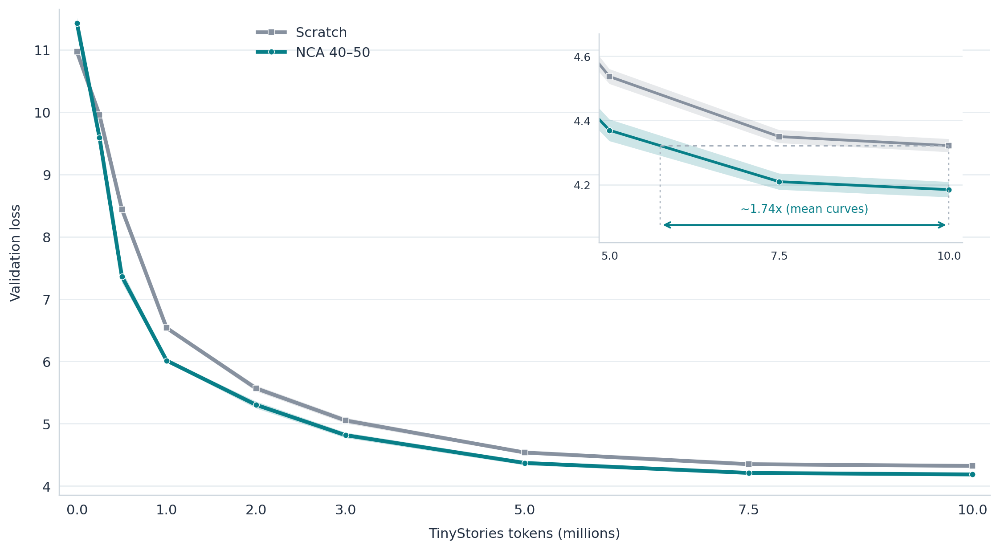
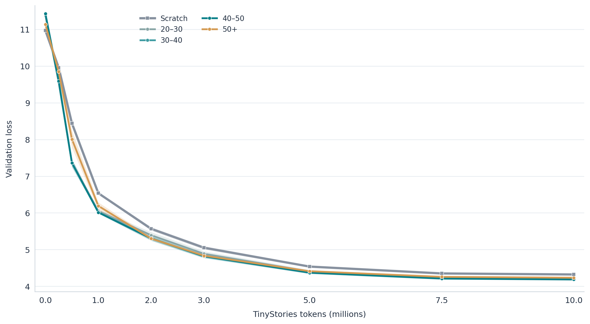
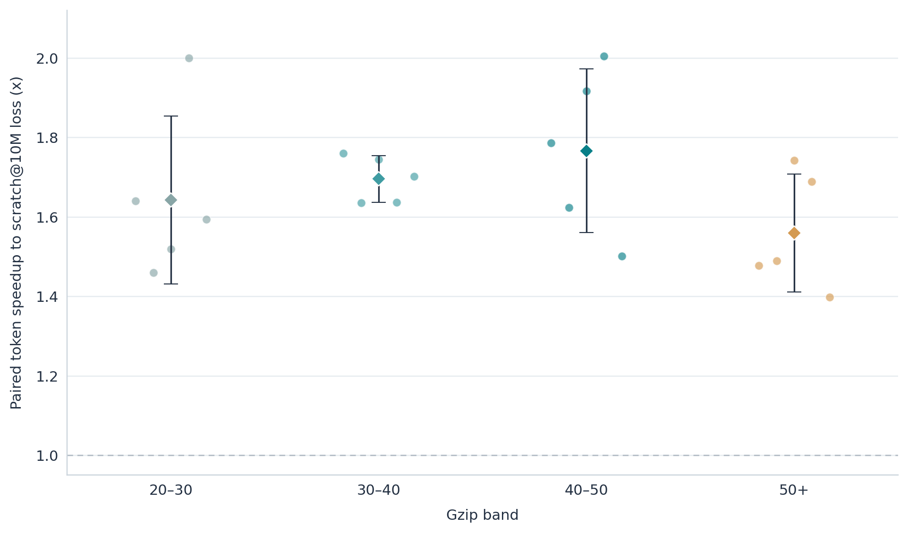
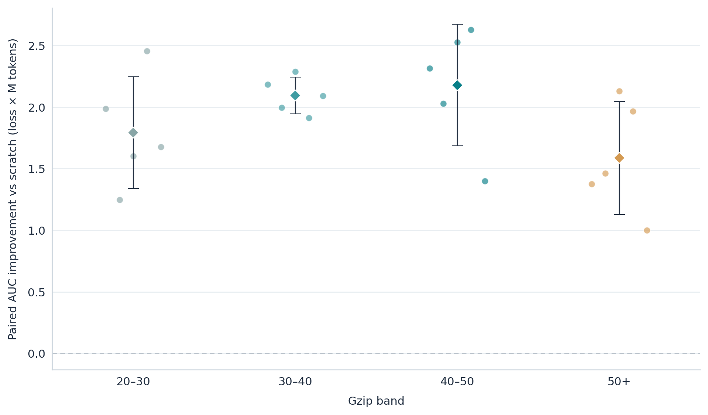
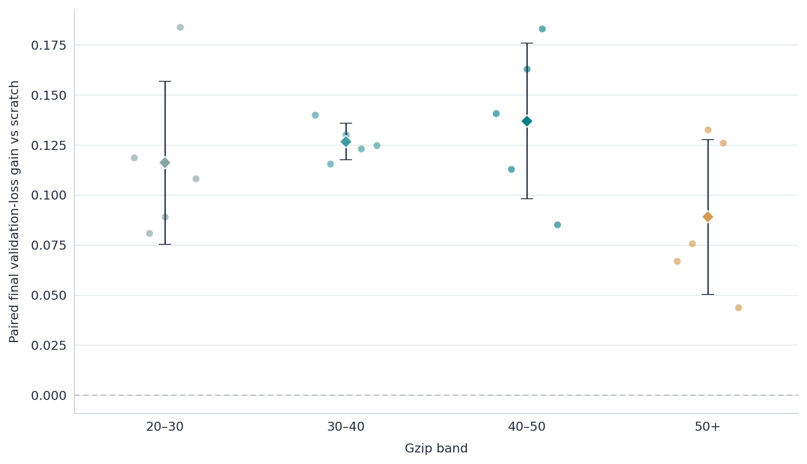

# Paper-regime post-hoc analysis: NCA pre-pre-training at ~1M parameters

## Executive summary

- **Core effect:** yes. All four structured NCA bands beat paired scratch at 10M TinyStories tokens in all 20/20 band–seed comparisons; these are five independent seeds, not 20 independent replications.
- **Sample efficiency:** the 40–50 band reaches each seed's scratch@10M loss using 42.7% fewer downstream tokens on average (five-seed paired mean).
- **Convergence:** its mean paired token ratio is 1.77x; this is a downstream-token ratio, not wall-clock speed or total pretraining cost.
- **Final quality:** the 40–50 band's mean validation loss improves by 0.137; mean perplexity falls from 75.33 to 65.70 (12.8% lower).
- **Five-seed consistency:** each structured band wins 5/5 paired final-loss comparisons; the two-sided exact sign-test p is 0.0625 per band.
- **Gzip resolution:** 40–50 leads on five-seed mean final loss, but its mean edge over 30–40 is only 0.010, and seed rankings change. The coarse bands do not establish a sharp universal optimum.

## Scope, sources, and formulas

This is a post-hoc analysis of completed `runs/1m-nca-transfer-v2/` artifacts. It covers structured NCA versus scratch and coarse gzip-band differences. Shuffled-NCA is retained only in raw final tables; no mechanistic inference uses it. The experimental model has 1,081,177 trainable text parameters; each structured NCA stage used 19,715,325 usable synthetic training labels before 10M downstream TinyStories tokens. Seeds 0–4 share initialization and downstream setup within each seed; they are the independent analysis units. The source [configuration](../../runs/1m-nca-transfer-v2/config/experiment.json), [completion marker](../../runs/1m-nca-transfer-v2/summary/done.json), and per-stage `done.json` plus `metrics.json` are checked by [`analyze.py`](analyze.py).

Formulas: loss gain = paired scratch loss − NCA loss; perplexity reduction = paired scratch perplexity − NCA perplexity. Final perplexity summaries average logged per-seed values, rather than exponentiating mean loss. For each seed, target = its own scratch validation loss at 10M; first NCA threshold crossing is linearly interpolated between adjacent logged checkpoints, without extrapolation. Token saving = 1 − NCA tokens/10M; speedup = 10M/NCA tokens. AUC is trapezoidal loss integration over each run's actual consumed-token positions, divided by 1M, with linear interpolation at the common interval start. Reported SD is sample SD. Descriptive 95% t intervals use df=4; paired bootstrap intervals enumerate all 5^5 seed-resampling combinations. These intervals are exploratory with n=5 and do not correct for multiple comparisons.

## A. Completion and sanity

The [summary marker](../../runs/1m-nca-transfer-v2/summary/done.json) matches the summary artifact hash and the canonical JSON configuration hash. Every stage below has a valid marker, metrics history, final checkpoint, budget, and final loss/perplexity matching the marker. No missing or corrupt metrics were found. Intended configuration and completed evidence agree on five seeds and six downstream conditions.

| Stage | Expected | Completed | Seeds / conditions |
| --- | --- | --- | --- |
| Structured + shuffled NCA | 25 | 25 | 0–4 × 5 |
| Downstream | 30 | 30 | 0–4 × 6 |
| Structured NCA only | 20 | 20 | 0–4 × 4 |

The intended language milestones and actual consumed-token positions are shown below. Actual positions are identical across all 30 downstream stages but differ slightly from the rounded intended milestones; analysis uses the logged positions. All final language runs consumed exactly 10,000,000 tokens. The planned NCA checkpoints are 0, 2M, 4M, 6M, 8M, 10M, 12M, 14M, 16M, 18M, and 20M; their final actual count is 19,715,325 usable labels.

| Planned tokens | Actual min | Actual max |
| --- | --- | --- |
| 0 | 0 | 0 |
| 250,000 | 251,904 | 251,904 |
| 500,000 | 501,760 | 501,760 |
| 1,000,000 | 1,001,472 | 1,001,472 |
| 2,000,000 | 2,000,896 | 2,000,896 |
| 3,000,000 | 3,000,320 | 3,000,320 |
| 5,000,000 | 5,001,088 | 5,001,088 |
| 7,500,000 | 7,501,696 | 7,501,696 |
| 10,000,000 | 10,000,000 | 10,000,000 |

**Metadata inconsistency:** global `config/experiment.json` retains `one_seed_exploratory: true` from the earlier setup, while the completed five-seed summary records `false`. The five seed directories and their completed markers establish the actual run. No training artifact was altered.

## B. Raw final results

At 10M downstream tokens; positive gains favor the condition over paired scratch. The shuffled rows are inventory only.

| Seed | Condition | Train loss | Val loss | Val PPL | Loss gain | PPL gain |
| --- | --- | --- | --- | --- | --- | --- |
| 0 | Scratch | 4.3123 | 4.3140 | 74.74 | 0.0000 | 0.00 |
| 0 | Shuffled NCA | 4.2226 | 4.2315 | 68.82 | 0.0825 | 5.92 |
| 0 | 20–30 | 4.1865 | 4.1954 | 66.38 | 0.1186 | 8.36 |
| 0 | 30–40 | 4.1636 | 4.1741 | 64.98 | 0.1399 | 9.76 |
| 0 | 40–50 | 4.1652 | 4.1734 | 64.93 | 0.1406 | 9.80 |
| 0 | 50+ | 4.2432 | 4.2471 | 69.90 | 0.0669 | 4.84 |
| 1 | Scratch | 4.3186 | 4.3173 | 74.98 | 0.0000 | 0.00 |
| 1 | Shuffled NCA | 4.1735 | 4.1873 | 65.84 | 0.1300 | 9.14 |
| 1 | 20–30 | 4.2245 | 4.2364 | 69.16 | 0.0809 | 5.83 |
| 1 | 30–40 | 4.1919 | 4.2018 | 66.81 | 0.1155 | 8.18 |
| 1 | 40–50 | 4.1867 | 4.2044 | 66.98 | 0.1129 | 8.01 |
| 1 | 50+ | 4.2337 | 4.2416 | 69.52 | 0.0757 | 5.47 |
| 2 | Scratch | 4.3233 | 4.3213 | 75.29 | 0.0000 | 0.00 |
| 2 | Shuffled NCA | 4.1916 | 4.1973 | 66.51 | 0.1239 | 8.78 |
| 2 | 20–30 | 4.2304 | 4.2323 | 68.87 | 0.0890 | 6.41 |
| 2 | 30–40 | 4.1883 | 4.1913 | 66.11 | 0.1300 | 9.18 |
| 2 | 40–50 | 4.1530 | 4.1585 | 63.97 | 0.1628 | 11.31 |
| 2 | 50+ | 4.1869 | 4.1888 | 65.94 | 0.1325 | 9.34 |
| 3 | Scratch | 4.3539 | 4.3556 | 77.92 | 0.0000 | 0.00 |
| 3 | Shuffled NCA | 4.1611 | 4.1728 | 64.90 | 0.1828 | 13.02 |
| 3 | 20–30 | 4.1534 | 4.1719 | 64.84 | 0.1837 | 13.07 |
| 3 | 30–40 | 4.2235 | 4.2325 | 68.89 | 0.1231 | 9.02 |
| 3 | 40–50 | 4.1640 | 4.1727 | 64.89 | 0.1829 | 13.02 |
| 3 | 50+ | 4.2241 | 4.2296 | 68.69 | 0.1260 | 9.22 |
| 4 | Scratch | 4.2966 | 4.3006 | 73.75 | 0.0000 | 0.00 |
| 4 | Shuffled NCA | 4.2075 | 4.2246 | 68.35 | 0.0761 | 5.40 |
| 4 | 20–30 | 4.1777 | 4.1926 | 66.19 | 0.1080 | 7.55 |
| 4 | 30–40 | 4.1570 | 4.1759 | 65.10 | 0.1248 | 8.65 |
| 4 | 40–50 | 4.2063 | 4.2154 | 67.72 | 0.0852 | 6.03 |
| 4 | 50+ | 4.2547 | 4.2569 | 70.59 | 0.0438 | 3.16 |

Across-seed summaries below include sample SD, median, range, and a descriptive t-based 95% CI. Full-precision values are in [`summary.json`](paper_regime/summary.json).

| Condition | Train mean±SD | Val mean±SD | Val median | Val min–max | Val 95% CI | PPL mean±SD | PPL median | PPL min–max | PPL 95% CI |
| --- | --- | --- | --- | --- | --- | --- | --- | --- | --- |
| Scratch | 4.321 ± 0.021 | 4.322 ± 0.020 | 4.317 | 4.301–4.356 | [4.296, 4.347] | 75.33 ± 1.55 | 74.98 | 73.75–77.92 | [73.40, 77.26] |
| Shuffled NCA | 4.191 ± 0.025 | 4.203 ± 0.025 | 4.197 | 4.173–4.232 | [4.172, 4.234] | 66.88 ± 1.66 | 66.51 | 64.90–68.82 | [64.82, 68.95] |
| 20–30 | 4.195 ± 0.032 | 4.206 ± 0.028 | 4.195 | 4.172–4.236 | [4.171, 4.240] | 67.09 ± 1.86 | 66.38 | 64.84–69.16 | [64.78, 69.40] |
| 30–40 | 4.185 ± 0.026 | 4.195 ± 0.024 | 4.191 | 4.174–4.233 | [4.166, 4.225] | 66.38 ± 1.60 | 66.11 | 64.98–68.89 | [64.40, 68.36] |
| 40–50 | 4.175 ± 0.021 | 4.185 ± 0.024 | 4.173 | 4.158–4.215 | [4.155, 4.215] | 65.70 ± 1.58 | 64.93 | 63.97–67.72 | [63.74, 67.66] |
| 50+ | 4.229 ± 0.026 | 4.233 ± 0.026 | 4.242 | 4.189–4.257 | [4.200, 4.266] | 68.93 ± 1.80 | 69.52 | 65.94–70.59 | [66.69, 71.17] |

| Condition | Final train median | Final train min–max | Final train 95% CI |
| --- | --- | --- | --- |
| Scratch | 4.319 | 4.297–4.354 | [4.295, 4.347] |
| Shuffled NCA | 4.192 | 4.161–4.223 | [4.160, 4.222] |
| 20–30 | 4.186 | 4.153–4.230 | [4.154, 4.235] |
| 30–40 | 4.188 | 4.157–4.223 | [4.152, 4.218] |
| 40–50 | 4.165 | 4.153–4.206 | [4.149, 4.201] |
| 50+ | 4.234 | 4.187–4.255 | [4.196, 4.261] |

## C. Paired final effects versus scratch

All effects use each seed's own scratch run. Exact two-sided sign-test p=0.0625 for each 5/5 structured-band direction; it is not evidence for a conventional 0.05 claim. The bootstrap interval is the exact percentile distribution over 5^5 resamples of five paired seeds.

| Band | Seed loss gains 0→4 | Loss mean±SD | Median | Bootstrap 95% | W/L/T | PPL gain mean±SD | PPL bootstrap 95% |
| --- | --- | --- | --- | --- | --- | --- | --- |
| 20–30 | 0.119, 0.081, 0.089, 0.184, 0.108 | 0.116 ± 0.041 | 0.108 | [0.090, 0.152] | 5/0/0 | 8.24 ± 2.87 | [6.41, 10.80] |
| 30–40 | 0.140, 0.115, 0.130, 0.123, 0.125 | 0.127 ± 0.009 | 0.125 | [0.120, 0.134] | 5/0/0 | 8.96 ± 0.59 | [8.49, 9.42] |
| 40–50 | 0.141, 0.113, 0.163, 0.183, 0.085 | 0.137 ± 0.039 | 0.141 | [0.106, 0.166] | 5/0/0 | 9.63 ± 2.74 | [7.48, 11.70] |
| 50+ | 0.067, 0.076, 0.133, 0.126, 0.044 | 0.089 ± 0.039 | 0.076 | [0.059, 0.119] | 5/0/0 | 6.41 ± 2.76 | [4.29, 8.52] |

## D. Full downstream learning curves

The table gives mean validation loss ± sample SD across seeds at each planned checkpoint; the preceding milestone table gives the actual token positions. The 40–50 band is the representative figure because it matches the established replication view and has the lowest five-seed mean final loss among these four bands. This does not establish that it is universally best.





| Planned | Scratch | 20–30 | 30–40 | 40–50 | 50+ |
| --- | --- | --- | --- | --- | --- |
| 0M | 10.969 ± 0.027 | 11.379 ± 0.038 | 11.410 ± 0.070 | 11.428 ± 0.089 | 11.133 ± 0.097 |
| 0.25M | 9.955 ± 0.076 | 9.554 ± 0.094 | 9.572 ± 0.143 | 9.594 ± 0.077 | 9.847 ± 0.109 |
| 0.5M | 8.442 ± 0.058 | 7.370 ± 0.087 | 7.360 ± 0.121 | 7.364 ± 0.101 | 8.008 ± 0.235 |
| 1M | 6.536 ± 0.029 | 6.051 ± 0.043 | 6.018 ± 0.036 | 6.013 ± 0.024 | 6.191 ± 0.097 |
| 2M | 5.567 ± 0.047 | 5.391 ± 0.088 | 5.310 ± 0.068 | 5.302 ± 0.056 | 5.301 ± 0.041 |
| 3M | 5.051 ± 0.046 | 4.886 ± 0.069 | 4.822 ± 0.056 | 4.815 ± 0.044 | 4.833 ± 0.031 |
| 5M | 4.537 ± 0.023 | 4.404 ± 0.042 | 4.380 ± 0.033 | 4.369 ± 0.034 | 4.410 ± 0.025 |
| 7.5M | 4.350 ± 0.020 | 4.232 ± 0.029 | 4.220 ± 0.025 | 4.210 ± 0.025 | 4.257 ± 0.026 |
| 10M | 4.322 ± 0.020 | 4.206 ± 0.028 | 4.195 ± 0.024 | 4.185 ± 0.024 | 4.233 ± 0.026 |

All structured bands begin with worse loss at zero language tokens after the text embedding/head is newly initialized. Every band overtakes scratch by the first logged nonzero checkpoint (~0.252M tokens) and remains ahead in mean loss at all later checkpoints. At that first checkpoint, 20–30, 30–40, and 40–50 win 5/5 paired seeds; 50+ wins 4/5. From ~0.502M onward, all four bands win 5/5 at every logged checkpoint. The early loss gap is larger than the final gap, so the observed advantage shrinks in absolute loss units but persists through 10M.

## E. Sample efficiency and convergence

The primary threshold is **each seed's own scratch@10M validation loss**. Tokens to threshold come from the first linear crossing of the logged NCA curve. Every structured run reaches its paired target within observed checkpoints; no extrapolation is used. The inset in Figure 1 uses the mean curves only to illustrate the crossing; its ~1.74x label is distinct from the mean of five paired seed-level speedups. The existing run summary's 40–50 threshold of 5.747M tokens is likewise a mean-curve crossing; this report's primary paired mean is 5.726M. These differ because interpolation and averaging do not commute.

| Seed | Band | NCA tokens (M) | Fewer tokens | Speedup |
| --- | --- | --- | --- | --- |
| 0 | 20–30 | 6.097 | 39.0% | 1.64x |
| 0 | 30–40 | 5.681 | 43.2% | 1.76x |
| 0 | 40–50 | 5.598 | 44.0% | 1.79x |
| 0 | 50+ | 6.770 | 32.3% | 1.48x |
| 1 | 20–30 | 6.852 | 31.5% | 1.46x |
| 1 | 30–40 | 6.116 | 38.8% | 1.64x |
| 1 | 40–50 | 6.159 | 38.4% | 1.62x |
| 1 | 50+ | 6.717 | 32.8% | 1.49x |
| 2 | 20–30 | 6.584 | 34.2% | 1.52x |
| 2 | 30–40 | 5.734 | 42.7% | 1.74x |
| 2 | 40–50 | 5.219 | 47.8% | 1.92x |
| 2 | 50+ | 5.741 | 42.6% | 1.74x |
| 3 | 20–30 | 5.000 | 50.0% | 2.00x |
| 3 | 30–40 | 6.111 | 38.9% | 1.64x |
| 3 | 40–50 | 4.990 | 50.1% | 2.00x |
| 3 | 50+ | 5.921 | 40.8% | 1.69x |
| 4 | 20–30 | 6.277 | 37.2% | 1.59x |
| 4 | 30–40 | 5.876 | 41.2% | 1.70x |
| 4 | 40–50 | 6.662 | 33.4% | 1.50x |
| 4 | 50+ | 7.152 | 28.5% | 1.40x |

| Band | Tokens M mean±SD | Median M | 95% t CI M | Savings mean±SD | Speedup mean±SD | Mean-curve x (visual only) |
| --- | --- | --- | --- | --- | --- | --- |
| 20–30 | 6.162 ± 0.711 | 6.277 | [5.279, 7.045] | 38.4% ± 7.1% | 1.64 ± 0.21x | 1.61x |
| 30–40 | 5.904 ± 0.205 | 5.876 | [5.650, 6.158] | 41.0% ± 2.0% | 1.70 ± 0.06x | 1.69x |
| 40–50 | 5.726 ± 0.685 | 5.598 | [4.875, 6.577] | 42.7% ± 6.9% | 1.77 ± 0.21x | 1.74x |
| 50+ | 6.460 ± 0.602 | 6.717 | [5.713, 7.208] | 35.4% ± 6.0% | 1.56 ± 0.15x | 1.55x |

| Band | Savings median | Savings 95% t CI | Speedup median | Speedup 95% t CI |
| --- | --- | --- | --- | --- |
| 20–30 | 37.2% | [29.6%, 47.2%] | 1.59x | [1.38x, 1.91x] |
| 30–40 | 41.2% | [38.4%, 43.5%] | 1.70x | [1.62x, 1.77x] |
| 40–50 | 44.0% | [34.2%, 51.3%] | 1.79x | [1.51x, 2.02x] |
| 50+ | 32.8% | [27.9%, 42.9%] | 1.49x | [1.37x, 1.74x] |



## F. Area under the learning curve

Lower AUC means lower validation loss across the downstream trajectory. Units are loss × million tokens. Full-range AUC includes the zero-token evaluation; the 0.5M and 1M starts are interpolated to common token positions. Paired improvements subtract each NCA AUC from its seed's scratch AUC.

| Condition | AUC 0–10M | AUC 0.5–10M | AUC 1–10M | Gain full | Gain from 0.5M | Gain from 1M |
| --- | --- | --- | --- | --- | --- | --- |
| Scratch | 51.564 ± 0.252 | 46.645 ± 0.244 | 42.898 ± 0.237 | — | — | — |
| 20–30 | 49.589 ± 0.370 | 44.851 ± 0.392 | 41.494 ± 0.399 | 1.975 ± 0.449 | 1.794 ± 0.454 | 1.404 ± 0.453 |
| 30–40 | 49.295 ± 0.363 | 44.550 ± 0.333 | 41.203 ± 0.314 | 2.269 ± 0.165 | 2.096 ± 0.149 | 1.695 ± 0.143 |
| 40–50 | 49.219 ± 0.307 | 44.466 ± 0.298 | 41.119 ± 0.294 | 2.345 ± 0.491 | 2.180 ± 0.493 | 1.778 ± 0.491 |
| 50+ | 49.918 ± 0.368 | 45.059 ± 0.319 | 41.506 ± 0.257 | 1.647 ± 0.510 | 1.587 ± 0.459 | 1.392 ± 0.386 |



## G. Early, middle, and late transfer

Entries are mean paired scratch loss − NCA loss. These are logged checkpoints near the named token amounts, not exactly rounded token positions.

| Band | ~0.5M | ~1M | ~2M | ~5M | 10M |
| --- | --- | --- | --- | --- | --- |
| 20–30 | 1.072 | 0.485 | 0.175 | 0.132 | 0.116 |
| 30–40 | 1.082 | 0.518 | 0.257 | 0.157 | 0.127 |
| 40–50 | 1.078 | 0.523 | 0.264 | 0.167 | 0.137 |
| 50+ | 0.434 | 0.345 | 0.265 | 0.126 | 0.089 |

At ~0.5M, mean paired gains span 0.434–1.082 loss units; by 10M they span 0.089–0.137. This is a strong early-learning advantage with a smaller persistent final-quality advantage. The observed curves do not establish an asymptotic advantage beyond 10M.

## H. Gzip-band analysis

Rank 1 is best among the four structured bands for the specified metric. Final-loss rankings change by seed; AUC and threshold-token rankings are also shown. The 40–50 band is best on the five-seed mean of all three metrics, but it has the best final loss in only two of five seeds.

| Band | Final loss ranks, seeds 0→4 | Mean rank | 0.5M AUC ranks | Threshold-token ranks | Final mean loss |
| --- | --- | --- | --- | --- | --- |
| 20–30 | 3, 3, 4, 1, 2 | 2.6 | 3, 4, 4, 2, 2 | 3, 4, 4, 2, 2 | 4.2057 |
| 30–40 | 2, 1, 3, 4, 1 | 2.2 | 2, 2, 2, 4, 1 | 2, 1, 2, 4, 1 | 4.1951 |
| 40–50 | 1, 2, 1, 2, 3 | 1.8 | 1, 1, 1, 1, 3 | 1, 2, 1, 1, 3 | 4.1849 |
| 50+ | 4, 4, 2, 3, 4 | 3.4 | 4, 3, 3, 3, 4 | 4, 3, 3, 3, 4 | 4.2328 |

Pairwise effects below are right-band loss − left-band loss, so positive values favor the left band. Within-seed SD measures variation across the five paired differences.

| Left vs right | Seed differences 0→4 | Mean±SD | 95% bootstrap | Left wins |
| --- | --- | --- | --- | --- |
| 20–30 vs 30–40 | -0.021, -0.035, -0.041, 0.061, -0.017 | -0.011 ± 0.041 | [-0.035, 0.026] | 1/5 |
| 20–30 vs 40–50 | -0.022, -0.032, -0.074, 0.001, 0.023 | -0.021 ± 0.036 | [-0.051, 0.005] | 2/5 |
| 20–30 vs 50+ | 0.052, 0.005, -0.044, 0.058, 0.064 | 0.027 ± 0.046 | [-0.014, 0.059] | 4/5 |
| 30–40 vs 40–50 | -0.001, 0.003, -0.033, -0.060, 0.040 | -0.010 ± 0.038 | [-0.040, 0.018] | 2/5 |
| 30–40 vs 50+ | 0.073, 0.040, -0.002, -0.003, 0.081 | 0.038 ± 0.040 | [0.006, 0.070] | 3/5 |
| 40–50 vs 50+ | 0.074, 0.037, 0.030, 0.057, 0.041 | 0.048 ± 0.017 | [0.035, 0.063] | 5/5 |

The largest gap between structured-band mean final losses is 0.0479, versus mean structured NCA–scratch gain 0.1171; the band spread is 0.41 of that main effect. Mean across-band seed SD of final loss is 0.0255. The 40–50 versus 30–40 mean edge is 0.0103, smaller than their paired-difference SD 0.0377. The data motivate more precise regime tests; they do not isolate a sharp Goldilocks optimum.



## I. NCA training loss and downstream transfer

Final NCA validation loss is measured on held-out NCA rules within each band. The NCA targets have different difficulty distributions across bands, so raw NCA losses are not directly comparable as transfer scores.

| Band | NCA val loss mean±SD | Downstream gain mean±SD |
| --- | --- | --- |
| 20–30 | 3.939 ± 0.011 | 0.116 ± 0.041 |
| 30–40 | 4.941 ± 0.012 | 0.127 ± 0.009 |
| 40–50 | 6.116 ± 0.078 | 0.137 ± 0.039 |
| 50+ | 8.198 ± 0.071 | 0.089 ± 0.039 |

| Downstream quantity | Pooled Pearson | Pooled Spearman | Band-centered Pearson | Band-centered Spearman |
| --- | --- | --- | --- | --- |
| downstream gain | -0.30 | -0.11 | 0.14 | 0.02 |
| downstream final loss | 0.37 | 0.24 | -0.02 | 0.03 |
| auc 500000 | 0.26 | 0.15 | -0.05 | 0.06 |
| tokens to threshold | 0.21 | 0.10 | -0.13 | -0.03 |

These 20 band–seed rows are clustered in five seeds and four bands, not 20 independent draws. The pooled association mainly reflects band difficulty and changes or nearly disappears after band centering. Lower NCA validation loss is therefore not established as a predictor of better TinyStories transfer. Correlations are descriptive; no p-values are used.

## J. Variance and robustness

The main result is more stable than the fine band ranking: each structured band wins 5/5 final paired comparisons against scratch, but the top final-loss band varies across seeds (40–50 in seeds 0 and 2; 30–40 in seeds 1 and 4; 20–30 in seed 3). The four mean final losses span 0.0479; across-seed SD within structured bands spans 0.0238–0.0277. Comparisons among bands are correlated because the seeds and downstream streams are paired. The five-seed sample supports effect consistency more strongly than precise band ordering.
Seed dependence is visible: seed 3 has the highest scratch final loss (4.356) and the largest 20–30 gain (0.184); seed 4 gives 40–50 its smallest gain (0.085) and ranks it third among bands. All five seeds are retained.

## K. Perplexity interpretation

Percent reduction uses (mean scratch PPL − mean NCA PPL) / mean scratch PPL. This is not a percentage change in loss. Perplexity is exp(validation loss) within each run; the table averages those five logged values.

| Band | Scratch mean PPL | NCA mean PPL | Absolute reduction | Percent reduction |
| --- | --- | --- | --- | --- |
| 20–30 | 75.33 | 67.09 | 8.24 | 10.9% |
| 30–40 | 75.33 | 66.38 | 8.96 | 11.9% |
| 40–50 | 75.33 | 65.70 | 9.63 | 12.8% |
| 50+ | 75.33 | 68.93 | 6.41 | 8.5% |

## L. Relation to the original paper

The [original paper](https://arxiv.org/html/2603.10055v1) reports improved language modeling and faster convergence after NCA pre-pre-training, complexity-sensitive transfer, and additional results at much larger model scale and on other corpora and tasks. Our setup is a tiny-scale, one-corpus probe, not an exact reproduction of its model size, downstream data, or full baselines.

| Original-paper claim | Our tiny-scale evidence | Status |
| --- | --- | --- |
| NCA PPT improves language modeling vs scratch | Four bands win 5/5 paired seeds at 10M TinyStories tokens | Qualitatively reproduced |
| NCA PPT increases downstream token efficiency | All bands reach paired scratch@10M before 10M | Qualitatively reproduced |
| Advantage persists during downstream training | Band mean curves lead at every nonzero checkpoint, including 10M | Qualitatively reproduced through 10M |
| Gzip complexity modulates transfer | Mean final losses span 0.048; 50+ underperforms 40–50 in all five seeds | Partially supported |
| Optimal complexity can differ by domain | One downstream corpus only; no cross-domain contrast | Not tested |
| Relative effect changes with model scale | One ~1M-parameter scale only | Not tested |
| Attention layers carry transfer | No component-transfer ablations | Not tested |
| Reasoning benchmark gains | No downstream reasoning evaluation | Not tested |
| C4 or Dyck comparison | Neither baseline run in this analysis | Not tested |

## What we can safely say

1. At ~1M parameters, NCA pre-pre-training consistently improves downstream TinyStories learning relative to scratch across five paired seeds and four structured bands.
2. For the representative 40–50 band, five-seed paired estimates give **42.7% fewer downstream tokens** and **1.77x mean convergence speedup** to each seed's own scratch@10M validation loss; these are not wall-clock or total-compute speedups.
3. At 10M, the 40–50 band's mean paired validation-loss improvement is **0.137**, and mean perplexity is **12.8% lower** than scratch.
4. The benefit is strongest early and remains at the final logged checkpoint; behavior after 10M is unknown.
5. Coarse gzip bands differ enough to motivate deeper work, but five seeds do not establish a universal optimum.

## What we cannot say

- Which gzip band is universally optimal, or whether a narrow Goldilocks peak exists.
- Why transfer happens, whether latent-rule inference is causal, or which model component carries the effect.
- That downstream wall-clock time or total compute is reduced after accounting for NCA pre-pretraining.
- That the effect generalizes to larger models, other language corpora, reasoning tasks, or other synthetic/natural pre-pretraining corpora.
- That this experiment reproduces the original paper's C4/Dyck comparisons, attention-transfer mechanism, cross-domain gzip matching, or reasoning gains.

## Reproduction files

- [`analyze.py`](analyze.py): deterministic analysis; reads completed stages and writes this report and all outputs.
- [`paper_regime/summary.json`](paper_regime/summary.json): full-precision derived data, completion inventory, and source paths.
- [`paper_regime/final_by_seed.csv`](paper_regime/final_by_seed.csv), [`threshold_by_seed.csv`](paper_regime/threshold_by_seed.csv), [`auc_by_seed.csv`](paper_regime/auc_by_seed.csv), and [`nca_loss_transfer.csv`](paper_regime/nca_loss_transfer.csv): compact tables.
- Five PNG figures above have SVG counterparts in `paper_regime/`.

```sh
uv run --with numpy --with scipy --with matplotlib python progress/part1/analyze.py
```
