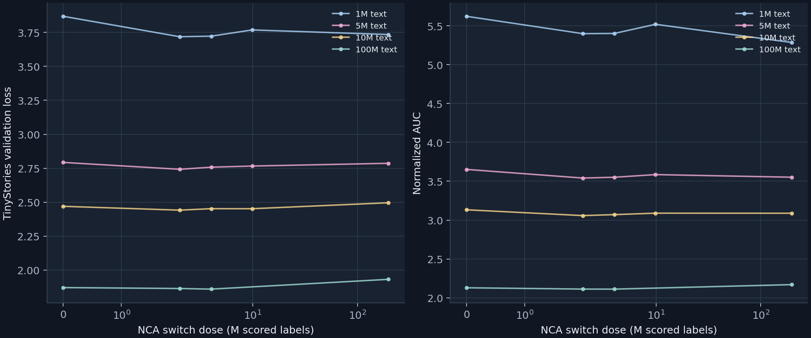
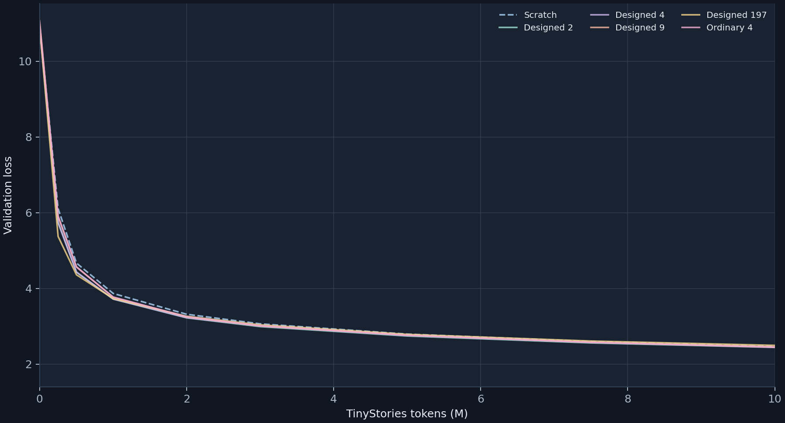
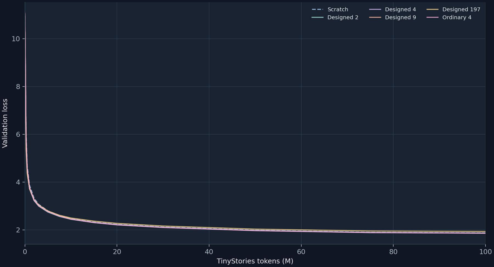

# Paper-ratio NCA pre-pretraining dose: seed 0

A fixed 100M-token TinyStories stream and ~10M-parameter model are used throughout. NCA corpora, selector, architecture, tokenizer, transfer operation, optimizer, and evaluation milestones are frozen. The intervention is **NCA switch dose**: when training leaves the same frozen NCA optimization trajectory for language. The 2M and 4M checkpoints use the original full-197M NCA learning-rate schedule; they are not independently optimized short runs. Seed 0 selects a dose, so this is an exploratory single-seed diagnostic rather than held-out confirmation.

## Switch-time curve

Each column below holds downstream TinyStories tokens fixed and varies only the scored NCA labels before transfer. Values are validation loss; `—` means the saved curve has not reached that downstream checkpoint. The 9.87M and 197.15M arms are existing context runs.



| Condition | NCA switch dose | 1M text | 5M text | 10M text | 100M text |
|:--|--:|--:|--:|--:|--:|
| Scratch | 0 | 3.86646 | 2.79254 | 2.46935 | 1.87087 |
| Designed 2 | 2,001,179 | 3.71642 | 2.74192 | 2.44106 | 1.86405 |
| Designed 4 | 4,001,087 | 3.72035 | 2.75736 | 2.45190 | 1.85943 |
| Designed 9 | 9,869,186 | 3.76612 | 2.76582 | 2.45171 | — |
| Designed 197 | 197,153,250 | 3.73264 | 2.78609 | 2.49552 | 1.93157 |





## Synthetic-to-language ratio

Ratios below use the fixed **planned** 100M TinyStories-token horizon; the observed horizon is listed separately. The 9.87M and 197.15M context arms reuse saved histories.

| Condition | Scored NCA labels | NCA:text at 100M text | Text observed |
|:--|--:|--:|--:|
| Scratch | 0 | 0 | 100,000,000 |
| Designed 2 | 2,001,179 | 1:49.97 | 100,000,000 |
| Designed 4 | 4,001,087 | 1:24.99 | 100,000,000 |
| Designed 9 | 9,869,186 | 1:10.13 | 10,000,384 |
| Designed 197 | 197,153,250 | 1.972:1 | 100,000,000 |
| Ordinary 4 | 4,001,087 | 1:24.99 | 100,000,000 |
| Ordinary 9 | 9,869,186 | 1:10.13 | 10,000,384 |
| Ordinary 197 | 197,153,250 | 1.972:1 | 100,000,000 |

## Early validation loss: paired conditions

These are the exact logged downstream checkpoints; lower is better. A missing cell means training has not reached it.

| Condition | 1M | 2M | 3M | 5M | 7.5M | 10M |
|:--|--:|--:|--:|--:|--:|--:|
| Scratch | 3.86646 | 3.31702 | 3.06373 | 2.79254 | 2.59599 | 2.46935 |
| Designed 2 | 3.71642 | 3.22153 | 2.98997 | 2.74192 | 2.55864 | 2.44106 |
| Designed 4 | 3.72035 | 3.22836 | 3.00592 | 2.75736 | 2.57501 | 2.45190 |
| Designed 9 | 3.76612 | 3.24658 | 3.00840 | 2.76582 | 2.57780 | 2.45171 |
| Designed 197 | 3.73264 | 3.26314 | 3.03829 | 2.78609 | 2.60924 | 2.49552 |
| Ordinary 4 | 3.77165 | 3.25213 | 3.01432 | 2.76268 | 2.57586 | 2.44647 |
| Ordinary 197 | 4.85895 | 3.90607 | 3.59355 | 3.26028 | 3.00427 | 2.84535 |

## Every observed validation checkpoint

PPL is `exp(loss)`. Differences are paired to the same seed-0 Scratch checkpoint. Designed minus Ordinary is shown only at the matched small NCA dose.

| Condition | Text tokens | Loss | PPL | Loss − Scratch | Designed − matched Ordinary |
|:--|--:|--:|--:|--:|--:|
| Scratch | 0 | 10.94640 | 56749.32 | +0.00000 | — |
| Scratch | 251,904 | 6.10973 | 450.22 | +0.00000 | — |
| Scratch | 501,760 | 4.66880 | 106.57 | +0.00000 | — |
| Scratch | 1,001,472 | 3.86646 | 47.77 | +0.00000 | — |
| Scratch | 2,000,896 | 3.31702 | 27.58 | +0.00000 | — |
| Scratch | 3,000,320 | 3.06373 | 21.41 | +0.00000 | — |
| Scratch | 5,001,216 | 2.79254 | 16.32 | +0.00000 | — |
| Scratch | 7,501,824 | 2.59599 | 13.41 | +0.00000 | — |
| Scratch | 10,000,384 | 2.46935 | 11.81 | +0.00000 | — |
| Scratch | 15,001,600 | 2.31982 | 10.17 | +0.00000 | — |
| Scratch | 20,000,768 | 2.22660 | 9.27 | +0.00000 | — |
| Scratch | 30,001,152 | 2.11622 | 8.30 | +0.00000 | — |
| Scratch | 50,001,920 | 1.98364 | 7.27 | +0.00000 | — |
| Scratch | 75,001,856 | 1.89645 | 6.66 | +0.00000 | — |
| Scratch | 100,000,000 | 1.87087 | 6.49 | +0.00000 | — |
| Designed 2 | 0 | 10.90581 | 54492.11 | -0.04059 | — |
| Designed 2 | 251,904 | 5.74734 | 313.36 | -0.36239 | — |
| Designed 2 | 501,760 | 4.42798 | 83.76 | -0.24081 | — |
| Designed 2 | 1,001,472 | 3.71642 | 41.12 | -0.15004 | — |
| Designed 2 | 2,000,896 | 3.22153 | 25.07 | -0.09549 | — |
| Designed 2 | 3,000,320 | 2.98997 | 19.89 | -0.07376 | — |
| Designed 2 | 5,001,216 | 2.74192 | 15.52 | -0.05062 | — |
| Designed 2 | 7,501,824 | 2.55864 | 12.92 | -0.03735 | — |
| Designed 2 | 10,000,384 | 2.44106 | 11.49 | -0.02829 | — |
| Designed 2 | 15,001,600 | 2.30237 | 10.00 | -0.01744 | — |
| Designed 2 | 20,000,768 | 2.21446 | 9.16 | -0.01214 | — |
| Designed 2 | 30,001,152 | 2.10408 | 8.20 | -0.01214 | — |
| Designed 2 | 50,001,920 | 1.97361 | 7.20 | -0.01004 | — |
| Designed 2 | 75,001,856 | 1.88917 | 6.61 | -0.00728 | — |
| Designed 2 | 100,000,000 | 1.86405 | 6.45 | -0.00683 | — |
| Designed 4 | 0 | 10.94587 | 56719.21 | -0.00053 | -0.07653 |
| Designed 4 | 251,904 | 5.73225 | 308.66 | -0.37748 | -0.18051 |
| Designed 4 | 501,760 | 4.43082 | 84.00 | -0.23798 | -0.13934 |
| Designed 4 | 1,001,472 | 3.72035 | 41.28 | -0.14612 | -0.05131 |
| Designed 4 | 2,000,896 | 3.22836 | 25.24 | -0.08866 | -0.02377 |
| Designed 4 | 3,000,320 | 3.00592 | 20.20 | -0.05781 | -0.00840 |
| Designed 4 | 5,001,216 | 2.75736 | 15.76 | -0.03518 | -0.00532 |
| Designed 4 | 7,501,824 | 2.57501 | 13.13 | -0.02098 | -0.00085 |
| Designed 4 | 10,000,384 | 2.45190 | 11.61 | -0.01745 | +0.00544 |
| Designed 4 | 15,001,600 | 2.30898 | 10.06 | -0.01084 | +0.00585 |
| Designed 4 | 20,000,768 | 2.21360 | 9.15 | -0.01300 | +0.00662 |
| Designed 4 | 30,001,152 | 2.10289 | 8.19 | -0.01333 | +0.00482 |
| Designed 4 | 50,001,920 | 1.97108 | 7.18 | -0.01256 | +0.00530 |
| Designed 4 | 75,001,856 | 1.88455 | 6.58 | -0.01190 | +0.00152 |
| Designed 4 | 100,000,000 | 1.85943 | 6.42 | -0.01145 | +0.00021 |
| Designed 9 | 0 | 11.07087 | 64271.48 | +0.12447 | — |
| Designed 9 | 251,904 | 5.89273 | 362.39 | -0.21700 | — |
| Designed 9 | 501,760 | 4.56376 | 95.94 | -0.10503 | — |
| Designed 9 | 1,001,472 | 3.76612 | 43.21 | -0.10034 | — |
| Designed 9 | 2,000,896 | 3.24658 | 25.70 | -0.07044 | — |
| Designed 9 | 3,000,320 | 3.00840 | 20.26 | -0.05533 | — |
| Designed 9 | 5,001,216 | 2.76582 | 15.89 | -0.02672 | — |
| Designed 9 | 7,501,824 | 2.57780 | 13.17 | -0.01818 | — |
| Designed 9 | 10,000,384 | 2.45171 | 11.61 | -0.01764 | — |
| Designed 197 | 0 | 10.93006 | 55829.76 | -0.01634 | — |
| Designed 197 | 251,904 | 5.37233 | 215.36 | -0.73740 | — |
| Designed 197 | 501,760 | 4.35890 | 78.17 | -0.30990 | — |
| Designed 197 | 1,001,472 | 3.73264 | 41.79 | -0.13382 | — |
| Designed 197 | 2,000,896 | 3.26314 | 26.13 | -0.05389 | — |
| Designed 197 | 3,000,320 | 3.03829 | 20.87 | -0.02544 | — |
| Designed 197 | 5,001,216 | 2.78609 | 16.22 | -0.00645 | — |
| Designed 197 | 7,501,824 | 2.60924 | 13.59 | +0.01325 | — |
| Designed 197 | 10,000,384 | 2.49552 | 12.13 | +0.02617 | — |
| Designed 197 | 15,001,600 | 2.36375 | 10.63 | +0.04393 | — |
| Designed 197 | 20,000,768 | 2.27074 | 9.69 | +0.04414 | — |
| Designed 197 | 30,001,152 | 2.16027 | 8.67 | +0.04406 | — |
| Designed 197 | 50,001,920 | 2.03034 | 7.62 | +0.04670 | — |
| Designed 197 | 75,001,856 | 1.95261 | 7.05 | +0.05617 | — |
| Designed 197 | 100,000,000 | 1.93157 | 6.90 | +0.06070 | — |
| Ordinary 4 | 0 | 11.02240 | 61230.39 | +0.07600 | — |
| Ordinary 4 | 251,904 | 5.91276 | 369.72 | -0.19697 | — |
| Ordinary 4 | 501,760 | 4.57016 | 96.56 | -0.09864 | — |
| Ordinary 4 | 1,001,472 | 3.77165 | 43.45 | -0.09481 | — |
| Ordinary 4 | 2,000,896 | 3.25213 | 25.85 | -0.06489 | — |
| Ordinary 4 | 3,000,320 | 3.01432 | 20.38 | -0.04941 | — |
| Ordinary 4 | 5,001,216 | 2.76268 | 15.84 | -0.02986 | — |
| Ordinary 4 | 7,501,824 | 2.57586 | 13.14 | -0.02013 | — |
| Ordinary 4 | 10,000,384 | 2.44647 | 11.55 | -0.02288 | — |
| Ordinary 4 | 15,001,600 | 2.30313 | 10.01 | -0.01669 | — |
| Ordinary 4 | 20,000,768 | 2.20698 | 9.09 | -0.01962 | — |
| Ordinary 4 | 30,001,152 | 2.09807 | 8.15 | -0.01815 | — |
| Ordinary 4 | 50,001,920 | 1.96578 | 7.14 | -0.01786 | — |
| Ordinary 4 | 75,001,856 | 1.88303 | 6.57 | -0.01342 | — |
| Ordinary 4 | 100,000,000 | 1.85922 | 6.42 | -0.01165 | — |
| Ordinary 9 | 0 | 11.14342 | 69107.78 | +0.19702 | — |
| Ordinary 9 | 251,904 | 6.07823 | 436.26 | -0.03150 | — |
| Ordinary 9 | 501,760 | 4.92673 | 137.93 | +0.25793 | — |
| Ordinary 9 | 1,001,472 | 3.91119 | 49.96 | +0.04472 | — |
| Ordinary 9 | 2,000,896 | 3.32405 | 27.77 | +0.00703 | — |
| Ordinary 9 | 3,000,320 | 3.06201 | 21.37 | -0.00172 | — |
| Ordinary 9 | 5,001,216 | 2.79350 | 16.34 | +0.00096 | — |
| Ordinary 9 | 7,501,824 | 2.60047 | 13.47 | +0.00448 | — |
| Ordinary 9 | 10,000,384 | 2.47216 | 11.85 | +0.00281 | — |
| Ordinary 197 | 0 | 11.17101 | 71040.89 | +0.22461 | — |
| Ordinary 197 | 251,904 | 6.23964 | 512.68 | +0.12991 | — |
| Ordinary 197 | 501,760 | 5.79306 | 328.02 | +1.12427 | — |
| Ordinary 197 | 1,001,472 | 4.85895 | 128.89 | +0.99248 | — |
| Ordinary 197 | 2,000,896 | 3.90607 | 49.70 | +0.58904 | — |
| Ordinary 197 | 3,000,320 | 3.59355 | 36.36 | +0.52982 | — |
| Ordinary 197 | 5,001,216 | 3.26028 | 26.06 | +0.46774 | — |
| Ordinary 197 | 7,501,824 | 3.00427 | 20.17 | +0.40829 | — |
| Ordinary 197 | 10,000,384 | 2.84535 | 17.21 | +0.37600 | — |
| Ordinary 197 | 15,001,600 | 2.65213 | 14.18 | +0.33231 | — |
| Ordinary 197 | 20,000,768 | 2.51128 | 12.32 | +0.28468 | — |
| Ordinary 197 | 30,001,152 | 2.33414 | 10.32 | +0.21792 | — |
| Ordinary 197 | 50,001,920 | 2.14767 | 8.56 | +0.16403 | — |
| Ordinary 197 | 75,001,856 | 2.04788 | 7.75 | +0.15144 | — |
| Ordinary 197 | 100,000,000 | 2.02375 | 7.57 | +0.15288 | — |

## AUC, fixed-loss crossings, and Scratch crossover

AUC uses trapezoidal integration and boundary interpolation. Fixed-loss crossings use only the first downward linear interpolation between logged checkpoints. No extrapolation.

| Condition | 0–10M AUC | 0–100M AUC | First Scratch crossing | Loss 3 | Loss 2.5 | Loss 2.25 | Loss 2 | Loss 1.9 |
|:--|--:|--:|--:|--:|--:|--:|--:|--:|
| Scratch | 3.13289 | 2.12974 | 0.000M (equal at zero) | 3.471M | 9.396M | 18.746M | 47.534M | 73.983M |
| Designed 2 | 3.05814 | 2.11302 | — | 2.957M | 8.748M | 17.980M | 45.956M | 71.795M |
| Designed 4 | 3.07066 | 2.11233 | — | 3.048M | 9.024M | 18.093M | 45.614M | 70.538M |
| Designed 9 | 3.08945 | — | 0.092M (Scratch lower → Designed lower) | 3.070M | 9.044M | — | — | — |
| Designed 197 | 3.08846 | 2.17020 | 5.820M (Designed lower → Scratch lower) | 3.304M | 9.902M | 21.878M | 59.761M | — |
| Ordinary 4 | 3.08959 | 2.11098 | 0.070M (Scratch lower → Designed lower) | 3.114M | 8.967M | 17.764M | 44.828M | 69.875M |
| Ordinary 9 | 3.14973 | — | 0.217M (Scratch lower → Designed lower) | 3.462M | 9.458M | — | — | — |
| Ordinary 197 | 3.64815 | 2.35520 | — | 7.569M | 20.637M | 39.026M | — | — |

## Early extension decision

```json
{
  "auc": {
    "2": 3.058140993138507,
    "4": 3.070664714689871
  },
  "checkpoints": [
    1001472,
    2000896,
    3000320,
    5001216,
    7501824,
    10000384
  ],
  "losses": {
    "2": [
      3.7164215184748173,
      3.221528205089271,
      2.989970640745014,
      2.74192415131256,
      2.5586368651129305,
      2.4410633496008813
    ],
    "4": [
      3.7203471176326275,
      3.2283587041310966,
      3.005922588519752,
      2.757364603690803,
      2.5750093115493655,
      2.451904156478122
    ]
  },
  "rule": "Extend both unless one is worse than the other at five of six early checkpoints by at least .02, and worse at the 10M endpoint and 0\u201310M AUC by at least .02; or worse than both other and Scratch at every checkpoint by .03 with AUC worse by .03.",
  "schema": "paper-ratio-early-decision-v1",
  "scratch_losses": [
    3.8664646088145673,
    3.3170222025364637,
    3.063734002877027,
    2.7925400140229613,
    2.5959855411201715,
    2.4693519067950547
  ],
  "selected_for_100m": [
    2,
    4
  ]
}
```

## Matched Ordinary dose

```json
{
  "matched_ordinary_dose": 4,
  "ranked": [
    {
      "auc": 2.113022196116043,
      "dose": 2,
      "loss": 1.864047541283071
    },
    {
      "auc": 2.1123338429093925,
      "dose": 4,
      "loss": 1.8594268155284226
    }
  ],
  "rule": "Lowest Designed 100M validation loss; within .01 loss, lower 0\u2013100M AUC; remaining tie favors lower NCA dose.",
  "schema": "paper-ratio-final-decision-v1"
}
```

## Limits

A paper-like NCA:text ratio is a tested regime, not an established optimum. The 2M and 4M checkpoints are early stops on one fixed NCA rule stream, initialization, and full-stage optimizer schedule. Seed 0 is used to select the dose; confirmation would freeze it and test held-out model seeds 1–4, which this runner does not launch. Downstream-token advantages omit synthetic pretraining compute and wall-clock cost. Designed-versus-Scratch and Designed-versus-matched-Ordinary are separate questions. The observed switch-time curve alone does not establish a causal mechanism for any advantage.
