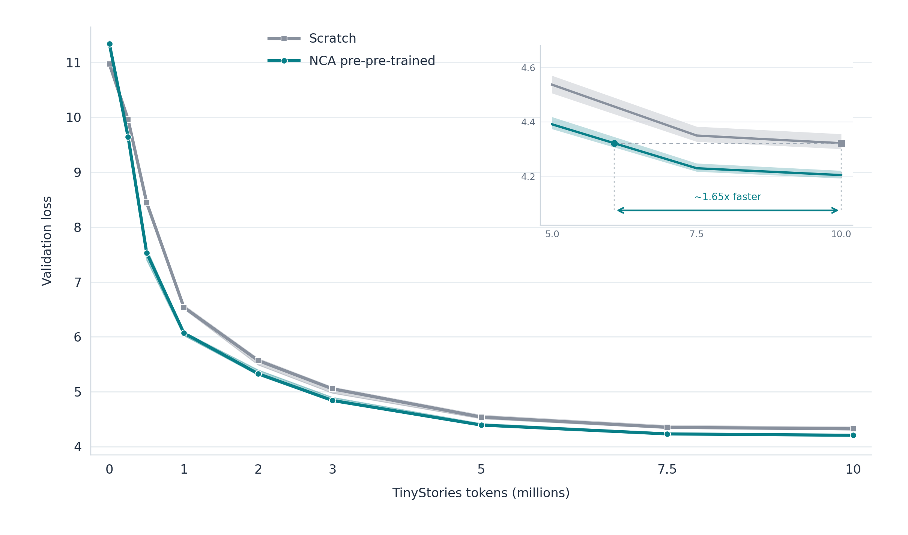

# Five-seed paired NCA → TinyStories replication

| Question | Result |
| --- | --- |
| Reliable improvement over scratch? | yes; 4/4 regimes favor NCA in >=4/5 seeds |
| Does `40_50` beat shuffled NCA? | 4/5 paired seeds; mean loss difference -0.0178 at 10M |
| `40_50` savings to scratch-final loss? | 42.5% on mean curves |
| Are effects consistent? | generic pretraining effect; see paired seed values below |
| Does complexity matter? | mean regime gap 0.0479 vs mean seed SD 0.0255; heuristic sensitivity: yes |
| Did `40_50` replicate as best? | rank 1/4 at 10M mean loss |

## Final 10M-token validation

| Condition | Mean loss | SD | Individual seeds 0–4 |
| --- | ---: | ---: | --- |
| scratch | 4.3218 | 0.0205 | 4.3140, 4.3173, 4.3213, 4.3556, 4.3006 |
| shuffled_nca | 4.2027 | 0.0249 | 4.2315, 4.1873, 4.1973, 4.1728, 4.2246 |
| nca_20_30 | 4.2057 | 0.0277 | 4.1954, 4.2364, 4.2323, 4.1719, 4.1926 |
| nca_30_40 | 4.1951 | 0.0238 | 4.1741, 4.2018, 4.1913, 4.2325, 4.1759 |
| nca_40_50 | 4.1849 | 0.0239 | 4.1734, 4.2044, 4.1585, 4.1727, 4.2154 |
| nca_50_plus | 4.2328 | 0.0265 | 4.2471, 4.2416, 4.1888, 4.2296, 4.2569 |

## Paired effects and sample efficiency

Loss differences use the same seed on both sides; negative favors pretraining.

| Comparison | 5M mean ± SD | 10M mean ± SD | Seeds favoring at 10M |
| --- | ---: | ---: | ---: |
| shuffled_nca − scratch | -0.1488 ± 0.0509 | -0.1191 ± 0.0430 | 5/5 |
| nca_20_30 − scratch | -0.1321 ± 0.0533 | -0.1160 ± 0.0407 | 5/5 |
| nca_30_40 − scratch | -0.1568 ± 0.0180 | -0.1266 ± 0.0091 | 5/5 |
| nca_40_50 − scratch | -0.1671 ± 0.0524 | -0.1369 ± 0.0389 | 5/5 |
| nca_50_plus − scratch | -0.1262 ± 0.0385 | -0.0890 ± 0.0386 | 5/5 |
| nca_40_50 − shuffled_nca | -0.0184 ± 0.0339 | -0.0178 ± 0.0303 | 4/5 |

| Condition | Tokens to scratch 10M loss | Token savings | AUC, 0.5M–10M |
| --- | ---: | ---: | ---: |
| scratch | 10,000,000 | 0.0% | 46,645,440 ± 243,996 |
| shuffled_nca | 6,032,594 | 39.7% | 44,695,846 ± 285,259 |
| nca_20_30 | 6,199,441 | 38.0% | 44,851,169 ± 391,583 |
| nca_30_40 | 5,910,553 | 40.9% | 44,549,701 ± 332,821 |
| nca_40_50 | 5,747,131 | 42.5% | 44,465,919 ± 297,776 |
| nca_50_plus | 6,447,716 | 35.5% | 45,058,690 ± 318,888 |

Tokens to threshold use linear interpolation between measured milestones. AUC is lower when average validation loss is lower. Other shared thresholds are in sample_efficiency.csv.

## Complexity regimes

| Regime | 1M loss ± SD (rank) | 5M loss ± SD (rank) | 10M loss ± SD (rank) |
| --- | ---: | ---: | ---: |
| nca_20_30 | 6.0512 ± 0.0433 (3/4) | 4.4045 ± 0.0425 (3/4) | 4.2057 ± 0.0277 (3/4) |
| nca_30_40 | 6.0182 ± 0.0361 (2/4) | 4.3798 ± 0.0326 (2/4) | 4.1951 ± 0.0238 (2/4) |
| nca_40_50 | 6.0133 ± 0.0240 (1/4) | 4.3695 ± 0.0338 (1/4) | 4.1849 ± 0.0239 (1/4) |
| nca_50_plus | 6.1909 ± 0.0972 (4/4) | 4.4104 ± 0.0252 (4/4) | 4.2328 ± 0.0265 (4/4) |

## Held-out-rule NCA validation

| Regime | Final mean loss | SD |
| --- | ---: | ---: |
| nca_20_30 | 3.9393 | 0.0110 |
| nca_30_40 | 4.9413 | 0.0122 |
| nca_40_50 | 6.1158 | 0.0781 |
| nca_50_plus | 8.1980 | 0.0707 |

## Interpretation

**Generic pretraining effect** under the stated descriptive criteria. This is a five-seed exploratory replication, not a statistical proof. The shuffled control preserves per-trajectory patch-token multisets and grid-marker positions while scrambling patch order across frames. See summary.json for exact paired differences, thresholds, AUC, NCA-side results, runtimes, and retries.

## Setup

The model, tokenizer, optimizer, schedule, context, and batch settings match v1. Each seed shares one random body and text head across all six conditions; seeds 0–4 use independent initializations. Every condition sees the same 10M TinyStories training targets in the same order and the same validation targets. Each pre-pretraining condition consumes 19,715,325 usable NCA labels. Exact configuration and source hashes are in summary.json.

## Two-curve English learning view

The NCA line equally averages the four structured bands within each seed. Lines show means across five seeds; shaded areas span the five seed-level values. The inset's ≈1.65× downstream-token ratio uses linear interpolation to find when the NCA mean reaches scratch's 10M-token validation loss. Shuffled is excluded.

